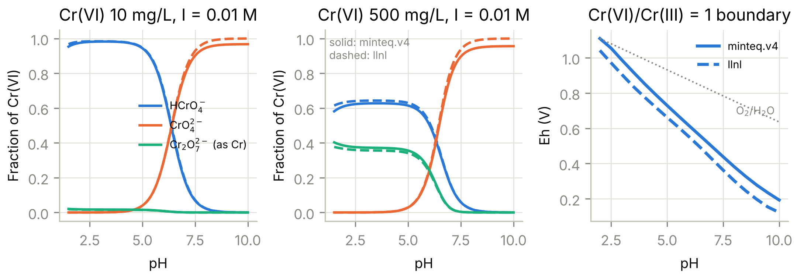
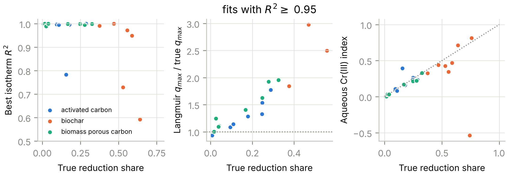
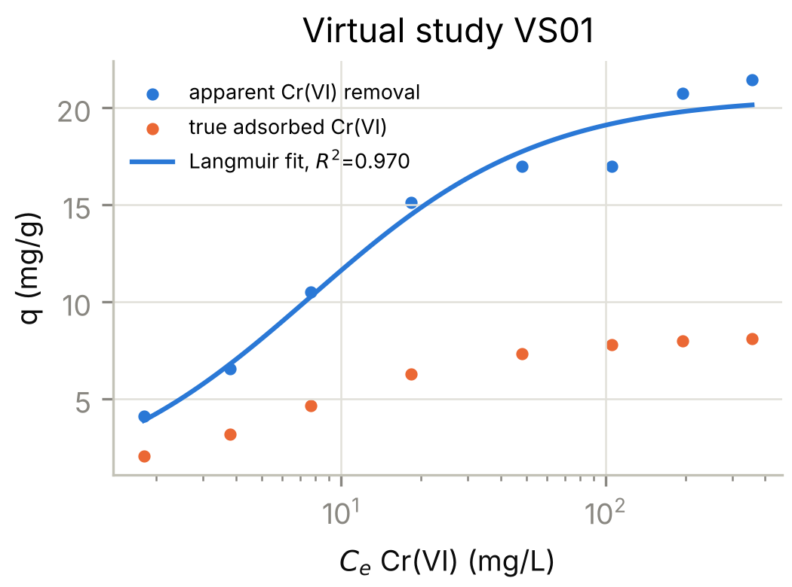
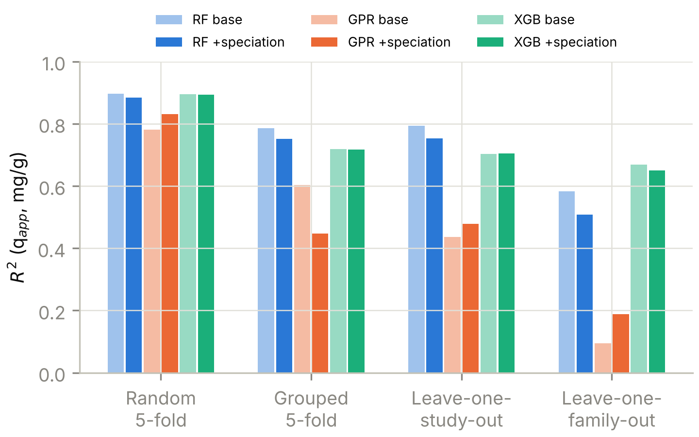

# CASSIA: A Data-Provenance-Aware, Speciation-Constrained Computational Framework for Distinguishing Cr(VI) Adsorption, Reduction and Precipitation in Carbonaceous Wastewater Treatment Systems

**Author:** Karthik [surname, affiliation and ORCID to be completed by the author]
**Corresponding author:** karthikresearchworks@gmail.com

**Article type:** Research article (computational methods)

---

## Highlights

- Loss of dissolved Cr(VI) on carbons is not, by itself, evidence of adsorption
- Two PHREEQC databases agree on Cr(VI) speciation but not on Cr(VI)/Cr(III) redox
- Isotherm fits with R² ≥ 0.95 concealed reduction shares of up to 56%
- Langmuir q_max overstated true Cr(VI) adsorption capacity by up to three-fold
- Study-aware conformal intervals restored nominal coverage for unseen studies

## Abstract

Decreases in dissolved Cr(VI) after contact with carbonaceous materials are routinely reported as adsorption, although Cr(VI) is also reduced to Cr(III) on carbon surfaces. We present CASSIA, an open computational framework that combines PHREEQC chromium chemistry with oxidation-state tracking, provenance-tagged endpoints and evidence classes, nonlinear isotherm model selection, and study-aware validation with conformal prediction intervals. Because no published dataset reports the true adsorption/reduction split, the methods were tested on 24 known-truth virtual studies (528 batch observations) generated by a mechanistic model coupling speciation-dependent adsorption, acid-promoted reduction and Cr(III) partitioning. The minteq.v4 and llnl databases agreed on Cr(VI) speciation to within 0.044 in species fraction but differed by 63–83 mV in the Cr(VI)/Cr(III) boundary. Of the 14 studies in which reduction caused more than 20% of Cr(VI) disappearance, 9 still gave isotherm fits with R² ≥ 0.95. Langmuir q_max overstated the true adsorption capacity by a median factor of 1.37 (up to 2.98), in rank agreement with the reduction share (Spearman ρ = 0.95), and the true capacity lay inside the bootstrap 95% interval in only 1 of 18 fits. Random-forest R² fell from 0.90 under random splits to 0.79 under leave-one-study-out and 0.58 under leave-one-family-out validation. Speciation features did not consistently improve prediction. Model-internal 90% intervals covered 85% of unseen-study observations, whereas study-aware conformal intervals covered 90–95%. Equilibrium fitting of residual Cr(VI) therefore cannot identify the removal mechanism; total-Cr and solid-phase speciation data, study-level validation and calibrated intervals are prerequisites for transferable claims.

**Keywords:** hexavalent chromium; biochar; activated carbon; PHREEQC; isotherm identifiability; leave-one-study-out validation; conformal prediction

---

## 1. Introduction

Hexavalent chromium is a priority contaminant in effluents from electroplating, leather tanning, pigment and wood-preservation industries. Its toxicity and mobility differ sharply from those of Cr(III) (Kotaś and Stasicka, 2000). Carbonaceous materials are the most studied low-cost sorbents for Cr(VI), and the literature now contains many batch studies on activated carbons, biochars and biomass-derived porous carbons (Mohan and Pittman, 2006; Mohan et al., 2011; Dong et al., 2011). Most of these studies report isotherm and kinetic constants, and a growing number train machine-learning models on the pooled values.

The difficulty is that Cr(VI) on carbon is a redox-active system. At low pH, oxygen-containing functional groups and the carbon matrix reduce Cr(VI) to Cr(III). Part of the Cr(III) is released to solution, part stays bound to the surface, and at higher pH it can precipitate as Cr(OH)₃ (Park et al., 2004; Dong et al., 2011). The quantity most often measured, residual Cr(VI) by the 1,5-diphenylcarbazide method, therefore records the *disappearance* of Cr(VI), not its adsorption. When q_e = (C₀ − C_e)/m is computed from residual Cr(VI) and fitted with Langmuir, Freundlich or pseudo-second-order equations, the fitted constants mix adsorption, reduction and precipitation in proportions the analysis cannot see. Critical reviews have documented related problems in aqueous adsorption modelling: linearised fitting, R² as the only selection criterion, and misread kinetic models (Tran et al., 2017; Simonin, 2016; Wang and Guo, 2020).

Machine-learning studies add a further risk. Rows from one publication share an adsorbent, a laboratory and an analytical protocol. Random train/test splits therefore leak study identity into the test set and inflate apparent accuracy (Roberts et al., 2017). A model can reach a high random-split R² while being unable to predict an unseen material.

This work builds and tests the infrastructure needed to ask whether aqueous speciation, adsorption-model selection and uncertainty-aware learning can separate genuine adsorption from apparent Cr(VI) removal. Four research questions are posed:

- **RQ1.** Does PHREEQC-derived Cr(VI) speciation improve predictive performance over raw pH and composition descriptors?
- **RQ2.** Can conventional isotherm and kinetic fitting distinguish adsorption from apparent removal?
- **RQ3.** Do models generalise across studies and material families, and how much do random splits overstate this?
- **RQ4.** How much uncertainty comes from unreported solution chemistry and from between-study heterogeneity, and can prediction intervals be made reliable?

RQ2–RQ4 cannot be answered with published data alone, because no published study reports the true adsorption/reduction split for every observation. We therefore pair a PHREEQC chemistry layer with a *known-truth* simulation study. Virtual batch experiments are generated from a mechanistic model that couples speciation-dependent adsorption, acid-promoted surface reduction and Cr(III) partitioning. They are then analysed exactly as published data would be. This design tests whether a method *can* recover the mechanism when the truth is known. It is a necessary condition for trusting the method on real data, but it does not replace real data. The multi-study literature dataset is defined here (schema, evidence classes, extraction protocol), but its extraction is reported as ongoing, and no empirical conclusion about real carbons is drawn in this paper.

The contribution is deliberately methodological. CASSIA does not claim a new adsorption mechanism, and the existing packages it uses (phreeqpython, adsorption, pyGAPS) are used for what they were designed for.

## 2. Methods

### 2.1 Software audit and roles

Four open-source code bases were audited for fitness of purpose (Table 1).

**Table 1.** Roles of the audited code bases in CASSIA.

| Code base | Licence | Role in CASSIA | Audit finding that shaped the design |
|---|---|---|---|
| phreeqpython (PHREEQC 3) (Parkhurst and Appelo, 2013) | Apache-2.0 | Aqueous Cr chemistry (core) | Bundled databases (`phreeqc.dat`, `wateq4f_PWN.dat`, `vitens.dat`, `pitzer.dat`) contain no Cr species. Cr-bearing databases from the USGS distribution must be supplied and validated. The `change_ph` helper relies on a `Fix_pH` phase absent from `minteq.v4.dat`. |
| adsorption (amvro23) | MIT | Isotherm and kinetic equations (core) | `Isotherms.set_inlet` applies a gas-phase transform (P·M_r/RT) to x. The Temkin equation fixes T = 298.15 K. Both are bypassed for aqueous data, and the equations are reused directly. |
| pyGAPS (Iacomi and Llewellyn, 2019) | MIT | BET recalculation from published N₂ isotherms (secondary) | Designed for gas/vapour isotherms. Used only for textural descriptors, never for aqueous Cr data. `area_BET_raw` expects the cross-section in nm². |
| RASPA3 (Ran et al., 2024) | see upstream | Not used in this release | No aqueous Cr(VI)–carbon surface-reaction model, and its reaction-ensemble functionality is experimental. Deferred (Section 4.4). |

### 2.2 Chromium chemistry layer

PHREEQC 3 was driven through phreeqpython 1.6.2 with two databases distributed by the USGS: `minteq.v4.dat` (MINTEQA2 v4 lineage; Allison et al., 1991) and `llnl.dat` (LLNL `thermo.com.V8.R6.230`). Other databases were rejected programmatically. Both contain the Cr(VI) protonation and dimerisation equilibria, Cr(III) hydrolysis species and the Cr(VI)/Cr(III) redox couple.

*Cr(VI) speciation.* Cr was entered as `Cr(6)` with one K⁺ per Cr, representing K₂Cr₂O₇ stock. PHREEQC does not re-equilibrate valence states entered separately in an initial solution, so this represents a freshly prepared Cr(VI) solution regardless of the default pe. Background electrolyte was NaCl at the stated ionic strength. pH was imposed by charge balance on Cl⁻ (acid addition) or, where the chromate charge exceeded the cation pool, on Na⁺ (base addition). Fractions are reported per Cr atom, so Cr₂O₇²⁻ counts twice.

*Redox scenarios.* Because batch papers almost never report Eh, the Cr(VI)/Cr(III) partition was computed as an explicit scenario: total Cr entered without a valence state, at an assumed pe. The grid was restricted to the stability field of water (pe ≤ 20.75 − pH at 25 °C). Outside it, PHREEQC does not converge and the results have no physical meaning. For each pH, the pe at which Cr(VI) and Cr(III) are equally abundant (pe₅₀) was obtained by interpolation. Eh = 0.05916·pe V.

*Cr(III) solubility.* The dissolved Cr(III) in equilibrium with Cr(OH)₃(am) or Cr₂O₃ was computed with the SOLUTION phase-boundary option (concentration adjusted to SI = 0 at fixed pH) in `minteq.v4.dat`. In `llnl.dat` the only Cr(III) solid (eskolaite) is written in terms of CrO₄²⁻ and O₂(aq), so a Cr(III)-only solubility is undefined without fixing the redox state. This asymmetry is reported as a database finding, not hidden. Below pH ≈ 4.5 the phase-boundary iteration does not converge for Cr(OH)₃(am), which indicates no solubility constraint at realistic concentrations.

*Speciation features for learning.* For each experimental condition (pH, C₀, I), CASSIA computes f(HCrO₄⁻), f(CrO₄²⁻), f(Cr₂O₇²⁻), the mean Cr(VI) charge per Cr atom, and the PHREEQC ionic strength. pH − pH_pzc is added as a surface-charge proxy.

### 2.3 Data provenance, endpoints and evidence classes

The master dataset schema (`data/cassia_schema.csv`) has 31 fields. Every row carries a DOI, a source location (table, figure or SI file) and an extraction method. Three endpoints are kept separate:

- q_app,VI = (C₀ − C_e,VI)/D, apparent Cr(VI) disappearance, always computable;
- q_total = (C₀ − C_e,total)/D, total-Cr uptake, only when total Cr was measured;
- the aqueous Cr(III) index, Σ(C_e,total − C_e,VI)/Σ(C₀ − C_e,VI), the share of Cr(VI) disappearance recovered as dissolved Cr(III).

Studies are assigned to evidence classes automatically (`cassia.dataset.classify`). **Class A** needs total and Cr(VI)-specific analyses, solid-phase Cr speciation (XPS or XANES), a final or controlled pH, and a reported background electrolyte. **Class B** needs either total Cr or solid-phase speciation. **Class C** has residual Cr(VI) only. For Class C rows the only permitted endpoint label is `apparent_CrVI_disappearance`. Unreported Eh, ionic strength, alkalinity and major ions are never imputed into the data file. They enter only as labelled scenario ranges (Section 2.7). The PRISMA 2020-aligned search, screening and extraction protocol (Page et al., 2021) is in `data/PROTOCOL.md`.

### 2.4 Known-truth virtual batch experiments

Each virtual study draws one material from one of three families (activated carbon, biochar, biomass-derived porous carbon). Family-specific ranges cover BET area, point of zero charge and reductant capacity, the latter being largest for biochars, consistent with their higher content of oxidisable organic matter. The batch model is a set of ordinary differential equations integrated with LSODA:

- Cr(VI) uptake follows a linear-driving-force approach to a Langmuir equilibrium q_eq = q_max K C/(1 + K C). The affinity is K = K₀ [0.05 + f(HCrO₄⁻ + Cr₂O₇²⁻)] [0.1 + (1 + exp((pH − pH_pzc)/0.8))⁻¹]. The speciation fractions are interpolated from PHREEQC (`minteq.v4.dat`, 50 mg L⁻¹, I = 0.01 M).
- Reduction is first order in dissolved Cr(VI) and proportional to the remaining surface reductant R_s (finite capacity R₀), with acid promotion (1 + 10^(pH − pH₅₀))⁻¹ and Arrhenius temperature dependence (E_a = 35 kJ mol⁻¹).
- Reduced chromium is partitioned into a surface-bound fraction (logistic in pH) and a dissolved fraction. The dissolved fraction is capped at the PHREEQC Cr(OH)₃(am) solubility, and any excess precipitates.

Measured concentrations carry 3% relative analytical noise, a 0.02 mg L⁻¹ detection limit and a study-level multiplicative calibration bias (log-normal, σ = 0.05). Each study contains an 8-point isotherm (C₀ = 10–400 mg L⁻¹ at the study's optimum pH, 1.8–3.5), a 6-point pH edge (pH 2–8, C₀ = 100 mg L⁻¹) and an 8-point kinetic series. Dose, temperature, ionic strength and equilibration time vary between studies. The training corpus has 24 studies (8 per family, 528 observations, seed 2026). An independent external corpus of 9 studies uses a different seed (777). Mass conservation is checked by unit test.

The simulator encodes one plausible mechanistic picture, chosen to be qualitatively consistent with the literature. It is not calibrated to any material. Its purpose is to make the ground truth available, not to predict real carbons.

### 2.5 Isotherm and kinetic model benchmarking (Model A)

The Langmuir, Freundlich, Sips and Temkin isotherms, and the pseudo-first-order (PFO) and pseudo-second-order (PSO) kinetic equations, were fitted in their nonlinear forms by bounded least squares. The equations were taken from `adsorption.models`, with Temkin evaluated at the experimental temperature. Models were ranked by AICc and Akaike weights (Burnham and Anderson, 2002), with BIC also reported. Residuals were tested with Shapiro–Wilk (normality) and a Wald–Wolfowitz runs test (systematic misfit). Parameter 95% confidence intervals came from a 300-replicate residual bootstrap. For each virtual study the fitted Langmuir q_max was compared with the true adsorption capacity, and the true share of Cr(VI) disappearance caused by reduction was computed from the simulator state.

### 2.6 Machine-learning models and validation (Models B and C)

The target was q_app,VI, modelled as log₁₀(q + 0.1 mg g⁻¹) and back-transformed for metrics. Two feature sets were compared. The *base* set (C₀, pH, D, t, T, I, S_BET, V_p, d_p, pH_pzc) is what a paper typically reports. The *chem* set adds the PHREEQC speciation features (Section 2.2). Three learners were used: random forest (Breiman, 2001; 400 trees), XGBoost (Chen and Guestrin, 2016; 500 rounds, depth 4) and Gaussian-process regression with a Matérn-5/2 ARD kernel plus white noise on standardised features (Rasmussen and Williams, 2006), all via scikit-learn (Pedregosa et al., 2011).

Four validation schemes were applied to every model–feature combination: random 5-fold (diagnostic only), grouped 5-fold by study, leave-one-study-out (LOSO) and leave-one-material-family-out (LOFO). The models were then refitted on all 24 studies and scored on the 9-study external corpus. RMSE, MAE, median absolute error and R² are reported in mg g⁻¹.

*Uncertainty (Model C).* Model-internal intervals (GPR predictive SD; RF across-tree spread) were compared with study-aware split-conformal intervals (Lei et al., 2018). In each outer LOSO fold, absolute residuals were collected from an inner 3-fold grouped CV over the training studies, and the ⌈(n+1)α⌉/n quantile set the interval half-width. Because calibration residuals are always out-of-study, the intervals absorb between-study variability. Coverage was evaluated at nominal levels 0.5–0.95, with PICP₉₀ (coverage at 90%) and the average coverage error (ACE, mean |empirical − nominal|). Between-study variability was quantified by a method-of-moments random-intercept decomposition of the out-of-study residuals (τ², σ², ICC; Gelman and Hill, 2007).

### 2.7 Missing-chemistry scenarios and robust design

For the pH-edge conditions, the effect of unreported chemistry on f(HCrO₄⁻) was propagated by Monte Carlo (40 draws per condition). Ionic strength was drawn log-uniformly over 10⁻³–10⁻¹ M, and an initial-versus-final pH ambiguity was drawn uniformly over ±0.5 units.

A treatment-design exercise compared nominal and robust decision rules. For 15 new virtual materials, pH (2.0–7.0) and dose (0.5–15 g L⁻¹) were chosen to minimise dose subject to residual Cr(VI) ≤ 0.5 mg L⁻¹ and dissolved total Cr ≤ 2 mg L⁻¹, starting from C₀ = 20 mg L⁻¹. The nominal rule used random-forest point predictions of q_app,VI and q_total. The robust rule used the lower 90% study-aware conformal bound on uptake. Each recommended design was then checked against the simulator's true outcome.

### 2.8 Reproducibility

All numbers, tables and figures are produced by `scripts/run_all.py` (seeded). The chemistry layer, endpoint logic, fitting and simulator mass balance are covered by 14 unit tests. Code, databases and outputs are in the `cassia/` directory of the accompanying repository.

## 3. Results

### 3.1 Chromium chemistry: where the databases agree and where they do not

**Cr(VI) speciation is robust to the database choice.** Log K values for the bichromate and dichromate equilibria agree to within 0.04 log units (Table 2). Species fractions computed with the two databases differ by at most 0.033 for HCrO₄⁻ (pH 1.5, 500 mg L⁻¹) and 0.044 for CrO₄²⁻ (pH 10, 500 mg L⁻¹) over pH 1.5–10 (Fig. 1a,b). The CrO₄²⁻ discrepancy at high pH comes from the alkali–chromate ion pairs NaCrO₄⁻ and KCrO₄⁻. These carry 4.4% of Cr at pH 10 and 500 mg L⁻¹ in minteq.v4 and are absent from llnl. The HCrO₄⁻/CrO₄²⁻ crossover lies at pH 6.38 in both databases at 10 mg L⁻¹ and I = 0.01 M. Ionic strength shifts it from pH 6.46 (I = 0.001 M) to 6.24 (I = 0.1 M).

The largest log K disagreement is for H₂CrO₄ (6.42 against 5.18). It has no practical effect above pH 2, because H₂CrO₄ never exceeds 0.7% of Cr(VI) there.

**Concentration matters more than the database.** At 10 mg L⁻¹ and pH 3, HCrO₄⁻ holds 98% of Cr(VI) and Cr₂O₇²⁻ only 1.7%. At 500 mg L⁻¹, Cr₂O₇²⁻ holds 34–38% of Cr over pH 2–5. A single isotherm spanning 10–500 mg L⁻¹ therefore samples materially different sorbate mixtures, a fact that single-solute isotherm equations ignore.

**Table 2.** Equilibrium constants (25 °C) for Cr(VI) reactions written as CrO₄²⁻ + n H⁺ ⇌ product.

| Product | log K, minteq.v4 | log K, llnl | Δ |
|---|---|---|---|
| HCrO₄⁻ | 6.510 | 6.494 | 0.016 |
| Cr₂O₇²⁻ (2 CrO₄²⁻ + 2 H⁺) | 14.560 | 14.519 | 0.041 |
| H₂CrO₄ | 6.419 | 5.175 | 1.244 |

**Redox thermodynamics differ substantially between databases.** The pe at which Cr(VI) and Cr(III) are equally abundant (50 mg L⁻¹ total Cr, I = 0.01 M) is 1.07–1.41 pe units lower in llnl than in minteq.v4 over pH 2.5–10 (Fig. 1c), equivalent to 63–83 mV in Eh. At pH 4, for example, the boundary lies at Eh = 0.85 V (minteq.v4) and 0.78 V (llnl). At pH 2, minteq.v4 predicts that Cr(III) dominates throughout the water-stability field: only 12% Cr(VI) remains even at the O₂/H₂O limit. llnl places the boundary at Eh = 1.04 V.

The practical meaning is that, at the pH values where Cr(VI) removal by carbons is usually optimal (pH 1.5–3), Cr(VI) is thermodynamically unstable with respect to reduction under almost any realistic redox condition. Its persistence in test solutions is kinetic. Whether a carbon surface supplies the electrons is therefore a question of rate and reductant capacity, not of equilibrium feasibility, and equilibrium adsorption models cannot address it.

**Cr(III) solubility is strongly pH dependent and database specific.** In minteq.v4, dissolved Cr(III) in equilibrium with Cr(OH)₃(am) falls from 16 mg L⁻¹ at pH 4.5 to 1.41 mg L⁻¹ at pH 5, 0.023 mg L⁻¹ at pH 6 and 1.2 × 10⁻³ mg L⁻¹ at pH 7. Crystalline Cr₂O₃ is 2.7 times less soluble at pH 5. Below pH ≈ 4.5 no Cr(III) solid constrains the solution at concentrations relevant here. Cr(III) produced by reduction in the usual pH 1.5–3 operating window therefore stays dissolved unless it binds to the surface, whereas around pH 6 and above it is likely to precipitate. llnl contains no Cr(III) hydroxide and writes its only Cr(III) solid (eskolaite) through the Cr(VI) master species, so the same calculation is not possible with it. A practitioner who chose llnl for its Cr(VI) data would silently lose the precipitation pathway.

**Fig. 1.** PHREEQC chromium chemistry with minteq.v4 (solid) and llnl (dashed). (a, b) Cr(VI) species fractions per Cr atom at 10 and 500 mg L⁻¹ Cr(VI), I = 0.01 M NaCl. (c) Eh at which Cr(VI) and Cr(III) are equally abundant (50 mg L⁻¹ total Cr); dotted line, O₂/H₂O boundary.

### 3.2 RQ2: isotherm fitting does not identify the removal mechanism

Across the 24 virtual studies, reduction accounted for a median of 25% of Cr(VI) disappearance in the isotherm series (range 0.8–76%). The share was highest for biochars, as built into the simulator. All results in this section come from the known-truth simulation.

**Goodness of fit is a weak, population-level signal only.** The best of the four isotherms reached R² ≥ 0.95 in 18 of 24 studies, and Langmuir alone in 17. Fit quality declined with reduction share on average (Spearman ρ = −0.57, p = 0.003; Fig. 2a), but the signal does not work for individual studies:
- Of the 14 studies with reduction shares above 20%, 9 still had R² ≥ 0.95.
- The largest reduction share compatible with R² ≥ 0.95 was 56%.
- The runs test detected systematic residual structure in only 1 of 24 studies.
- Akaike weights favoured Langmuir and Sips (9 studies each) over Freundlich and Temkin (3 each), with no relation to mechanism.

The six studies with poor fits (R² < 0.95) were five high-reduction biochars and one activated carbon. In two of the biochars (VS04, VS07), apparent uptake at the highest C₀ was negative, because a calibration bias of a few per cent exceeded the removal signal. This is a reminder that low-capacity materials tested at high C₀ can fall below analytical resolution.

**Publishable fits overstate capacity in proportion to reduction.** In the 18 studies with R² ≥ 0.95 (median R² = 0.9988), the fitted Langmuir q_max exceeded the true Cr(VI) adsorption capacity by a median factor of 1.37 (range 0.93–2.98). The overestimate was almost perfectly rank-correlated with the reduction share (ρ = 0.95, p = 8 × 10⁻¹⁰; Fig. 2b). Over all 24 studies, the median ratio was 2.28 where reduction exceeded 30% (n = 9) and 1.09 where it was below 10% (n = 6).

The residual bootstrap interval was precise but wrong: the true q_max lay inside the 95% interval in only 1 of 18 publishable fits. Parameter uncertainty from curve fitting measures how well the curve is determined, not whether the model represents the process.

Fig. 3 shows the clearest case, chosen as the highest-reduction study with R² ≥ 0.95, so it illustrates rather than represents. Biochar VS01 gave a textbook Langmuir isotherm (R² = 0.970) with q_max = 20.6 mg g⁻¹, while the true Cr(VI) adsorption capacity was 8.2 mg g⁻¹. Reduction accounted for 56% of the removal. Nothing in the fitted curve indicates this.

**Kinetic model preference is uninformative.** PSO was preferred over PFO by AICc in 7 of 24 kinetic series. The simulator's adsorption step is a linear-driving-force (PFO-type) process, so PFO preference is expected. It carries no information about reduction, which supports the argument that "PSO fits best, therefore chemisorption" is not a valid inference (Simonin, 2016).

**A total-Cr mass balance recovers much of the signal.** The aqueous Cr(III) index is available whenever total Cr is measured alongside Cr(VI), which is the minimum requirement for evidence Class B. It ranked studies correctly by reduction share (ρ = 0.71, p = 1 × 10⁻⁴; Fig. 2c) but underestimated the share by a median of 12%, because surface-bound and precipitated Cr(III) are invisible in solution. It is therefore a lower bound. Closing the balance needs solid-phase speciation (XPS or XANES), the defining requirement of Class A.

**Fig. 2.** Known-truth identifiability test (24 virtual studies). (a) Best isotherm R² against the true share of Cr(VI) disappearance due to reduction. (b) Fitted Langmuir q_max divided by the true adsorption capacity, for fits with R² ≥ 0.95. (c) Aqueous Cr(III) index against the true reduction share; dotted line, 1:1. The negative outlier is a low-uptake biochar whose total-Cr and Cr(VI) analyses are dominated by analytical bias.

**Fig. 3.** Illustrative virtual study VS01 (biochar, pH 3.3), selected as the highest-reduction case with R² ≥ 0.95. Blue, apparent Cr(VI) removal with Langmuir fit; orange, true adsorbed Cr(VI) at the same points.

### 3.3 RQ3: random splits overstate transferability

Table 3 and Fig. 4 report out-of-fold performance for the target q_app,VI.

**Inflation from random splits.** For every learner, random 5-fold validation gave the highest scores, and they fell as the validation unit became coarser:
- Random forest: R² 0.896 (RMSE 7.6 mg g⁻¹) under random splits, 0.793 (10.7) under LOSO and 0.584 (15.2) under LOFO. Moving from random to family-level splits doubled the RMSE.
- XGBoost: 0.895, 0.704 and 0.669.
- Gaussian process: 0.781, 0.436 and 0.095, the largest collapse of the three. Its stationary kernel interpolates well within studies but has little basis for extrapolating to new materials.

**Ranking changes with the validation scheme.** The model ranking depended on the scheme. Random splits placed RF and XGBoost level. LOSO favoured RF (R² 0.79 against 0.70). LOFO favoured XGBoost (0.67 against 0.58). A model chosen by random-split performance is therefore not necessarily the best for new materials.

**Between-study heterogeneity.** A random-intercept decomposition of the GPR (chem) LOSO residuals gave τ² = 0.124 and σ² = 0.083 (log₁₀ units squared), an intra-class correlation of 0.60. Most of the error on an unseen study is a study-level offset: material properties and calibration bias that the descriptors do not capture. This is the component that random splits hide, because the same study appears on both sides of the split.

**External corpus.** On the nine independent external studies, models refitted on all 24 training studies reached R² = 0.79 (GPR chem), 0.77 (RF base) and 0.69 (XGBoost chem). For RF and XGBoost the external R² was 0.01–0.07 below the corresponding LOSO value, so LOSO was close to, but slightly optimistic about, performance on genuinely new studies. For GPR the external R² was well above LOSO (0.63–0.79 against 0.44–0.48), so a single 9-study external set is itself a noisy estimate.

**Table 3.** Out-of-fold performance for apparent Cr(VI) uptake (mg g⁻¹). Base, reported descriptors; chem, base + PHREEQC speciation features.

| Model | Features | Random 5-fold R² / RMSE | Grouped 5-fold R² / RMSE | LOSO R² / RMSE | LOFO R² / RMSE | External R² / RMSE |
|---|---|---|---|---|---|---|
| RF | base | 0.896 / 7.60 | 0.786 / 10.92 | 0.793 / 10.74 | 0.584 / 15.24 | 0.766 / 14.54 |
| RF | chem | 0.885 / 8.03 | 0.751 / 11.78 | 0.754 / 11.72 | 0.507 / 16.58 | 0.762 / 14.67 |
| XGB | base | 0.895 / 7.66 | 0.719 / 12.53 | 0.704 / 12.86 | 0.669 / 13.58 | 0.638 / 18.10 |
| XGB | chem | 0.894 / 7.70 | 0.717 / 12.57 | 0.705 / 12.83 | 0.649 / 13.98 | 0.693 / 16.67 |
| GPR | base | 0.781 / 11.05 | 0.603 / 14.88 | 0.436 / 17.73 | 0.095 / 22.47 | 0.628 / 18.35 |
| GPR | chem | 0.831 / 9.70 | 0.447 / 17.56 | 0.479 / 17.05 | 0.189 / 21.27 | 0.790 / 13.78 |

**Fig. 4.** R² for apparent Cr(VI) uptake under four validation schemes. Pale bars, base descriptors; saturated bars, with PHREEQC speciation features.

### 3.4 RQ1: speciation features do not consistently help

The hypothesis that PHREEQC-derived speciation features improve predictive reliability was **not supported in general**. This held even though, in the simulator, adsorption affinity depends on speciation by construction:
- **RF:** the features slightly worsened performance in every scheme (ΔR² −0.004 to −0.08).
- **XGBoost:** they changed R² by at most ±0.02 in cross-validation and improved the external R² by 0.055.
- **GPR:** they helped under random (+0.05), LOSO (+0.04), LOFO (+0.09) and external (+0.16) validation but hurt under grouped 5-fold (−0.16).

The likely explanation is that the speciation fractions are smooth, deterministic functions of pH, C₀ and I, all of which are already in the base set. Tree ensembles can approximate such functions from raw pH, and adding correlated features dilutes their splits. A stationary-kernel GP benefits more, because the features linearise the sigmoidal pH response.

Two implications follow. Speciation features are not a reliable source of predictive skill and should not be justified by accuracy gains alone. Their value is interpretive: they replace an empirical pH dependence with a chemically meaningful variable, and they make the effect of unreported chemistry calculable (Section 3.6).

### 3.5 RQ4: calibrated uncertainty for unseen studies

Model-internal intervals were too narrow for new studies (Table 4):
- At the nominal 90% level, the RF across-tree interval covered 85.4% of LOSO observations and the GPR predictive interval 85.6%.
- Study-aware split-conformal intervals, calibrated on out-of-study residuals, covered 90.3% (RF) and 94.9% (GPR).

The price was width. The mean 90% interval spanned 1.18 (RF) and 1.53 (GPR) log₁₀ units, against 0.76 and 0.98 for the internal intervals. A 1.18-log interval corresponds to a factor of about 15 between the bounds. The average coverage error across nominal levels from 50% to 95% was not lower for the conformal intervals (0.051 and 0.035, against 0.029 and 0.031). The single global half-width overcovers at some levels and undercovers at others.

The conformal intervals are therefore honest at the level they were calibrated for, but they are not sharp. Most of their width is the between-study offset identified in Section 3.3 (inner-fold between-study SD τ = 0.37–0.42 log units).

**Table 4.** Prediction-interval reliability under leave-one-study-out validation (chem features).

| Model | Interval | PICP₉₀ | ACE (0.5–0.95) | Mean 90% width (log₁₀) |
|---|---|---|---|---|
| RF | across-tree spread | 0.854 | 0.029 | 0.76 |
| GPR | predictive SD | 0.856 | 0.031 | 0.98 |
| RF | study-aware conformal | 0.903 | 0.051 | 1.18 |
| GPR | study-aware conformal | 0.949 | 0.035 | 1.53 |

### 3.6 Unreported chemistry

**Effect on the speciation feature.** When ionic strength (10⁻³–10⁻¹ M) and the pH basis (initial versus final, ±0.5) were both treated as unknown, the 90% range of f(HCrO₄⁻) was narrow at pH ≤ 4.4 (width ≤ 0.06) and wide near the bichromate–chromate transition:
- 0.22 at pH 5.6;
- 0.36 at pH 6.8 (from 0.11 to 0.47 around a nominal 0.25).

Ionic strength alone moved f(HCrO₄⁻) at pH 6.5 from 0.43 (I = 0.001 M) to 0.30 (I = 0.1 M). For most published Cr(VI)–carbon work, run at pH 2–3, missing electrolyte information is a minor uncertainty. For the pH 5–7 range relevant to real effluents and to pH-edge data, it is a first-order one. The pH basis matters most of all, and is often not stated.

**Effect on Eh.** The 63–83 mV database disagreement in the redox boundary (Section 3.1) is a further, irreducible scenario uncertainty for any study that does not report Eh.

### 3.7 Decision consequences: nominal versus robust treatment design

Fifteen new virtual materials were each given a design (pH, dose) for C₀ = 20 mg L⁻¹, chosen to meet residual Cr(VI) ≤ 0.5 mg L⁻¹ and dissolved total Cr ≤ 2 mg L⁻¹ (Table 5).

**Nominal rule.** Designs chosen from point predictions were feasible on paper for 14 materials, at a median dose of 2 g L⁻¹. The simulator showed that only 1 of the 14 met both targets. Thirteen failed on Cr(VI) and nine on total Cr.

**Robust rule.** The conformal lower bound on uptake found feasible designs for 13 materials, at a median dose of 8 g L⁻¹. Of these, 7 met both targets. Six failed on Cr(VI) and two on total Cr.

The robust rule improved reliability roughly seven-fold, at four times the adsorbent dose, but still failed for 6 of 13 materials. Meeting a 0.5 mg L⁻¹ limit from 20 mg L⁻¹ requires more than 97.5% removal. That target lies in the tail of the uptake distribution, where relative prediction errors are largest and where a 90% marginal interval gives no guarantee for the individual design.

Both rules selected pH 4.5–5.5 rather than the pH 2–3 at which uptake is highest, because dissolved Cr(III) released at low pH violated the total-Cr limit. This is the practical consequence of the adsorption/reduction distinction. A design based on Cr(VI) removal alone would choose low pH and could discharge Cr(III) above the total-Cr limit.

**Table 5.** Robust versus nominal design for 15 new virtual materials (C₀ = 20 mg L⁻¹; targets: Cr(VI) ≤ 0.5 mg L⁻¹, total Cr ≤ 2 mg L⁻¹).

| Rule | Feasible designs | Targets met (true outcome) | Median dose (g L⁻¹) |
|---|---|---|---|
| Point prediction | 14 / 15 | 1 / 14 | 2.0 |
| Conformal lower bound | 13 / 15 | 7 / 13 | 8.0 |

## 4. Discussion

### 4.1 What a residual-Cr(VI) isotherm can and cannot say

The central result is negative and, we argue, robust. The simulator was built so that adsorption and reduction coexist in proportions spanning the range implied by the experimental literature. Under these conditions, conventional nonlinear isotherm fitting with information-criterion selection produced excellent fits whose capacity parameter tracked the reduction share rather than the adsorption capacity. The two diagnostics a careful analyst would apply, bootstrap intervals and residual runs tests, did not reveal the problem.

The conclusion does not depend on the details of the simulator. Whenever a second sink for Cr(VI) exists and depends smoothly on C₀, a saturating curve fitted to total disappearance absorbs it into q_max. Equilibrium fitting is therefore not a mechanistic test, and q_max from residual-Cr(VI) data should be reported as *apparent Cr(VI) removal capacity*, as the Class C label enforces. This complements earlier critiques of aqueous isotherm practice (Tran et al., 2017) with a quantitative, known-truth demonstration specific to a redox-active sorbate.

The PHREEQC results sharpen the point. Within the pH window where removal is usually optimal, Cr(VI) is thermodynamically unstable relative to Cr(III) at almost any Eh inside the water-stability field. Whether reduction occurs is therefore a matter of kinetics and reductant supply. Neither is described by an equilibrium isotherm, and neither can be inferred from residual Cr(VI) alone.

### 4.2 Minimum reporting for mechanistic claims

The evidence-class scheme translates these findings into reporting requirements:
- A paper that claims adsorption should measure total Cr alongside Cr(VI). This yields the aqueous Cr(III) index, a ranking-quality lower bound on reduction (Section 3.2).
- It should characterise the spent solid by XPS or XANES to close the balance.
- It should report the final (not only initial) pH, the background electrolyte, and ideally Eh.

Studies lacking these remain useful for engineering. They show that Cr(VI) disappears under stated conditions. But they should not be pooled with Class A data as evidence of adsorption capacity, and machine-learning models trained on them should be described as predicting apparent removal.

### 4.3 Machine learning across studies

The random-versus-grouped gap (Section 3.3) reproduces in this domain what is known from ecology and materials informatics (Roberts et al., 2017). Its size here, a doubling of RMSE from random to family-level splits, should be a warning for the many single-study and random-split Cr(VI) machine-learning models in the literature.

The intra-class correlation of 0.6 says that the dominant error source for a new study is the study itself. Collecting more rows from the same studies will not reduce it; more independent studies, better material descriptors and inter-laboratory calibration will. It also explains why study-aware conformal intervals must be wide to be honest.

The failure of speciation features to improve accuracy is a useful corrective to the assumption that chemistry-informed features always improve a model. In CASSIA their role is to make chemistry explicit and its uncertainty calculable, not to raise R².

### 4.4 Scope decisions: pyGAPS and RASPA3

pyGAPS is used only to recompute BET areas, with Rouquerol criteria, from published N₂ isotherms, so that material descriptors are extracted consistently across studies. It is not applied to aqueous data.

RASPA3 was audited but not used. It offers mature GCMC and MD capabilities, but no model of aqueous Cr(VI)–carbon surface reactions, and its reaction-ensemble functionality is experimental. A molecular simulation of oxyanion uptake in idealised slit pores could inform pore-accessibility descriptors, for example the fraction of pore volume accessible to hydrated HCrO₄⁻ against Cr₂O₇²⁻. It would not, however, predict reduction, which is the process this paper shows to be decisive. Adding it to the primary argument would have weakened the paper. It is left as an optional future module with a narrowly defined purpose.

### 4.5 Limitations

1. **No empirical results yet.** All findings in Sections 3.2–3.7 come from simulated data. They establish what the methods can and cannot recover when the truth is known, not how real carbons behave. The literature corpus (target 20–30 studies, 250–500 conditions) has been specified, but its extraction has not started. The seed dataset of Ramirez et al. (2020) is registered and not yet transcribed, because the publisher host was not reachable from the build environment.
2. **One mechanistic picture.** The simulator encodes a single, plausible mechanism. Real systems include adsorption-coupled surface reduction of adsorbed Cr(VI), Cr(III) re-adsorption kinetics, carbon oxidation by-products and dissolved organic reductants. Different choices would change the numbers, but not the identifiability argument of Section 4.1.
3. **Database coverage.** Only two thermodynamic databases were compared, and the Cr(III) solubility comparison was possible in only one of them. Ball and Nordstrom (1998) and Rai et al. (1987) give critically evaluated Cr data that could be used to build a third, Cr-specific database.
4. **Simplified chemistry inputs.** Speciation features were computed at a single nominal ionic strength per study. The simulator's speciation look-up used a fixed 50 mg L⁻¹ table, which understates dimer formation at higher C₀.
5. **Basic Model C.** The hierarchical component is a variance decomposition and a study-level conformal calibration, not a fitted Bayesian multilevel model. A full hierarchical Bayesian treatment is a natural extension once real data with replicate information are available.

## 5. Conclusions

1. On Cr(VI)–carbon systems, isotherm fitting of residual Cr(VI) is not a test of mechanism. In known-truth simulations, fits with R² ≥ 0.95 concealed reduction shares of up to 56% and overstated adsorption capacity by up to three-fold, in proportion to the reduction share. Bootstrap intervals and residual diagnostics did not reveal this.
2. A total-Cr mass balance provides a ranking-quality lower bound on reduction. Solid-phase Cr speciation is required to close it. These define evidence Classes B and A.
3. The two PHREEQC databases agree on Cr(VI) speciation but disagree by 63–83 mV on the Cr(VI)/Cr(III) boundary, and only minteq.v4 supports Cr(III)-hydroxide solubility. Database choice must be reported and tested.
4. Random cross-validation overstates the transferability of Cr(VI) removal models. Leave-one-study-out and leave-one-family-out validation should be the default, and between-study variance should be reported.
5. Model-internal prediction intervals under-cover on unseen studies. Study-aware conformal intervals restore nominal coverage, at the cost of width, and improved the reliability of treatment designs seven-fold in a robust-design test.
6. CASSIA, with its schema, evidence classes and extraction protocol, is released as open code. The empirical multi-study application is the next step and will be reported separately.

## Data and code availability

All code, the two PHREEQC databases, the virtual corpora, the result tables (T2–T8) and the figure scripts are in the `cassia/` directory of the repository `karthice1/adsorption` (branch `claude/exciting-hawking-ayadsw`). Every number in this paper is regenerated by `python scripts/run_all.py`. The master dataset template, schema, study registry and extraction protocol are in `cassia/data/`. No experimental data were generated in this study.

## CRediT authorship contribution statement

**Karthik [surname]:** Conceptualization, Methodology, Software, Formal analysis, Writing – original draft, Writing – review & editing. [Add co-authors and roles as appropriate.]

## Declaration of competing interest

The author declares no known competing financial interests or personal relationships that could have appeared to influence the work reported in this paper.

## Declaration of generative AI and AI-assisted technologies in the writing process

During the preparation of this work the author used Claude (Anthropic) to write and run analysis code and to draft the manuscript text. After using this tool, the author reviewed and edited the content as needed and takes full responsibility for the content of the publication. [The author should verify this statement against the target journal's current policy before submission.]

## References

Allison, J.D., Brown, D.S., Novo-Gradac, K.J., 1991. MINTEQA2/PRODEFA2, A Geochemical Assessment Model for Environmental Systems: Version 3.0 User's Manual. EPA/600/3-91/021. U.S. Environmental Protection Agency, Athens, GA.

Ball, J.W., Nordstrom, D.K., 1998. Critical evaluation and selection of standard state thermodynamic properties for chromium metal and its aqueous ions, hydrolysis species, oxides, and hydroxides. J. Chem. Eng. Data 43, 895–918.

Breiman, L., 2001. Random forests. Mach. Learn. 45, 5–32.

Burnham, K.P., Anderson, D.R., 2002. Model Selection and Multimodel Inference: A Practical Information-Theoretic Approach, 2nd ed. Springer, New York.

Chen, T., Guestrin, C., 2016. XGBoost: A scalable tree boosting system. In: Proc. 22nd ACM SIGKDD Int. Conf. Knowledge Discovery and Data Mining, pp. 785–794.

Dong, X., Ma, L.Q., Li, Y., 2011. Characteristics and mechanisms of hexavalent chromium removal by biochar from sugar beet tailing. J. Hazard. Mater. 190, 909–915.

Gelman, A., Hill, J., 2007. Data Analysis Using Regression and Multilevel/Hierarchical Models. Cambridge University Press, Cambridge.

Iacomi, P., Llewellyn, P.L., 2019. pyGAPS: a Python-based framework for adsorption isotherm processing and material characterisation. Adsorption 25, 1533–1542.

Kotaś, J., Stasicka, Z., 2000. Chromium occurrence in the environment and methods of its speciation. Environ. Pollut. 107, 263–283.

Lei, J., G'Sell, M., Rinaldo, A., Tibshirani, R.J., Wasserman, L., 2018. Distribution-free predictive inference for regression. J. Am. Stat. Assoc. 113, 1094–1111.

Mohan, D., Pittman, C.U., 2006. Activated carbons and low cost adsorbents for remediation of tri- and hexavalent chromium from water. J. Hazard. Mater. 137, 762–811.

Mohan, D., Rajput, S., Singh, V.K., Steele, P.H., Pittman, C.U., 2011. Modeling and evaluation of chromium remediation from water using low cost bio-char, a green adsorbent. J. Hazard. Mater. 188, 319–333.

Page, M.J., McKenzie, J.E., Bossuyt, P.M., et al., 2021. The PRISMA 2020 statement: an updated guideline for reporting systematic reviews. BMJ 372, n71.

Park, D., Yun, Y.-S., Park, J.M., 2004. Reduction of hexavalent chromium with the brown seaweed *Ecklonia* biomass. Environ. Sci. Technol. 38, 4860–4864.

Parkhurst, D.L., Appelo, C.A.J., 2013. Description of input and examples for PHREEQC version 3 — A computer program for speciation, batch-reaction, one-dimensional transport, and inverse geochemical calculations. U.S. Geological Survey Techniques and Methods, book 6, chap. A43.

Pedregosa, F., Varoquaux, G., Gramfort, A., et al., 2011. Scikit-learn: Machine learning in Python. J. Mach. Learn. Res. 12, 2825–2830.

Rai, D., Sass, B.M., Moore, D.A., 1987. Chromium(III) hydrolysis constants and solubility of chromium(III) hydroxide. Inorg. Chem. 26, 345–349.

Ramirez, A., et al., 2020. Experimental and computational data set on adsorption of Cr(VI) from water using an activated carbon. Data Brief. https://doi.org/10.1016/j.dib.2020.105292 [full author list, volume and article number to be verified].

Ran, Y.A., Sharma, S., Balestra, S.R.G., Li, Z., Calero, S., Vlugt, T.J.H., Snurr, R.Q., Dubbeldam, D., 2024. RASPA3: A Monte Carlo code for computing adsorption and diffusion in nanoporous materials and thermodynamics properties of fluids. J. Chem. Phys. 161, 114106.

Rasmussen, C.E., Williams, C.K.I., 2006. Gaussian Processes for Machine Learning. MIT Press, Cambridge, MA.

Roberts, D.R., Bahn, V., Ciuti, S., et al., 2017. Cross-validation strategies for data with temporal, spatial, hierarchical, or phylogenetic structure. Ecography 40, 913–929.

Simonin, J.-P., 2016. On the comparison of pseudo-first order and pseudo-second order rate laws in the modeling of adsorption kinetics. Chem. Eng. J. 300, 254–263.

Tran, H.N., You, S.-J., Hosseini-Bandegharaei, A., Chao, H.-P., 2017. Mistakes and inconsistencies regarding adsorption of contaminants from aqueous solutions: A critical review. Water Res. 120, 88–116.

Wang, J., Guo, X., 2020. Adsorption kinetic models: Physical meanings, applications, and solving methods. J. Hazard. Mater. 390, 122156.

Software: phreeqpython (Vitens), https://github.com/Vitens/phreeqpython; adsorption, https://github.com/amvro23/adsorption [author attribution to be added from the repository]; PHREEQC databases minteq.v4.dat and llnl.dat, USGS PHREEQC 3 distribution.

