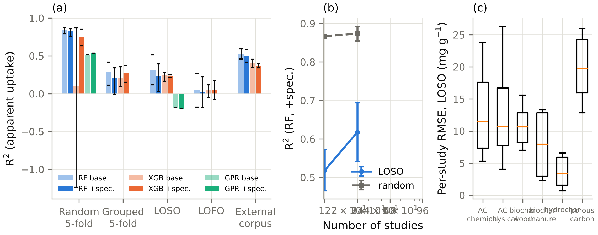
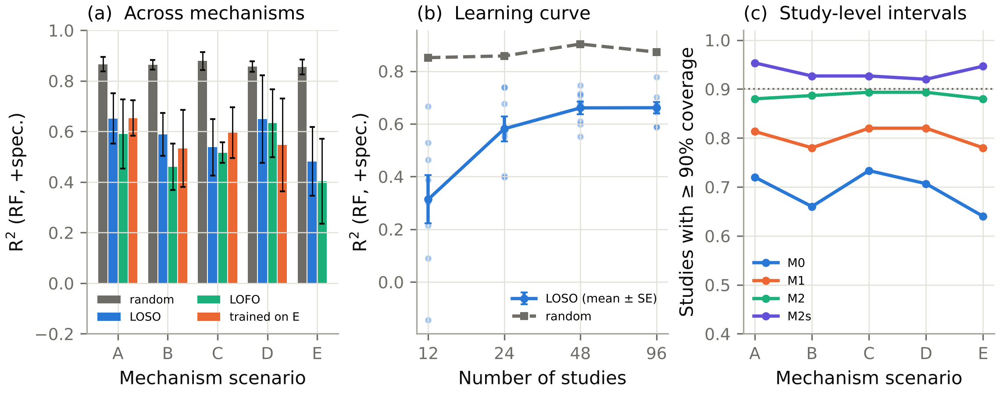
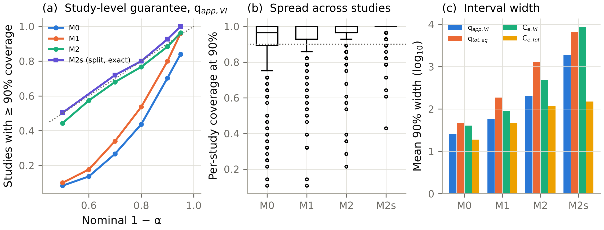
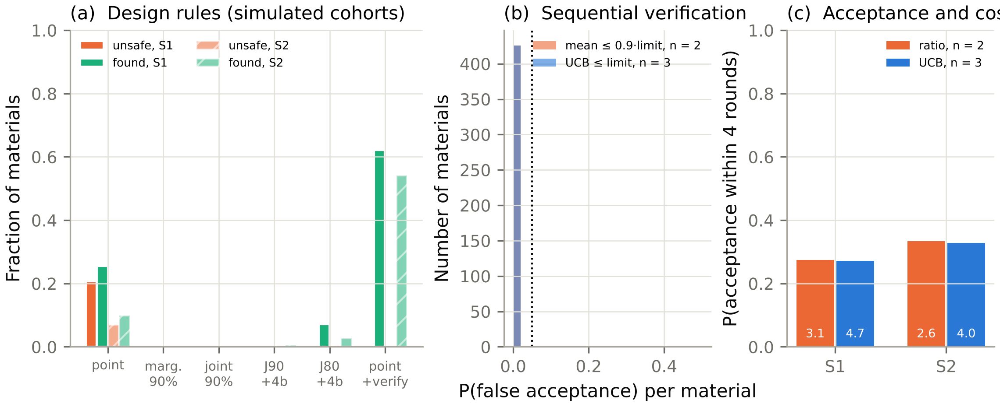
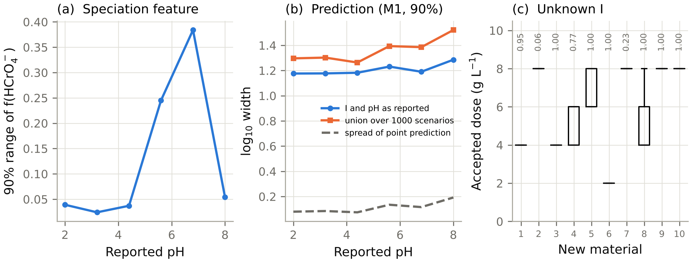

# CASSIA: A Provenance-Aware Computational Framework for Evidence-Constrained Analysis of Cr(VI) Removal by Carbonaceous Materials

## Highlights

- Simulated Cr(VI)-only data were often equivalent to adsorption-only fits within 10%
- In the benchmark, total-Cr and solid-phase data raised rejection power to 80–96%
- PHREEQC databases differ by 63–83 mV in the Cr(VI)/Cr(III) redox boundary
- Exact study-level conformal intervals hold coverage but span over 3 log units
- No unsafe accepted designs were observed in the simulated test cohorts

## Abstract

Loss of dissolved Cr(VI) on carbonaceous materials is routinely reported as adsorption, although Cr(VI) is also reduced to Cr(III). CASSIA is an open, provenance-aware framework that separates apparent removal, total-aqueous-Cr removal and adsorption, assigns observation-level evidence classes (C, B, A1, A2), and tests which mechanisms a measurement design can identify. Three PHREEQC databases agreed on Cr(VI) speciation within 0.044 but differed by 63–83 mV in the Cr(VI)/Cr(III) boundary. In known-truth simulations with five mechanism scenarios, adsorption-only was not rejected by a calibrated χ² test for 63–76% of high-reduction studies observed through residual Cr(VI) alone, and a noncentral-χ² equivalence test showed it equivalent within a 10% margin for 43–65%. With total Cr, calibrated power was 80–88% (cross-validated type-I error 3–5%); with XPS or XANES, 90–96%. Random cross-validation overstated transferability (random-forest R² 0.86–0.89 versus 0.48–0.65 leave-one-study-out across scenarios), and speciation features did not improve prediction. An exact study-level split-conformal interval met its proven coverage guarantee but spanned 3.3 log₁₀ units at 90%. Point-prediction treatment designs were unsafe for 7–21% of new virtual materials; with sequential confirmatory testing, no unsafe accepted design was observed (Wilson 95% upper bound 1.3%). All results are synthetic or thermodynamic: no published experimental data were analysed, and the extraction protocol and tested pipeline are released for that step.

**Keywords:** hexavalent chromium; carbonaceous adsorbents; PHREEQC; mechanism identifiability; leave-one-study-out validation; conformal prediction; data provenance

---

## 1. Introduction

Hexavalent chromium is a priority contaminant in effluents from electroplating, leather tanning, pigment and wood-preservation industries. Its toxicity and mobility differ sharply from those of Cr(III) (Kotaś and Stasicka, 2000). Activated carbons, biochars and biomass-derived porous carbons are the most widely studied low-cost sorbents for Cr(VI) (Mohan and Pittman, 2006; Mohan et al., 2011; Dong et al., 2011), and pooled literature data are increasingly used to train machine-learning (ML) models.

**Redox behaviour on carbon.** Carbon surfaces are redox active towards Cr(VI). Experimental studies on biomass and biochars have shown that, at low pH, Cr(VI) is reduced to Cr(III). The reduction can proceed directly from solution or after adsorption, through oxygen-containing functional groups and the carbon matrix. The resulting Cr(III) is partly released to solution, partly retained on the surface and, at higher pH, precipitated (Park et al., 2004; Dong et al., 2011; Mohan et al., 2011).

**What residual Cr(VI) measures.** The quantity most often reported, residual Cr(VI) by the 1,5-diphenylcarbazide method, records the *disappearance* of Cr(VI), not its adsorption. Isotherm constants fitted to q = (C₀ − C_e,VI)/m therefore mix adsorption, reduction and precipitation in unknown proportions. This adds to well-documented problems of aqueous adsorption modelling: linearised fitting, R² as the only selection criterion, and over-interpreted kinetic models (Tran et al., 2017; Simonin, 2016; Wang and Guo, 2020).

**Two further gaps.**
- *Chemistry.* Cr(VI) speciation depends on concentration through dichromate formation, and Cr(III) solubility depends strongly on pH. Both rest on thermodynamic data whose sources differ (Rai et al., 1987; Ball and Nordstrom, 1998). Yet adsorption studies rarely report the background electrolyte, the final pH or the redox state, and ML studies seldom propagate this missing information.
- *Statistics.* Observations from one publication share an adsorbent, a laboratory and a protocol. Random train/test splits therefore leak study identity (Roberts et al., 2017). Prediction intervals calibrated on pooled observations carry no guarantee for a new study, because exchangeability holds, at best, between studies (Dunn et al., 2023).

**Contribution.** This paper does not propose a new removal mechanism or another chromium-uptake predictor. It contributes an open framework, CASSIA (*Chromium Adsorption, Speciation and Surface-reduction Identifiability Analysis*), built to answer three questions:

- **Q1.** What can actually be established about Cr(VI) removal from a given set of measurements?
- **Q2.** What remains mechanistically unidentifiable without additional evidence, and which additional measurement resolves it?
- **Q3.** How much confidence should an engineer place in predicted removal performance, and in a treatment design, for a new carbonaceous material?

**Evidence used.** Two kinds of evidence are used, and they are kept separate throughout:
1. *Thermodynamic calculations* with three chromium-bearing PHREEQC databases.
2. *Known-truth simulation benchmarks.* A multi-mechanism kinetic model generates virtual batch studies in which the true split between adsorption, reduction and precipitation is known. Five alternative mechanism scenarios, at least 100 replicate corpora and randomised family-level priors are used, so that conclusions do not rest on one assumed mechanism.

**Status of empirical data.** The application to published experimental data is defined (schema, evidence classes, extraction protocol, seed dataset) but has not yet been carried out (Section 3.8). No result in this paper is an empirical finding about a real carbon.

## 2. Methods

### 2.1 Endpoints, evidence classes and terminology

Three endpoints are computed and never merged:
- **Apparent Cr(VI) uptake**, q_app,VI = (C₀ − C_e,VI)/D. It is always computable.
- **Total-aqueous-Cr uptake**, q_tot,aq = (C₀ − C_e,tot)/D. It requires a total-Cr analysis (AAS or ICP). It is not adsorption either, because it includes Cr(III) retained or precipitated on the solid.
- **Aqueous Cr(III) index**, Σ(C_e,tot − C_e,VI)/Σ(C₀ − C_e,VI). It is a lower bound on the share of Cr(VI) disappearance due to reduction.

Evidence classes are assigned **per observation** (`cassia.dataset.classify`), because a single paper may report total Cr or solid-phase data for some experiments only. Oxidation-state identification and chromium mass balance are treated as different analytical tasks:
- **Class C:** residual Cr(VI) only. Solid-phase data without a total-aqueous-Cr analysis also count as C.
- **Class B:** Cr(VI) and total aqueous Cr.
- **Class A1:** B plus solid oxidation-state evidence, a final or controlled pH, and a reported electrolyte. XPS and XANES are recorded separately because their sampling depths and artefacts differ.
- **Class A2:** A1 plus a solid Cr inventory (digestion and total-Cr analysis) and phase or coordination evidence distinguishing retained from precipitated Cr(III).

A1 establishes that Cr(III) is present on the solid; only A2 quantifies how much Cr sits where.

A study-level label (the best class present) is kept for reporting only. Class C observations may be labelled only as *apparent* Cr(VI) removal.

Negative apparent uptake (C_e,VI > C₀ within analytical error) is retained in the data, flagged, and censored at q = 0 for model targets. Values below the limit of detection (LOD) enter as LOD/2 and are flagged.

### 2.2 Software architecture and release

CASSIA 0.2.0 is organised in six layers (Table 1).

**Table 1.** CASSIA layers, modules and responsibilities.

| Layer | Module | Responsibility |
|---|---|---|
| 1 Data | `cassia.dataset` | 34-field schema with DOI and source location per row; validation and QC flags; endpoints; observation-level evidence classes |
| 2 Chemistry | `cassia.chemistry` | PHREEQC adapter (phreeqpython 1.6.2): Cr(VI) speciation, a 4-D speciation grid, redox scenarios, Cr(III) saturation, database provenance |
| 3 Simulator | `cassia.simulate` | Known-truth multi-mechanism batch model (scenarios A–E), mass and electron balances, measurement model |
| 4 Identifiability | `cassia.identifiability` | Fisher information by measurement design, detection tests, equivalence tests, profile likelihood, metadata-bias propagation |
| 5 Models and uncertainty | `cassia.fitting`, `cassia.validation` | Nonlinear isotherm/kinetic selection; RF, XGBoost and GPR under four validation schemes; study-level conformal prediction |
| 6 Decision support | `scripts/run_v2.py` (design stage) | Two-endpoint dose/pH design under point, marginal and joint rules |
| auxiliary | `cassia.pores` | pyGAPS 4.x adapter: BET area (Rouquerol criteria) from published N₂ isotherms |

**Reuse of existing packages.**
- The isotherm and kinetic equations are taken from the `adsorption` package (Amvro23, MIT licence). Its gas-phase concentration transform and its fixed-temperature Temkin form are bypassed for aqueous data.
- pyGAPS (Iacomi and Llewellyn, 2019) is used only for gas-isotherm descriptors.

**Release contents.** The release includes:
- the MIT licence, a `CITATION.cff` file and a changelog;
- a pinned environment (`requirements-lock.txt`, Python 3.13.17);
- SHA-256 checksums and `$Id` revision lines for the bundled databases;
- an end-to-end example workflow for user data (`examples/user_data_workflow.py`);
- a release record (`release/RELEASE.md`, `release/MANIFEST.sha256`) with SHA-256 checksums of every code, database, data, result and figure file, the code commit hash and the exact commands;
- 39 automated tests, covering mass and electron conservation for every scenario, saturation-index statuses, interpolation accuracy, the conformal constructions and a negative control for the equivalence test.

Every number and figure in this paper is regenerated by `scripts/run_v2.py`, with seeds listed in the script.

### 2.3 Chromium chemistry layer

**Databases.** PHREEQC 3 was used with the three chromium-bearing databases distributed by the USGS (Parkhurst and Appelo, 2013):
- `minteq.v4.dat` (MINTEQA2 v4 lineage; Allison et al., 1991);
- `minteq.dat` (MINTEQA2 v3 lineage);
- `llnl.dat` (LLNL thermo.com.V8.R6.230).

Their revision lines and checksums are given in Table S2. The databases bundled with phreeqpython contain no chromium species and are rejected programmatically.

**Cr(VI) speciation.** Cr was entered as `Cr(6)` with one K⁺ per Cr, representing a K₂Cr₂O₇ stock, in NaCl at the stated ionic strength. pH was imposed by charge balance on Cl⁻ or, where infeasible, on Na⁺. Valence states entered separately are not re-equilibrated in a PHREEQC initial solution, so this represents a freshly prepared Cr(VI) solution. Fractions are per Cr atom.

**Speciation grid.** To represent the concentration dependence of dimerisation wherever it matters, a grid was computed with `minteq.v4.dat`:
- pH 1.5–10 in 0.25 steps (35 values);
- dissolved Cr(VI) 0.01–700 mg L⁻¹ (11 values);
- I 10⁻³–10⁻¹ M (5 values);
- T 288–318 K (4 values).

That is 7,700 PHREEQC solutions, interpolated multilinearly. The simulator evaluates speciation at the *current* dissolved Cr(VI), pH, I and T. The ML features are evaluated at each row's C₀, pH, I and T. Interpolation error was checked against 300 direct PHREEQC calls at random interior points.

**Redox scenarios.** Total Cr was entered without a valence state at an assumed pe, restricted to the water-stability field (pe ≤ 20.75 − pH). The Eh at which Cr(VI) and Cr(III) are equally abundant was obtained by interpolation.

**Cr(III) solubility.** The v0.1 analysis relied on convergence of the PHREEQC phase-boundary option, which the reviewer rightly criticised. The saturation index of the Cr(III) hydroxide (Cr(OH)₃(am) in minteq.v4; Cr(OH)₃(A) in minteq) is now evaluated directly for solutions of prescribed dissolved Cr(III). Saturation is located by bisection on log₁₀ C between 10⁻⁶ and 5,000 mg L⁻¹. Every evaluation returns a status:
- `bracketed` (with the SI at the solution);
- `undersaturated_to_cmax`: SI < 0 even at 5,000 mg L⁻¹, a direct thermodynamic statement;
- `supersaturated_at_cmin`;
- `speciation_failed`: reported, never interpreted.

`llnl.dat` contains no Cr(III) hydroxide, and its only Cr(III) solid (eskolaite) is written through CrO₄²⁻ and O₂. A Cr(III)-only solubility is therefore undefined there and is reported as not computable.

**External validation.** An independent check against the critically evaluated constants of Ball and Nordstrom (1998) and Rai et al. (1987) requires their tabulated values. These could not be retrieved from the build environment. CASSIA accepts a reference-constant table for this comparison (Section 4.7).

**Background electrolyte.** The electrolyte is NaCl unless stated otherwise. Its effect on Cr(VI) speciation was checked against NaNO₃ and Na₂SO₄ (I = 0.01 and 0.1 M; §3.1). Adsorption competition by these anions on the carbon surface is not represented.

### 2.4 Multi-mechanism known-truth simulator

**General model.** One kinetic model contains five removal pathways (`cassia.simulate`). Its states are:
- dissolved Cr(VI), C_v;
- adsorbed Cr(VI), q₆;
- Cr(III) formed on the surface, q₃s;
- Cr(III) re-adsorbed from solution, q₃r;
- dissolved Cr(III), C₃;
- precipitated Cr(III), P₃;
- surface reductant, R_s (mmol e⁻ g⁻¹);
- leached dissolved reductant, L (mmol e⁻ L⁻¹);
- pH.

**Rate expressions.**
- *Adsorption:* linear-driving-force approach to a Langmuir equilibrium, whose affinity depends on the HCrO₄⁻ + Cr₂O₇²⁻ fraction from the speciation grid and on surface charge relative to pH_pzc.
- *Direct surface-mediated reduction* of dissolved Cr(VI) (pathway B): r_B = k_B h(pH) (R_s/R₀) C_v.
- *Adsorption-coupled reduction* of adsorbed Cr(VI) in place (pathway C): r_C = k_C h(pH) (R_s/R₀) q₆.
- *Dissolved-phase reduction* by reductants leached from the carbon (pathway D): r_D = k_D h(pH) L C_v.
- In all three, h(pH) = [1 + 10^(pH − pH₅₀)]⁻¹, with an Arrhenius temperature dependence.

**Fate of Cr(III).**
- Surface-formed Cr(III) is retained with a pH-dependent affinity θ₃(pH) and released at a rate k_rel (1 − θ₃) q₃s.
- Dissolved Cr(III) re-adsorbs towards a Langmuir equilibrium.
- Cr(III) precipitates or redissolves towards the PHREEQC Cr(OH)₃(am) solubility at the current pH and I.

**pH drift (scenario E).** pH follows a proton balance: reduction consumes protons, precipitation releases three per Cr, and proton exchange with the carbon relaxes pH towards pH_pzc. The total buffer capacity is that of the carbon plus 2.303[H⁺].

**Conservation.** The model conserves both chromium mass and electron equivalents:
- C_v + D(q₆ + q₃s + q₃r) + C₃ + P₃ = C₀;
- 3 × (Cr reduced) = D(R₀ − R_s) + (L_leached − L).

Both are verified by unit tests for every scenario.

**Scenarios.**

| Scenario | Pathways switched on |
|---|---|
| A | adsorption only (negative control) |
| B | adsorption + direct surface reduction |
| C | adsorption + adsorption-coupled reduction |
| D | adsorption + dissolved-phase reduction |
| E | all pathways + Cr(III) re-adsorption + precipitation + pH drift |

**Material and study populations.**
- *Families and family-level parameters.* There are six families: chemically and physically activated carbons, wood and manure biochars, hydrochars, and biomass-derived porous carbons. Each has physically plausible ranges of S_BET and pH_pzc. The family-level means of reductant capacity, leachable reductant and specific capacity are redrawn for every corpus from a common hyper-prior, so which family is most reductive is itself random across replicates. This removes the circularity identified by the reviewer, where the most reductive family was fixed by construction.
- *Experiments per study.* Each virtual study contains an 8-point isotherm (C₀ = 5–300 mg L⁻¹ at an optimum pH of 1.8–3.5), a 6-point pH edge (pH 2–8), an 8-point kinetic series and a 6-point dose series (0.5–8 g L⁻¹ at C₀ = 20 mg L⁻¹).
- *Measurement model.* Cr(VI) and total Cr carry 3% relative error, detection limits and a study-level calibration bias.
- *Solid-phase measurements* follow technique-specific models (`cassia.measurement`; Table S1):
  - **XPS** is surface-sensitive. The reported Cr(III) fraction is e·f/(e·f + 1 − f) + b·(1 − ·), where f is the true fraction, e a per-study surface-enrichment factor (log-normal, SD 0.4) and b ~ U(0, 0.15) beam- or vacuum-induced reduction of Cr(VI) during analysis; the fitting noise is 0.05.
  - **XANES** is bulk-sensitive: no enrichment, b ~ U(0, 0.03), noise 0.03.
  - **Solid Cr inventory** is measured with 5% relative error.
  - **Phase evidence** gives the precipitated share of solid Cr(III) with an absolute error of 0.10.

  These are assumptions encoding qualitative behaviour, not instrument specifications.
- *Evidence classes and reporting.* Classes are assigned at study level (C 0.40, B 0.30, A1 0.20, A2 0.10; A1 split equally between XPS and XANES) and then resolved per observation. Ionic strength and final pH are reported with class-dependent probabilities.

Every parameter, its distribution and the numerical settings (LSODA, rtol 10⁻⁶, atol 10⁻⁸) are listed in Table S1. The simulator is one family of plausible mechanisms. It is not calibrated to any material; its purpose is to make the ground truth available.

### 2.5 Mechanism benchmark (conventional isotherm analysis)

**Design.** For each scenario, 100 replicate corpora of 30 studies were generated (15,000 virtual studies in total). In every study, the isotherm series was analysed as in conventional practice:
- nonlinear Langmuir, Freundlich, Sips and Temkin fits (Temkin at the experimental T), with AICc/BIC and Akaike weights (Burnham and Anderson, 2002);
- Shapiro–Wilk and runs tests on the residuals;
- PFO/PSO kinetic fits.

In 20 replicates per scenario, 200-replicate residual-bootstrap intervals were computed for Langmuir q_max.

**Outcomes.** The outcomes are:
- the true shares of Cr(VI) disappearance attributable to adsorbed Cr(VI), Cr(III) on the solid, dissolved Cr(III) and precipitate (mass-weighted over the isotherm series);
- the fraction of fits with R² ≥ 0.95;
- the ratio of fitted to true q_max;
- bootstrap-interval coverage of the true q_max;
- for Class A/B studies, the aqueous Cr(III) index.

Across-replicate variability gives Monte Carlo standard errors (MCSE).

### 2.6 Mechanism-identifiability engine

Six cumulative measurement designs were defined:

| Design | Measurements | Evidence class |
|---|---|---|
| D1 | residual Cr(VI) at equilibrium (isotherm + pH edge) | C |
| D2 | D1 + Cr(VI) kinetics | C |
| D3 | D2 + total dissolved Cr at every point | B |
| D4x | D3 + XPS Cr(III) fraction on three solids + final pH | A1 (XPS) |
| D4n | D3 + XANES Cr(III) fraction on three solids + final pH | A1 (XANES) |
| D5 | D4n + solid Cr inventory + phase evidence on the same solids | A2 |

(The v0.2 design D4, with unbiased solid oxidation state, is retained only for the profile likelihoods in Supplementary Fig. S1.)

Four complementary analyses were applied.

1. **Local identifiability.**
   - *Sensitivities.* For each study, the sensitivity matrix J of all observables was computed by forward differences. It covers the log-transformed or pH-scale kinetic parameters, the study bias and the technique nuisances: the XPS enrichment and beam reduction, or the XANES beam reduction.
   - *Posterior.* The Fisher information JᵀWJ, where W is the inverse measurement variance, was combined with a weakly informative Gaussian prior: SD 0.5 log₁₀ units for kinetic parameters and the uniform-equivalent SDs for the nuisances. The delta method then gives Laplace-approximation posterior SDs of the reduction share and of the precipitation share.
   - *Caveat.* This analysis assumes the mechanistic model structure is known, so it is an optimistic bound.
2. **Model-free detection tests.** Each was assessed over 20 noisy replicates per study, and in the paired pure-adsorption controls to measure false alarms:
   - a one-sided z-test that dissolved Cr(III) = Σ(C_e,tot − C_e,VI) exceeds analytical noise (B);
   - XPS Cr(III) fraction > 0.20 (A1, XPS);
   - XANES Cr(III) fraction > 0.10 (A1, XANES).
3. **Adsorption-only goodness of fit and equivalence (Appendix B).**
   - *Model and controls.* A flexible empirical adsorption-only model was fitted to each design's observations by weighted least squares: a pH-dependent Sips equilibrium, a free kinetic curve, study bias, pH relaxation and, for A1/A2, a bounded measurement-induced apparent Cr(III) fraction. Every study was paired with a negative control: the same material with reduction switched off. Both arms were run at 3% and 10% analytical noise.
   - *Three outcomes per study.*
     - **rejected**, when χ² exceeds a threshold calibrated on the negative controls (their 95th percentile; type-I error estimated by split-half cross-validation);
     - **equivalent within ε**, when a noncentral-χ² equivalence test, the goodness-of-fit analogue of two one-sided tests (Schuirmann, 1987; Wellek, 2010), shows that the misfit non-centrality is below a margin λ₀(ε). The margin corresponds to a systematic discrepancy of ε = 5, 10 or 20% in every concentration (0.05 absolute for oxidation-state fractions);
     - **inconclusive**, otherwise.
   - *Terminology.* "Not rejected" is never interpreted as "equivalent".
   - *Operating characteristics.* Type-I error, power and false-equivalence rate were evaluated against the noise-free misfit of each study.
4. **Metadata bias.** The first-order bias in the inferred reduction share was propagated for misreported pH (+0.5) and ionic strength (×10), via Δθ = Σ_post JᵀW(y_true − y_assumed). These v0.2 analyses use designs D1 and D3.

**Sample sizes.**
- Analyses 1 and 2: 300 studies (200 from scenario E and 100 from scenarios B–D).
- Analysis 3: 120 studies (60 from E, 20 each from B–D), each with a paired control, × 6 designs × 2 noise levels.

### 2.7 Machine-learning models and validation

**Targets and transforms.**
- *Targets:* q_app,VI (all rows), q_tot,aq (rows with total Cr) and, for the design layer, residual concentrations C_e,VI and C_e,tot.
- *Transform:* each is modelled as log₁₀(y + c), with c = 0.1 mg g⁻¹ for uptake and LOD/2 for concentrations.
- *Back-transformation:* uses Duan's (1983) smearing factor estimated on training residuals. The naive inverse is reported for comparison.

**Features.**
- *Base set:* C₀, pH, D, t, T, log₁₀ I, an I-imputed flag, S_BET, V_p, d_p and pH_pzc. Unreported I is imputed at 0.01 M and flagged.
- *Chem set:* adds the PHREEQC speciation features and pH − pH_pzc.

**Models.** Hyperparameters were fixed a priori (Table S3): RF (300 trees, min. leaf 2), XGBoost (500 rounds, depth 4, learning rate 0.05) and GPR (Matérn-5/2 ARD + white noise, standardised inputs). All seeds were fixed. Nested tuning by inner 4-fold grouped CV (RF: 9 configurations; XGBoost: 4) was evaluated on three corpora to quantify its effect.

**Validation design.**
- *Corpora:* 20 independent scenario-E corpora of 30 studies (six families; 840 observations each).
- *Schemes:* random 5-fold (diagnostic only), grouped 5-fold by study, leave-one-study-out (LOSO) and leave-one-family-out (LOFO, six held-out families).
- *External test:* models trained on each corpus were tested on an *external* corpus generated with different hyper-prior draws, so that population shift is included.
- *GPR:* evaluated on three corpora because of its cost, and treated as exploratory. Its ARD kernel hyperparameters were optimised on a seeded 250-row subsample of each training fold and then held fixed while the GP was refitted on all training rows, so no test information is used.

**Reporting.** Each corpus reports pooled R², RMSE, MAE and median absolute error, with 1,000-replicate study-level (cluster) bootstrap intervals and per-study errors. Across corpora the distribution of each metric is reported, and model differences are paired by corpus. Between-study variability is quantified by a random-intercept decomposition of out-of-study residuals (τ², σ², ICC; Gelman and Hill, 2007). A learning curve (12–96 studies; eight replicates each) estimates how many independent studies a transferable model needs.

**Additional analyses.**
- *Mechanism scope.* The main ML analysis uses scenario E. To test whether its conclusions depend on the mechanism, RF and XGBoost (random, LOSO, LOFO) and the interval methods were repeated on five corpora of each scenario A–E.
- *Cross-mechanism transfer.* Models trained on scenario-E corpora were also tested on corpora generated under scenarios A–D.
- *Censoring and LOD treatment.* Four treatments were compared on five corpora (RF, LOSO): censoring at zero with LOD/2 (baseline), dropping censored rows, an inverse-hyperbolic-sine transform that keeps negative values, and LOD instead of LOD/2.

### 2.8 Study-level conformal prediction

Three interval constructions were compared. All are calibrated on out-of-study residuals, with the study as the unit.

- **M0 – pooled residuals (v0.1 method).** The half-width is the ⌈(n+1)(1−α)⌉/n quantile of pooled absolute residuals from an inner grouped 10-fold CV. Residuals within a study are dependent, so M0 has no formal guarantee for a new study.
- **M1 – study-level CV+ with study-weighted scores.**
  - *Construction:* the CV+ interval of Barber et al. (2021), formed with study-level folds (K = 10). Each calibration study contributes total weight 1 (weight 1/n_j per observation), as in the weighted pooling of Dunn et al. (2023), and the test study carries one further unit of weight.
  - *Target:* marginal coverage of a random observation from a new study.
- **M2 – study-level CV+ with study scores (empirical).**
  - *Score:* s_j is the ⌈0.9 n_j⌉-th smallest absolute residual of study j.
  - *Interval:* bounded by the ⌊α(J+1)⌋-th and ⌈(1−α)(J+1)⌉-th order statistics of the fold-model predictions ∓ s_j.
  - *Status:* the v0.2 claim of a 1 − 2α guarantee is withdrawn. The CV+ bound is proven for scalar scores of exchangeable points, and its extension to within-study quantile scores is not established (Appendix A).
- **M2s – study-level split conformal (exact).**
  - *Construction:* the training studies are split at random into halves, one for model fitting and J for calibration. Each calibration study is scored by s_j as above, and the half-width is the ⌈(1−α)(J+1)⌉-th smallest score.
  - *Guarantee (Appendix A):* under exchangeability of studies, with probability ≥ 1 − α at least ⌈0.9 n⌉ of a new study's n observations are covered. The guarantee is marginal over the study population (families, study sizes), not conditional on a family.
  - *Requirement:* J ≥ (1 − α)/α calibration studies. With fewer, the interval is unbounded.

**Evaluation.** Each construction was evaluated by outer LOSO on 10 corpora for all four targets, at nominal levels 0.50–0.95. There were 29 training studies per test study; for M2s, about 14 of these were used for calibration. Reported for each:
- mean, median, 10th-percentile and worst per-study coverage;
- the fraction of studies covered at the nominal level;
- the observation-weighted coverage;
- the mean width;
- the number of calibration studies.

### 2.9 Treatment-design layer

**Models.** Residual Cr(VI) and residual total Cr are modelled directly (Section 2.7), each with its own M1 interval. Modelling effluent through q, as in v0.1, is ill-conditioned when removal approaches completeness.

**Design problem.**
- *Grid:* pH 2–7 in 0.5 steps and dose 0.5–8 g L⁻¹ (the training range), 24 h contact.
- *Rule:* choose the lowest dose meeting both limits.
- *Targets:* S1, C₀ = 20 mg L⁻¹ with limits Cr(VI) ≤ 0.5 and total Cr ≤ 2 mg L⁻¹; S2, C₀ = 5 mg L⁻¹ with limits 0.1 and 0.5 mg L⁻¹.

**Decision rules.**
- *Point:* point predictions.
- *Marginal 90%:* each endpoint's upper bound at α = 0.10.
- *Joint 90%:* Bonferroni, each endpoint at α = 0.05, so that the joint miscoverage is ≤ 0.10 by the union bound.
- *Joint 90% / 80% + 4 confirmatory batches:* four batches on the new material (pH 3, doses 0.5–4 g L⁻¹, 3% analytical noise) estimate its study offset for each endpoint. The centre is shifted by that offset. The half-width is the study-weighted (1 − α) quantile of offset-adjusted out-of-study residuals of the training studies, with α = 0.05 or 0.10 per endpoint (heuristic; it assumes the confirmatory batches are exchangeable with the study's other observations).
- *Point + verify (model-guided, test-confirmed):* the point model proposes the pH and the lowest dose. Confirmatory batches are run at that design, and, if they fail, the dose is escalated along the grid for at most four rounds. Two acceptance rules were compared:
  - **(i) v0.2 rule:** duplicates; accept when both mean measured concentrations are ≤ 90% of their limits.
  - **(ii) error-controlled rule:** triplicates; accept when the one-sided upper confidence bound of each endpoint is ≤ its limit. The bound is mean × exp[z·√(σ_r²/n + σ_b²)], with σ_r = 0.03 random and σ_b = 0.05 calibration uncertainty. z is the 1 − α/(2R) normal quantile, with α = 0.05 and R = 4 rounds (Bonferroni over two endpoints and four looks).

  The probability of accepting a non-compliant design was estimated with 1,000 simulated verification sequences per material and target. Two analytical-error models were used: calibration bias shared by both endpoints with correlated replicate errors (ρ = 0.5), and independent biases and errors.

**Cohorts.** Twenty independent cohorts were used, each with its own 30-study training corpus and 15 new materials drawn from the same hyper-priors (300 materials per target).

**Truth and metrics.** For every material, the simulator gave the true attainability: the lowest grid dose at which any pH meets both limits. For every rule and target the following were reported:
- unsafe recommendations (recommended but non-compliant in truth), with Wilson 95% intervals (Wilson, 1927);
- compliant designs found among attainable materials;
- infeasibility declarations for attainable materials;
- reliability among recommendations;
- the dose overhead relative to the true minimum dose.

**Sensitivity.** The operating-window sensitivity of point + verify designs was evaluated at pH ± 0.25 and ± 0.5 and dose × 0.8 and × 1.2. Predicted and true effluent were compared on a sub-grid.

### 2.10 Propagation of unreported chemistry

**Prediction level.** For studies that did not report ionic strength or final pH, 1,000 scenarios were drawn: I log-uniform on 10⁻³–10⁻¹ M and a pH-basis ambiguity uniform on ±0.5. They were propagated through the speciation features, the q_app,VI predictions and the M1 intervals. For each observation the following were recorded: the 90% range of f(HCrO₄⁻), the spread of the point prediction, and the union interval width against the nominal width. Grouped 5-fold models were used on four corpora.

**Design level.** For six new materials per corpus, the designer's assumed I was drawn 300 times from the same range, while the true I was 0.01 M. The point + verify design was re-run for each draw (confirmatory batches at the true conditions), and the true outcome of each accepted design was simulated. This gives distributions of recommended dose, residual total Cr and compliance probability.

**Mechanistic level.** The first-order bias in the inferred reduction share is given by the identifiability engine (Section 2.6).

### 2.11 Literature-data protocol and seed dataset

The extraction protocol (`data/PROTOCOL.md`) is PRISMA 2020-aligned (Page et al., 2021). It specifies:
- the databases: Scopus, Web of Science, PubMed, Zenodo, Mendeley Data, Figshare and Data in Brief;
- the exact search strings;
- the eligibility rules;
- table-first extraction with digitisation as a recorded fallback;
- unit normalisation and provenance fields;
- quality-appraisal fields (replicates, SD, blanks, mass balance, pH drift);
- observation-level evidence classification.

The seed dataset is Ramirez et al. (2020), Data in Brief 29, 105292: activated carbon from teak-wood residue, with equilibrium and kinetic data in the supplementary files. It is registered in `data/study_registry.csv`. Execution of the search and the extraction is pending (Section 3.8).

### 2.12 Use of AI tools in the research process

The CASSIA code, the analysis scripts and the manuscript drafts were developed with an AI coding assistant (Claude, Anthropic), working under the author's direction in a version-controlled repository.

**Safeguards.** The scientific design and the reviewer-driven changes were specified by the author. The correctness checks built into the work are:
- unit tests for conservation laws and numerical constructions;
- negative controls (scenario A);
- cross-checks of interpolated against direct PHREEQC calculations;
- full regeneration of every reported number from seeded scripts.

[The author should add a statement of their own verification of code and results here before submission.]

## 3. Results

Sections 3.1 and 3.7 report thermodynamic calculations. Sections 3.2–3.6 report **synthetic, known-truth benchmarks**. They are statements about what the methods can and cannot recover under the simulated mechanisms, not empirical findings about real carbons. Section 3.8 reports the status of the empirical application.

### 3.1 Chromium chemistry across three databases

**Cr(VI) speciation is robust to the database choice (Table 2, Fig. 1a,b).**
- The log K values for HCrO₄⁻ and Cr₂O₇²⁻ agree to within 0.016 and 0.041 log units across the three databases.
- Over pH 1.5–10 and 10–500 mg L⁻¹, species fractions differ from minteq.v4 by at most 0.031 (minteq; HCrO₄⁻ at pH 1.5, 500 mg L⁻¹) and 0.044 (llnl; CrO₄²⁻ at pH 10, 500 mg L⁻¹). The llnl difference reflects the alkali–chromate ion pairs (NaCrO₄⁻, KCrO₄⁻) that only the MINTEQ databases contain.
- The HCrO₄⁻/CrO₄²⁻ crossover lies at pH 6.37–6.38 in all three databases (10 mg L⁻¹, I = 0.01 M).
- The crossover shifts with ionic strength, from pH 6.46 (I = 0.001 M) to 6.24 (I = 0.1 M). The temperature effect is small: pH 6.37 at 288 K, 6.40 at 318 K.
- H₂CrO₄ is the only species with a large log K disagreement (6.42, 5.65 and 5.18). It never exceeds about 2% of Cr(VI) above pH 1.5.

**Concentration matters more than the database.**
- At pH 3 the dichromate share of Cr rises from 0.17% at 1 mg L⁻¹ to 1.7% (10), 7.4% (50), 13.1% (100), 28.2% (300) and 43.7% (700 mg L⁻¹) in minteq.v4.
- The three databases agree to within 0.02 at every concentration.
- A single isotherm spanning 5–300 mg L⁻¹ therefore samples materially different sorbate mixtures. This is why the revised simulator evaluates speciation at the current dissolved Cr(VI) (reviewer comment 3A).
- The four-dimensional speciation grid reproduced 300 direct PHREEQC solutions with a maximum absolute error of 0.011 and a mean error of 0.0011 in species fraction.

**Table 2.** Equilibrium constants (25 °C) for CrO₄²⁻ + n H⁺ ⇌ product.

| Product | minteq.v4 | minteq | llnl |
|---|---|---|---|
| HCrO₄⁻ | 6.510 | 6.509 | 6.494 |
| Cr₂O₇²⁻ (2 CrO₄²⁻ + 2 H⁺) | 14.560 | 14.557 | 14.519 |
| H₂CrO₄ | 6.419 | 5.651 | 5.175 |

**The redox boundary is database dependent (Fig. 1c).**
- The Eh at which Cr(VI) and Cr(III) are equally abundant (50 mg L⁻¹ total Cr) is 63–83 mV higher in minteq.v4 than in llnl over pH 2.5–10. The two MINTEQ versions agree to within −19 to +5 mV.
- At pH 2, neither MINTEQ database reaches 50% Cr(VI) anywhere inside the water-stability field. At the O₂/H₂O limit, only 12% Cr(VI) remains in minteq.v4.
- Under the conditions where Cr(VI) removal by carbons is usually optimal, Cr(VI) is thermodynamically unstable with respect to reduction at almost any attainable Eh. Its persistence is kinetic.
- The 63–83 mV spread is a *between-database* difference, not an independently validated uncertainty interval for real systems (reviewer comment 3C).

**Direct saturation indices replace phase-boundary convergence (Fig. 1d, Table S4).**
- Of 174 bisection evaluations (two databases × three ionic strengths × 29 pH values), 146 were bracketed and 28 returned 'undersaturated up to 5,000 mg L⁻¹'. None failed.
- A 625-point SI map over pH 3–9 and 10⁻³–10³ mg L⁻¹ Cr(III) converged everywhere.
- On the 0.25-pH evaluation grid, undersaturation up to 5,000 mg L⁻¹ extends to pH 4.25 in minteq.v4 at I = 0.001–0.01 M and to pH 4.5 at I = 0.1 M, and to pH 3.5 in minteq at all three ionic strengths (Table S4). This is a direct thermodynamic result, not an inference from non-convergence. The constants themselves have not been validated independently against critically evaluated data (§4.7).
- At I = 0.01 M, the dissolved Cr(III) at saturation with Cr(OH)₃(am) is:

| pH | minteq.v4 (mg L⁻¹) | minteq (mg L⁻¹) |
|---|---|---|
| 4.0 | undersaturated up to 5,000 | 266 |
| 4.5 | 16 | 9.5 |
| 5.0 | 1.42 | 0.79 |
| 6.0 | 0.023 | 0.017 |
| 7.0 | 1.2 × 10⁻³ | 1.8 × 10⁻³ |
| 8.0 | 1.4 × 10⁻⁴ | 7.8 × 10⁻⁴ |

- The two MINTEQ versions therefore differ by more than an order of magnitude at pH 4, and by a factor of 5.5 at pH 8.
- llnl.dat cannot provide this quantity (Section 2.3).

**The background electrolyte matters little for Cr(VI) speciation.** Replacing NaCl by NaNO₃ or Na₂SO₄ changed the Cr(VI) species fractions by at most 0.024 (CrO₄²⁻ at pH 6.5, I = 0.1 M, where Na₂SO₄ forms fewer alkali–chromate ion pairs) at pH 3, 5 and 6.5 (I = 0.01 and 0.1 M), and moved the HCrO₄⁻/CrO₄²⁻ crossover by at most 0.004 pH units. Sulfate formed CrO₃SO₄²⁻, up to 1.0% of Cr(VI) at pH 3 and I = 0.1 M. Competition of these anions for surface sites on the carbon is not represented, so the result concerns solution chemistry only.

**Fig. 1.** PHREEQC chromium chemistry with three databases (thermodynamic calculations; no experimental data). (a, b) Cr(VI) species fractions per Cr atom at 10 and 500 mg L⁻¹, I = 0.01 M NaCl. (c) Eh at which Cr(VI) and Cr(III) are equally abundant (50 mg L⁻¹ total Cr), with the O₂/H₂O boundary. (d) Dissolved Cr(III) at saturation with Cr(OH)₃(am) by direct saturation-index bisection. Triangles mark pH values at which solutions remain undersaturated up to 5,000 mg L⁻¹ (filled: minteq.v4; open: minteq).

### 3.2 Mechanism benchmark: what conventional isotherm analysis recovers (synthetic)

**Scale and mechanism mix.** Across 15,000 virtual studies (5 scenarios × 100 corpora × 30 studies), the true share of Cr(VI) disappearance due to reduction (isotherm series, mass-weighted) had these medians:
- scenario B: 0.24 (5–95%: 0.02–0.92);
- scenario C: 0.22 (0.03–0.75);
- scenario D: 0.04 (0.002–0.54);
- scenario E: 0.38 (0.05–0.93).

In scenario E the removed chromium was distributed as follows (medians): 0.62 adsorbed Cr(VI), 0.24 dissolved Cr(III), 0.045 Cr(III) on the solid and essentially no precipitate (95th percentile 0.065), consistent with the Cr(OH)₃ undersaturation at the isotherm pH of 1.8–3.5 (Section 3.1). The distributions are shown in Fig. 2a,d.

**Goodness of fit does not discriminate mechanisms (Fig. 2b).**
- *Negative control.* In the pure-adsorption control (A), only 46.7% of best-isotherm fits reached R² ≥ 0.95 (MCSE 0.8%). For low-capacity families (manure biochar, hydrochar; median true q_max 1–4 mg g⁻¹), only 16% did, because their adsorption signal is close to analytical noise.
- *Reduction can improve fit quality.* The share of R² ≥ 0.95 fits rose to 58.8% (B) and 59.3% (E). For the low-capacity families it roughly doubled, to 31–34%, because reduction adds a smooth, saturating removal signal.
- *High-reduction studies still fit well.* Among studies whose reduction share exceeded 0.2, R² ≥ 0.95 was reached in 46% (B), 41% (C), 17% (D) and 52% (E).
- *Residual diagnostics did not help.* The runs test flagged 4.9–7.9% of Langmuir fits in every scenario, including the control.
- *Kinetic model choice did not help.* PSO was preferred over PFO in 25% of control series and 27–34% of reduction scenarios, so it carries no mechanistic information.

**Publishable fits overstate capacity in proportion to reduction, and the size depends on the mechanism (Fig. 2c, Table 3).** Fits whose q_max reached the fitting bound because the isotherm never saturated (0.6–3.1%) were excluded.

**Table 3.** Fitted/true Langmuir q_max for publishable fits (R² ≥ 0.95), by scenario (synthetic; 3,000 studies per scenario).

| Scenario | Median ratio (IQR) | Median ratio, reduction share > 0.3 (n) | Spearman ρ, reduction share vs ratio (mean ± SD over replicates) |
|---|---|---|---|
| A (control) | 1.02 (0.97–1.18) | – | – |
| B | 1.32 (1.07–2.60) | 4.88 (604) | 0.60 ± 0.19 |
| C | 1.15 (1.04–1.50) | 1.60 (446) | 0.32 ± 0.19 |
| D | 1.04 (0.98–1.21) | 13.7 (43; mostly very-low-capacity materials) | 0.13 ± 0.20 |
| E | 1.31 (1.08–2.29) | 2.25 (857) | 0.63 ± 0.17 |

- With reduction shares below 0.05, the median ratio was 1.02–1.03 in every scenario.
- The qualitative conclusion is that a saturating fit to apparent removal absorbs the reduction sink into q_max. It holds for direct surface reduction (B), adsorption-coupled reduction (C) and the combined mechanism (E).
- It is weak for dissolved-phase reduction (D), which rarely dominates removal at the simulated leachable-reductant levels.

**Bootstrap intervals are miscalibrated for reasons beyond mechanism.**
- The 95% residual-bootstrap interval of Langmuir q_max covered the true q_max in only 22% of publishable control fits (n = 289).
- Coverage fell further to 8.8–17.4% in the reduction scenarios.
- Eight-point isotherms that do not fully reach equilibrium produce intervals that are both precise and biased, even without reduction. Reduction makes this worse.

**A total-Cr mass balance tracks reduction where Cr(III) stays dissolved.** For Class A/B studies, the aqueous Cr(III) index ranked studies by reduction share with Spearman ρ = 0.73 (B), 0.52 (C), 0.33 (D) and 0.71 (E). It underestimated the share by a median of 23% in C and E, where Cr(III) is partly retained on the solid. It is therefore a lower bound, as intended.

**Family patterns follow from assumed capacity, not from assumed reductance.**
- Even with family-level reductant priors redrawn in every replicate, hydrochar had the highest mean reduction share in 83 of 100 scenario-E replicates.
- With hydrochar excluded, the most reductive family varied (manure biochar 56, wood biochar 39, physically activated carbon 5).
- Within scenario E the drawn family reductant prior correlated with the reduction share (ρ = 0.40), as intended. The dominance of low-surface-area chars, however, comes from the assumed proportionality between S_BET and adsorption capacity: a small adsorption sink inflates the reduction *share*.
- This is a property of the simulator and must not be read as an empirical statement about hydrochars (reviewer comment 2).

**Fig. 2.** Mechanism benchmark (synthetic; 15,000 virtual studies). (a) True reduction share of Cr(VI) disappearance by scenario (box: IQR; whiskers: 5–95%). (b) Share of studies whose best isotherm fit reaches R² ≥ 0.95, against the true reduction share (bins with ≥ 20 studies); dotted line, pure-adsorption control. (c) Fitted/true Langmuir q_max for fits with R² ≥ 0.95 (median and IQR; log scale). (d) Fate of the removed Cr(VI) in scenario E. Scenario definitions are in Section 2.4 and all parameter distributions in Table S1.

### 3.3 Identifiability: which measurements establish the mechanism (synthetic)

**If the model were known (Fig. 3a).** With the mechanistic model structure assumed known, the median Laplace posterior SD of the reduction share fell with each added measurement (high-reduction studies, share > 0.4):

| Design | D1 | D2 | D3 | D4x | D4n | D5 |
|---|---|---|---|---|---|---|
| Posterior SD of reduction share | 0.061 | 0.053 | 0.033 | 0.026 | 0.020 | 0.011 |

The prior SD was 0.04–0.28.
- *Precipitation share.* Only the A2 design constrained it well: posterior SD 0.026 under D5, against 0.037 (D4n), 0.077 (D3) and 0.14 (D1). This rests on only 11 studies with a precipitated share above 0.02, because Cr(OH)₃ is undersaturated at the isotherm pH.
- *Caveat.* The Fisher analysis assumes the exact rate laws are known, so it is an optimistic bound.

**Model-free diagnostics carry technique-specific false alarms (Fig. 3b).** All three diagnostics gained detection with the reduction share (shares < 0.05, 0.05–0.2, 0.2–0.4 and > 0.4), but their false-alarm rates in pure-adsorption controls differed:

| Diagnostic | Detection rate by reduction share | False-alarm rate in controls |
|---|---|---|
| Dissolved-Cr(III) z-test (B) | 10%, 36%, 72%, 71% | 0.9% |
| XPS Cr(III) > 0.20 (A1) | 17%, 57%, 78%, 80% | 7.1% |
| XANES Cr(III) > 0.10 (A1) | 11%, 65%, 85%, 85% | 1.0% |

- XPS false-alarms seven times as often as XANES because of the assumed beam/vacuum reduction and surface enrichment.
- An XPS Cr(III) signal on its own is therefore weaker evidence of reduction than the same signal from XANES.

**Adsorption-only fits: rejection, equivalence or neither (Table 4, Fig. 3c,d; Appendix B).** For 120 studies, each paired with a pure-adsorption control:
- *The nominal χ² test over-rejects.* Its type-I error was 6.7–15%, because the empirical model only approximates the generating adsorption model.
- *Calibration fixes this.* With thresholds calibrated on the controls, the cross-validated type-I error was 3.3–12.5%, mostly 3–7%. With 120 controls the Monte Carlo SE of these estimates is about 2 percentage points.
- *Power with Class C data is low.* For high-reduction studies (share > 0.3), the calibrated test rejected adsorption-only in only 37% (D1) and 35% (D2) at 3% analytical noise, and 26% and 24% at 10% noise.
- *Cr(III) measurements raise power.* Adding total Cr (D3) raised power to 80–88%. Adding solid-phase evidence (D4x, D4n, D5) raised it to 90–96%.

**Non-rejection under Class C reflects genuine structural equivalence.** Because the simulator gives noise-free data, the true misfit of the best adsorption-only approximation is known for every study.
- *Ground truth.* For 77% of high-reduction studies, adsorption only reproduced the noise-free Class C observations (D1) within a 5% systematic discrepancy, and for 90% within 10%. With total Cr (D3), only 22% and 39% did; with solid-phase evidence (D4x–D5), only 12–16% and 24–29%.
- *The test recovers this truth.* At 3% noise, the equivalence test declared 'equivalent within 5%' for 59% (D1) and 65% (D2) of high-reduction studies, but only 4–12% under D3–D5.
- *Its false-equivalence rate stayed within α.* It was 0–4.3% across all designs, noise levels and margins, i.e. at most α = 0.05. Its power to declare equivalence when the true misfit was within the margin was 96–99% at 3% noise for all designs.
- *More noise means more inconclusive outcomes.* At 10% analytical noise, equivalence could be demonstrated less often: under D1, 4% of high-reduction studies at ε = 5% and 43% at ε = 10%. The share of inconclusive outcomes rose to 31–71%.
- *Conclusion.* In this benchmark, residual-Cr(VI) data from strongly reducing systems are typically *demonstrably* compatible with adsorption only within 5–10%, not merely 'not rejected'. Total-Cr and solid-phase data usually break that equivalence.

**Table 4.** Adsorption-only model, high-reduction studies (true share > 0.3; n = 51): calibrated rejection, equivalence within ε = 10% and true within-margin status (synthetic).

| Design | Rejected, 3% noise | Rejected, 10% | Equivalent (ε = 10%), 3% | Equivalent, 10% | Truly within ε = 10% (noise-free) | Calibrated type-I, 3% / 10% |
|---|---|---|---|---|---|---|
| D1 (C) | 0.37 | 0.26 | 0.63 | 0.43 | 0.90 / 0.84 | 0.067 / 0.058 |
| D2 (C) | 0.35 | 0.24 | 0.65 | 0.63 | 0.92 / 0.86 | 0.100 / 0.083 |
| D3 (B) | 0.88 | 0.80 | 0.12 | 0.20 | 0.39 / 0.39 | 0.050 / 0.033 |
| D4x (A1, XPS) | 0.96 | 0.90 | 0.04 | 0.10 | 0.29 / 0.20 | 0.058 / 0.067 |
| D4n (A1, XANES) | 0.94 | 0.92 | 0.06 | 0.08 | 0.28 / 0.16 | 0.125 / 0.033 |
| D5 (A2) | 0.96 | 0.92 | 0.04 | 0.08 | 0.24 / 0.18 | 0.067 / 0.067 |

'Truly within' depends on the noise level because the margin is expressed in units of the analytical SD.

**These statements are conditional on the benchmark.** They hold under the assumed measurement models (§2.4), in particular the XPS and XANES bias distributions. They do not establish that total-Cr or solid-phase data make mechanisms distinguishable in every real carbonaceous system.

**Profile likelihood (Supplementary Fig. S1; v0.2 designs).** All profile points met the optimiser convergence criterion, but some profiles are not smooth (e.g. a peak at +0.6 log units for study VS002), indicating local optima at those points; the true profile lies at or below the plotted curve, so these profiles are indicative only; the minimum −2 log L was consistent with the number of observations (3.4 for n = 14 under D1; 21–79 for n = 44–61 under D3/D4).

- *Low-reduction study (true share 0.15).* The reductant capacity R₀ was practically non-identifiable. The 95% profile region extended from at least 16-fold below to 1.6-fold above the true value under every design. The implied reduction share nevertheless stayed within 0.13–0.14 (D1) and 0.17–0.18 (D3, D4). A share can be well determined while the parameter that generates it is not, *provided the model structure is correct*.
- *High-reduction study (true share 0.60).* R₀ was sharply identified, within one grid step of 0.2 log units, under all designs. The share at the minimum was 0.601 in each case.
- *Caveat.* The profiles use the known model structure and include the true parameters among the optimiser starts. They therefore show identifiability under the correct model, not the ease of estimation. The equivalence test removes that assumption, and under it Class C data lose most of their discriminating power.

**Misreported metadata (v0.2 designs D1, D3).**
- Analysing the data at a pH 0.5 units above the true value biased the inferred reduction share by a median of 0.032 (90th percentile 0.157) under D1, and by 0.024 (0.092) under D3.
- A ten-fold error in ionic strength caused much smaller biases: medians of 0.003 and 0.001, 90th percentiles of 0.025 and 0.015.
- The pH basis (initial vs final) is therefore the reporting omission that matters most for mechanism inference.

**Fig. 3.** Mechanism identifiability by measurement design (synthetic). (a) Laplace-posterior SD of the reduction share assuming the true model structure (median per bin; dotted: prior). (b) Detection rates of three model-free diagnostics; false-alarm rates in pure-adsorption controls are given in the legend. (c) Outcome of the adsorption-only test at 10% analytical noise and ε = 10% (rejected by the calibrated χ² test; equivalent within ε by the noncentral-χ² equivalence test; inconclusive), for studies with reduction share > 0.3 (solid) and 5–30% (hatched). (d) Power of the calibrated rejection test against the true reduction share, by design.

### 3.4 Transferability of ML models across studies (synthetic)

Fig. 4 and Table 5 summarise 20 independent scenario-E corpora (30 studies, six families, 840 observations each). The Gaussian process was run on 3 corpora. The target is apparent Cr(VI) uptake. About 40 observations per corpus (4.8%) had negative apparent uptake and were censored at zero.

**Random splits overstate transferability.**

| Validation scheme | RF (base features) R² mean ± SD | 95% range over corpora | RMSE (mg g⁻¹) |
|---|---|---|---|
| Random 5-fold | 0.892 ± 0.024 | – | 5.0 |
| Grouped 5-fold | 0.638 | – | 9.1 |
| Leave-one-study-out | 0.631 ± 0.137 | 0.41–0.82 | 9.2 |
| Leave-one-family-out | 0.559 | 0.14–0.79 | 10.0 |
| External corpora (different hyper-priors) | 0.562 | 0.28–0.77 | 9.7 |

- The study-level cluster bootstrap gave mean 95% intervals of 0.44–0.76 for the LOSO R² of a single corpus. One corpus of 30 studies therefore cannot pin transferability down to better than about ±0.15 in R².
- The same ordering held for XGBoost (random 0.873, LOSO 0.596, LOFO 0.515).
- The Gaussian process collapsed outside random splits (LOSO 0.26 base, 0.33 chem; 3 corpora).

**Apparent model superiority is not significant.**
- RF exceeded XGBoost under LOSO by a mean of 0.038 R² (SD 0.090). It was better in 14 of 20 corpora (sign test p = 0.12).
- Nested grouped tuning changed LOSO R² by +0.001 (RF) and −0.040 (XGBoost) on three corpora. Tuning on 24–29 training studies overfits the inner folds.

**Speciation features do not improve prediction.** With the concentration-, I- and T-dependent features, the change in LOSO R² relative to the base set was:
- RF: −0.009 ± 0.031 (positive in 7 of 20 corpora);
- XGBoost: −0.013 ± 0.060 (positive in 8 of 20 corpora);
- Gaussian process: +0.08 ± 0.49 (3 corpora).

The hypothesis that chemistry-informed features improve predictive reliability (RQ1 of v0.1) is not supported. The speciation fractions are smooth functions of pH, C₀, I and T, which are already inputs, so tree models gain nothing from them (§4.3).

**Most error on a new study is between-study.**
- Forty-five per cent (ICC 0.45 ± 0.14) of the variance of out-of-study residuals was a study-level offset.
- Per-study RMSE under LOSO ranged from 1.9 to 14.8 mg g⁻¹ (10th–90th percentile) and scaled with material capacity: median 9.0 mg g⁻¹ for chemically activated carbons, 3.5 mg g⁻¹ for hydrochars.

**The conclusions hold across mechanisms, but transfer between mechanisms is not free (Fig. 5a; Table S6).** RF with speciation features was evaluated on five corpora for each mechanism scenario:
- Random-split R² was 0.86–0.89 for every scenario. LOSO R² was 0.48–0.65 and LOFO R² 0.40–0.63, so the random-split inflation is not specific to scenario E.
- Speciation features again lowered LOSO R² slightly in every scenario (−0.010 to −0.033).
- Models trained on scenario-E corpora and tested on corpora generated under other mechanisms reached R² = 0.65 (A), 0.53 (B), 0.60 (C) and 0.55 (D). For B and D this is 0.05–0.10 below the within-scenario LOSO R²; for A and C it is equal or higher.
- These mechanism shifts were tested only within one model family; they say nothing about mechanisms outside it.

**Retransformation.** Duan smearing reduced the mean back-transformation bias from −1.86 to −1.30 mg g⁻¹, but did not remove it, because the residuals are heteroscedastic.

**More studies help, more rows do not (Fig. 5b).** The learning curve was repeated with 8 replicate corpora per size (v0.2 used 4, and its curve was not monotonic: 0.47, 0.59, 0.56, 0.75):
- LOSO R² rose from 0.31 ± 0.09 (mean ± SE) with 12 studies to 0.58 ± 0.05 (24), 0.66 ± 0.02 (48) and 0.66 ± 0.02 (96). The rank correlation between corpus size and LOSO R² was ρ = 0.58 (p < 0.001, 32 corpora).
- With 8 replicates the curve is monotonic in its means but levels off beyond about 48 studies. The 48- and 96-study means differ by less than their SE. The v0.2 dip at 48 studies and its higher value at 96 were therefore replicate noise.
- The between-replicate SD fell from 0.26 (12 studies) to 0.06 (96). Small corpora are unreliable as well as less accurate.
- Random-split R² stayed between 0.85 and 0.90 throughout.
- The effective sample size for transferability is the number of independent studies. On this evidence, a literature corpus of 20–30 studies yields LOSO R² of about 0.5–0.6, and the plateau near 0.66 reflects irreducible between-study heterogeneity in the simulator, not a general property of real data.

**Table 5.** Out-of-fold R² for apparent Cr(VI) uptake: mean (2.5–97.5% range across 20 corpora; GPR: 3 corpora).

| Model | Features | Random 5-fold | Grouped 5-fold | LOSO | LOFO | External |
|---|---|---|---|---|---|---|
| RF | base | 0.892 (0.85–0.93) | 0.638 (0.40–0.81) | 0.631 (0.41–0.82) | 0.559 (0.14–0.79) | 0.562 (0.28–0.77) |
| RF | chem | 0.882 (0.81–0.92) | 0.629 (0.40–0.79) | 0.622 (0.40–0.79) | 0.534 (0.08–0.74) | 0.525 (0.19–0.75) |
| XGB | base | 0.873 (0.76–0.93) | 0.624 (0.42–0.80) | 0.596 (0.36–0.78) | 0.515 (0.16–0.73) | 0.561 (0.40–0.74) |
| XGB | chem | 0.865 (0.76–0.93) | 0.607 (0.39–0.76) | 0.584 (0.29–0.78) | 0.509 (0.17–0.74) | 0.497 (0.17–0.69) |
| GPR | base | 0.511 (0.03–0.82) | – | 0.256 (−0.39–0.64) | – | – |
| GPR | chem | 0.736 (0.68–0.83) | – | 0.332 (0.20–0.47) | – | – |

**Fig. 4.** Transferability of ML models (synthetic; 20 corpora of 30 studies). (a) R² for apparent Cr(VI) uptake under five validation schemes (bars: mean; whiskers: 2.5–97.5% range across corpora). (b) Learning curve from v0.2: R² against the number of independent studies (RF with speciation features; mean ± SD of 4 replicates); superseded by the 8-replicate curve in Fig. 5b. (c) Per-study RMSE under leave-one-study-out by family (ACc/ACp: chemically/physically activated carbon; BCw/BCm: wood/manure biochar; HC: hydrochar; PC: biomass-derived porous carbon).

**Fig. 5.** Robustness of the ML and interval results across mechanisms (synthetic). (a) Out-of-fold R² for apparent uptake by mechanism scenario (RF with speciation features; 5 corpora per scenario; bars: mean, whiskers: SD): random 5-fold, leave-one-study-out, leave-one-family-out, and models trained on scenario-E corpora and tested on the given scenario. (b) Learning curve: leave-one-study-out R² against the number of studies (8 replicate corpora per size; mean ± SE; points: replicates) and random-split R². (c) Fraction of unseen studies with ≥ 90% within-study coverage at nominal 90%, by scenario and interval method (dotted: 0.90).

### 3.5 Study-level prediction intervals (synthetic)

Table 6 and Fig. 6 report outer leave-one-study-out evaluations on 10 corpora: 300 test studies for Cr(VI) endpoints and 182 for total-Cr endpoints, which are measured only in Class A/B studies.

**Average coverage is the wrong criterion.**
- The pooled-residual interval M0 (the v0.1 method) reached its nominal *average* coverage for every endpoint (0.89–0.90 at 90%).
- Only 65–75% of individual test studies were covered at 90%, and the worst study had 11–29% of its observations covered.
- The observations of one study share an offset, so pooled calibration averages over-coverage of 'easy' studies with severe under-coverage of others.

**The study-level CV+ intervals address exactly this.**
- M1 (study-weighted) raised the share of studies covered at ≥ 90% to 76–87%.
- M2 (one score per study, CV+) raised it to 88–93%. M2 has no proven guarantee (Appendix A), so these figures are empirical only.
- M2 is conservative at lower nominal levels (mean coverage 0.77–0.82 at a nominal 0.50).

**The price is width, and it is large.**
- At 90%, M2 intervals spanned 2.1–3.1 log₁₀ units, against 1.3–1.7 for M0: a factor of 100–1,000 between the bounds.
- At 95%, intervals for the total-Cr endpoints were effectively unbounded. Only about 17 studies with total-Cr data were available for calibration, fewer than the 19 that a study-level 95% quantile requires.
- This is a concrete data requirement: certifying total-Cr predictions at 95% needs at least 19 independent studies that report total Cr.

**The exact split-conformal interval M2s behaved as its theorem predicts (Table 6b, Fig. 6).**
- *Calibration.* Training studies were split in half, giving 14 calibration studies for Cr(VI) endpoints and 8.6 on average for total-Cr endpoints. The fraction of unseen studies with at least 90% of their observations covered tracked the nominal level for apparent uptake: 0.93, 0.80, 0.72 and 0.50 at nominal 0.90, 0.80, 0.70 and 0.50. Every value lies within the theoretical bounds of 1 − α and 1 − α + 1/(J + 1).
- *Cost.* The price of exactness is width, 3.3 log₁₀ units at 90% for apparent uptake. Only half of the training studies are used to fit the model.
- *Unbounded intervals.* At 95%, M2s is unbounded for every endpoint, because it needs J ≥ 19. At 90% it is unbounded for 63% of test studies on the total-Cr endpoints, because it needs J ≥ 9.
- *Across mechanisms.* The guarantee held in all five scenarios (≥ 0.92 of studies covered at ≥ 90%; Fig. 5c).
- *Interpretation.* Exact study-level guarantees are available, but with literature-scale numbers of studies they are too wide for low-effluent engineering decisions. This is a substantive negative result, not a defect of the method.

**Table 6b.** M2s, exact study-level split conformal: fraction of unseen studies with ≥ 90% within-study coverage (10 corpora, leave-one-study-out).

| Endpoint | Calibration studies (mean) | 1 − α = 0.50 | 0.70 | 0.80 | 0.90 | 0.95 | Width at 0.90 (log₁₀; bounded intervals) |
|---|---|---|---|---|---|---|---|
| q_app,VI | 14 | 0.50 | 0.72 | 0.80 | 0.93 | unbounded | 3.28 |
| C_e,VI | 14 | 0.57 | 0.76 | 0.81 | 0.95 | unbounded | 3.94 |
| q_tot,aq | 8.6 | 0.52 | 0.78 | 0.88 | 0.97 (63% unbounded) | unbounded | 3.81 |
| C_e,tot | 8.6 | 0.52 | 0.72 | 0.87 | 0.98 (63% unbounded) | unbounded | 2.18 |

**Coverage is marginal over families, not conditional.** For apparent uptake, M0 covered 0.77 of hydrochar observations (0.85 with M1, 0.91 with M2), compared with 0.96–0.99 for the other families. Under M2s, only 84% of hydrochar studies met the 90% within-study target, against 90–98% for the other families (Table S5). Study-level calibration does not repair heterogeneity between families.

**Table 6.** Study-level coverage at a nominal 90% under leave-one-study-out validation (10 corpora; RF with speciation features). Coverage is the fraction of a test study's observations inside its interval.

| Endpoint | Method | Mean | Median | 10th pct | Worst | Studies ≥ 0.90 | Width (log₁₀) | Calibration studies |
|---|---|---|---|---|---|---|---|---|
| q_app,VI | M0 | 0.898 | 0.96 | 0.71 | 0.11 | 0.70 | 1.40 | 29 |
| q_app,VI | M1 | 0.937 | 1.00 | 0.82 | 0.11 | 0.80 | 1.76 | 29 |
| q_app,VI | M2 | 0.960 | 1.00 | 0.89 | 0.21 | 0.88 | 2.32 | 29 |
| q_tot,aq | M0 | 0.893 | 1.00 | 0.58 | 0.15 | 0.75 | 1.66 | 17 |
| q_tot,aq | M1 | 0.953 | 1.00 | 0.89 | 0.15 | 0.87 | 2.27 | 17 |
| q_tot,aq | M2 | 0.976 | 1.00 | 0.90 | 0.40 | 0.91 | 3.11 | 17 |
| C_e,VI | M0 | 0.900 | 1.00 | 0.64 | 0.29 | 0.65 | 1.61 | 29 |
| C_e,VI | M1 | 0.940 | 1.00 | 0.79 | 0.39 | 0.76 | 1.94 | 29 |
| C_e,VI | M2 | 0.974 | 1.00 | 0.89 | 0.46 | 0.90 | 2.68 | 29 |
| C_e,tot | M0 | 0.901 | 1.00 | 0.70 | 0.11 | 0.73 | 1.28 | 17 |
| C_e,tot | M1 | 0.949 | 1.00 | 0.85 | 0.18 | 0.87 | 1.68 | 17 |
| C_e,tot | M2 | 0.973 | 1.00 | 0.90 | 0.25 | 0.93 | 2.07 | 17 |

**Fig. 6.** Study-level conformal prediction (synthetic; outer leave-one-study-out on 10 corpora). (a) Nominal against mean per-study coverage for apparent uptake (dotted: 10th-percentile study). (b) Distribution of per-study coverage at 90%. (c) Mean per-study coverage at 90% for the four endpoints. M0: pooled residuals; M1: study-level CV+ with study-weighted scores; M2: study-level CV+ with one score per study.

### 3.6 Treatment design with two endpoints (synthetic)

**Set-up.** Of the 300 new materials per target (20 cohorts × 15), 169 (S1) and 181 (S2) could truly meet both limits somewhere on the design grid (Table 7, Fig. 7).

**Point predictions are unsafe.**
- They recommended a design for 105 materials (S1). Only 41% of these complied in truth.
- Sixty-two materials (20.7%; Wilson 95% interval 16.5–25.6%) received an unsafe recommendation: 38 failed the Cr(VI) limit and 45 the total-Cr limit (some failed both).
- For S2 the unsafe rate was 7.0% (4.6–10.5%).

**Calibrated bounds are safe but useless.**
- Marginal-90% and joint-90% rules recommended nothing for any material, so they never failed and never helped.
- With the study-level uncertainty available from 30 heterogeneous training studies, no effluent at or below 0.5 mg L⁻¹ Cr(VI) can be certified for a new material.
- This is not a defect of the rule. It is the honest consequence of the between-study variability in §3.4.

**Confirmatory batches help only partly.**
- Estimating the new material's offset from four confirmatory batches (pH 3, 0.5–4 g L⁻¹) narrowed the bounds.
- At joint 90% (95% per endpoint) the rule recommended a design for 1 material only, because the total-Cr bound remains unbounded with about 17 calibration studies (§3.5).
- At joint 80% it recommended designs for 14 (S1) and 6 (S2) materials, with 86% and 83% compliance and 2 and 1 unsafe recommendations.

**Model-guided, test-confirmed design worked.**
- In this protocol the model proposes the pH and starting dose. Duplicate confirmatory batches are then run at the proposed design, and the dose is escalated until both measured concentrations fall below 90% of their limits (at most four rounds).
- It accepted designs for 105 (S1) and 98 (S2) materials. Every accepted design complied in truth. No unsafe accepted design was observed in these simulated cohorts; the Wilson 95% upper bound on the unsafe rate is 1.3% of materials per target. This is an observed frequency, not a guarantee.
- It found compliant designs for 62% (S1) and 54% (S2) of attainable materials, after a mean of 1.4–1.5 rounds.
- The median dose was twice the true minimum dose, which is the price of escalating on a coarse dose grid.

**Verification is a sequential decision, so its false-acceptance risk was evaluated explicitly (Table 7b, Fig. 7b,c).**
- *Simulation.* For every material and target, 1,000 verification sequences were simulated, with up to four dose rounds and both endpoints measured each round. Each sequence drew a calibration bias and correlated replicate errors.
- *Per material.* The probability of accepting a non-compliant design was:
  - v0.2 rule (duplicates, mean ≤ 90% of each limit): mean 0.01% across materials, worst material 1.4–1.7%;
  - error-controlled rule (triplicates, one-sided upper confidence bound ≤ limit, Bonferroni over two endpoints and four rounds): worst material 0.1–0.7%.
- *Overall.* No material exceeded 5% under either rule, with shared or independent calibration bias. The controlled rule needed about 50% more batches per material (4.7 against 3.1 for S1; 4.0 against 2.6 for S2).
- *Operating characteristic.* Because these averages depend on how close true concentrations sit to the limits, Table 7b gives the acceptance probability over four rounds for a design whose true concentrations stay at a fixed ratio to both limits:

| True concentration / limit | v0.2 rule | Error-controlled rule |
|---|---|---|
| 1.00 (at the limit) | 3.7% | 0.8% |
| 1.05 | 0.2% | 0.04% |
| 0.90 (truly compliant) | 59% | 37% |

  Both figures assume shared calibration bias. The controlled rule is about five times safer at the limit and less likely to accept compliant designs close to the limit.
- *Scope.* These are properties under the assumed analytical-error model (3% random, 5% calibration uncertainty), not guarantees for real laboratories.

**Table 7b.** Sequential verification: probability of accepting a non-compliant design (1,000 simulated sequences per material; 300 materials per target).

| Target | Rule | Bias model | Mean P(false acceptance) | Worst material | Materials > 5% | Mean batches |
|---|---|---|---|---|---|---|
| S1 | v0.2 (n = 2, mean ≤ 0.9·limit) | shared | 0.0001 | 0.014 | 0 | 3.1 |
| S1 | controlled (n = 3, UCB ≤ limit) | shared | 0.0000 | 0.001 | 0 | 4.7 |
| S2 | v0.2 | shared | 0.0001 | 0.015 | 0 | 2.6 |
| S2 | controlled | shared | 0.0000 | 0.007 | 0 | 4.0 |
| S1 | v0.2 | independent | 0.0001 | 0.015 | 0 | 3.1 |
| S1 | controlled | independent | 0.0000 | 0.002 | 0 | 4.7 |

**Sensitivity of accepted designs (S1).**
- They tolerated a dose increase of 20% (100% compliance) and a pH increase of 0.25 (95%).
- They were sensitive to lower pH: compliance fell to 81% at −0.25 and 62% at −0.5 pH units, because dissolved Cr(III) release rises as pH falls.
- A 20% dose reduction gave 83% compliance.

**Effluent predictions.** Predicted and true effluent concentrations on a design sub-grid were rank-correlated (Spearman 0.65 for Cr(VI), 0.55 for total Cr), with median absolute errors of 0.40 and 0.22 log₁₀ units. The 95% upper bounds held for 97.9% (Cr(VI)) and 100% (total Cr) of grid points.

**Table 7.** Design outcomes for 300 new virtual materials per target (S1: C₀ = 20 mg L⁻¹, limits Cr(VI) ≤ 0.5 and total Cr ≤ 2 mg L⁻¹; S2: C₀ = 5 mg L⁻¹, limits 0.1 and 0.5 mg L⁻¹).

| Target | Rule | Designs recommended | Compliant (true) | Unsafe (of all materials) | Attainable materials found | Median dose (g L⁻¹) |
|---|---|---|---|---|---|---|
| S1 | point prediction | 105 | 41% | 62 (20.7%) | 25% | 4 |
| S1 | marginal 90% | 0 | – | 0 | 0% | – |
| S1 | joint 90% (Bonferroni) | 0 | – | 0 | 0% | – |
| S1 | joint 90% + 4 confirmatory batches | 1 | 100% | 0 | 0.6% | 6 |
| S1 | joint 80% + 4 confirmatory batches | 14 | 86% | 2 (0.7%) | 7% | 4 |
| S1 | point + verification batches | 105 | 100% | 0 | 62% | 8 |
| S2 | point prediction | 39 | 46% | 21 (7.0%) | 10% | 4 |
| S2 | joint 90% (Bonferroni) | 0 | – | 0 | 0% | – |
| S2 | joint 80% + 4 confirmatory batches | 6 | 83% | 1 (0.3%) | 3% | 4 |
| S2 | point + verification batches | 98 | 100% | 0 | 54% | 8 |

**Fig. 7.** Treatment design for new virtual materials (synthetic; 20 cohorts × 15 materials per target). (a) Fraction of all materials receiving an unsafe recommendation, and fraction of attainable materials for which a compliant design was found, by design rule (point prediction; marginal and joint 90% bounds; joint 90% and 80% bounds with up to four confirmatory batches; point prediction with sequential verification); solid: S1, hatched: S2. (b) Distribution over materials of the probability of accepting a non-compliant design under the two verification rules (shared calibration bias; materials whose dose ladder contains a non-compliant dose; dotted: 5%). (c) Mean probability of acceptance within four rounds; numbers in the bars: mean batches per material.

### 3.7 Propagation of unreported chemistry

**Prediction level.** Unknown ionic strength (10⁻³–10⁻¹ M) and an unknown pH basis (±0.5) were propagated with 1,000 draws per observation for 462 pH-edge observations from studies that did not report them.
- The 90% range of f(HCrO₄⁻) was 0.035 at pH ≤ 3.5, 0.045 at pH 3.5–5, 0.24 at pH 5–6.5 and 0.08 at pH 6.5–8.5.
- The resulting spread of the point prediction was 0.08–0.14 log₁₀ units, small compared with the study-level interval width (1.18–1.28 log₁₀ units).
- The union of the M1 intervals over all scenarios was 6–14% wider than the nominal interval.

**Design level.** Twenty-four new materials were each re-designed 300 times with the test-confirmed protocol, under different assumed ionic strengths.
- An unknown ionic strength changed the accepted dose for 3 of the 10 materials with accepted designs (e.g. 4–8 g L⁻¹).
- It never produced a non-compliant accepted design, because the confirmatory batches are run at the true conditions.

**Mechanistic level.** Unreported pH matters more than unreported ionic strength (§3.3): a 0.5-unit pH error biased the inferred reduction share by up to 0.16 (90th percentile).

**Conclusion.** For prediction and design, missing solution chemistry is a second-order uncertainty compared with between-study heterogeneity. For mechanistic interpretation, a missing pH basis is first-order.

**Fig. 8.** Propagation of unreported ionic strength and pH basis (1,000 draws per observation; synthetic studies). (a) 90% range of f(HCrO₄⁻). (b) Width of the nominal M1 interval, of its union over scenarios, and spread of the point prediction (log₁₀). (c) Accepted dose under unknown ionic strength for each new material (box over 300 draws; numbers: compliance probability).

### 3.8 Empirical application: status

**Not done.** No published experimental observation was analysed in this revision. The seed dataset (Ramirez et al., 2020; Data in Brief 29, 105292) and the systematic search were blocked: the hosts required to retrieve articles and supplementary files (PubMed Central, ScienceDirect, Crossref, Europe PMC, Zenodo, Mendeley Data, Figshare) were not reachable from the computational environment. No values were transcribed from memory or estimated.

**Ready.** The empirical pipeline is complete and tested:
- schema validation and QC flags;
- observation-level evidence classes;
- endpoints with Class C labelling;
- isotherm selection with bootstrap intervals;
- the aqueous Cr(III) index;
- study-level CV+ intervals;
- the design protocol.

It runs end to end on files in the CASSIA schema (`examples/user_data_workflow.py`).

**Next steps, in order:**
1. Extract the Ramirez et al. data as a Class C benchmark of the workflow.
2. Carry out the registered search and extraction, identifying the subset of studies with total-Cr and XPS/XANES evidence.
3. Apply the identifiability and validation analyses of §3.3–3.6 to the real corpus, keeping the evidence classes separate.

## 4. Discussion

### 4.1 What can be established from which measurements

The revised analysis gives a mechanism-resolved answer to the question in the title. It rests on synthetic evidence and should be read with that qualification.

**Terminology.** Three outcomes are distinguished throughout (Appendix B). 'Rejected' means the calibrated χ² test rejected the adsorption-only model. 'Equivalent within ε' means the equivalence test demonstrated that the adsorption-only misfit is smaller than a stated margin. 'Not rejected' alone is inconclusive and is never read as structural equivalence.

**Class C (residual Cr(VI) only).**
- Such data establish that Cr(VI) disappears under the stated conditions, and how fast.
- They do not establish why. In the benchmark, adsorption-only was *not rejected by the specified test* for 63–76% of high-reduction studies, and it was *demonstrated equivalent within 10%* for 43–65% of them (Table 4). For 90% of these studies the noise-free misfit was truly within 10%: the non-rejection reflects genuine structural equivalence of the Class C observations, not merely low power.
- Conventional isotherm statistics do not repair this. Fit quality is weakly, and sometimes positively, related to reduction; residual diagnostics flag 5–8% of fits regardless of mechanism; bootstrap intervals for q_max are precise but rarely cover the true capacity.
- The fitted q_max is an *apparent Cr(VI) removal capacity*. Under surface or adsorption-coupled reduction it exceeds the adsorption capacity in proportion to the reduction share.

**Class B (adds a total-Cr analysis).**
- Adding total Cr changes the picture qualitatively. The calibrated test then rejected adsorption-only in 80–88% of high-reduction studies, with cross-validated type-I error of 3–5%, and equivalence within 10% was demonstrated for only 12–20%.
- The aqueous Cr(III) index ranks studies by reduction share, as a lower bound.

**Class A1 and A2 (add solid-phase evidence).**
- A1 (oxidation state of the solid and final pH) raised calibrated power to 90–96%. XPS and XANES gave similar power in the fitted test, but their model-free diagnostics differed: the assumed beam reduction and surface enrichment made a simple XPS threshold false-alarm in 7.1% of pure-adsorption controls, against 1.0% for XANES (§3.3). An XPS Cr(III) signal is therefore not, on its own, evidence of chemical reduction.
- A2 (adds a solid Cr inventory and phase evidence) added little to rejection power over A1, but it was the only design that constrained the *precipitated* share (posterior SD 0.026 against 0.037–0.14). Its benefit is the partitioning of the reduced Cr, not the detection of reduction.
- These detectability statements are conditional on the assumed measurement models; with larger real XPS biases, the A1/A2 advantage would shrink.

**Recommendation.** This hierarchy is a quantitative argument, within the benchmark, for the minimum reporting set of §4.4. It also gives a criterion for pooling literature data: Class C observations may train a model of apparent removal, but they must not be pooled with Class A/B observations as evidence of adsorption capacity.

**Why the known-structure analyses look better.** The Fisher and profile analyses are much more optimistic than the equivalence test, and the contrast is instructive. If the analyst knew the exact rate laws, even Class C data would constrain the reduction share. Real analysts do not, and once the structure is unknown, the information about mechanism in Class C data largely disappears: the equivalence test shows that a flexible adsorption-only model reproduces them within a few per cent. Identifiability here is a property of the data *and* of what the analyst is entitled to assume.

### 4.2 Thermodynamic feasibility versus surface kinetics

**What thermodynamics says.** At the pH where carbons remove Cr(VI) most effectively (1.5–3.5), Cr(VI) is unstable with respect to Cr(III) at almost any Eh inside the water-stability field (§3.1). The two MINTEQ databases do not even reach a 50% Cr(VI) fraction at pH 2. Cr(III) is also undersaturated with respect to Cr(OH)₃(am) up to thousands of mg L⁻¹ below pH 4.25 (minteq.v4, I ≤ 0.01 M; 3.5 with minteq.dat).

**What it cannot say.** Equilibrium thermodynamics therefore says that reduction is possible and that its product will stay dissolved at low pH. It says nothing about whether reduction happens on the time scale of a batch test. That depends on:
- the rate of electron transfer from the carbon;
- its finite reductant capacity;
- the competition between adsorption and reduction.

These are kinetic and material-specific properties that equilibrium isotherms cannot represent, and that the simulator represents only through assumed rate laws.

**Consequence.** The redox calculations in CASSIA are labelled *scenarios*. A PHREEQC equilibrium prediction is never presented as a prediction of reduction in a batch experiment.

**Caveat on Eh.** The 63–83 mV difference between databases shows that even the thermodynamic boundary is uncertain. Without measured Eh, the redox state of a published experiment cannot be reconstructed.

### 4.3 Machine learning across studies

The random-versus-study gap (R² 0.89 against 0.63) reproduces, in this domain, what is known from ecology and materials informatics (Roberts et al., 2017). Three aspects matter for practice.

1. **One corpus cannot rank learners.** LOSO R² varied widely between corpora of identical design (95% range 0.41–0.82), and within-corpus cluster-bootstrap intervals were about ±0.15. A single literature corpus of 20–30 studies therefore cannot establish small differences between learners; the apparent RF–XGBoost advantage (0.04) was not significant.
2. **The error is a study-level offset.** Nearly half of the out-of-study error is a study-level offset (ICC 0.45). Neither more rows from the same studies nor hyperparameter tuning removes it; the learning curve shows that independent studies are the limiting resource. The offset also explains why study-level intervals must be wide (§3.5), and why confirmatory measurements on the new material are so valuable (§3.6).
3. **Chemistry features do not raise accuracy.** Chemistry-informed features did not improve accuracy even though, in the simulator, adsorption affinity depends on speciation by construction. Tree ensembles reconstruct smooth functions of pH, C₀, I and T from the raw inputs. In CASSIA, the role of these features is to make chemistry explicit and its uncertainty calculable, not to raise R².

4. **Scope across mechanisms.** The validation ordering (random ≫ LOSO > LOFO) held in all five mechanism scenarios, but a model trained under one mechanism lost 0.05–0.10 in R² when applied to corpora generated under solution or adsorption-coupled reduction. A literature model is therefore conditional on the mechanism mix of its training studies, which Class C data cannot reveal.
5. **The Gaussian process is exploratory.** It was run on 3 corpora only, its kernel was not tuned per corpus, and it collapsed outside random splits. No conclusion about kernel methods in general is drawn from it.

### 4.4 A minimum reporting standard for mechanistic claims

The results support five requirements for any paper that claims Cr(VI) *adsorption* by a carbonaceous material:
1. total Cr alongside Cr(VI) for at least the isotherm and pH-edge series;
2. solid-phase Cr speciation (XPS or XANES) for at least the lowest- and highest-loading solids;
3. final as well as initial pH;
4. the background electrolyte and ionic strength;
5. replicate analytical SDs.

**Why these.** Items 1–2 move a study from Class C to Class A, which is the step that made mechanisms distinguishable in the benchmark (§3.3). In the benchmark, items 1–2 raised the calibrated power to reject adsorption-only from about 35% to 80–96%. XANES is preferable to XPS where available, and XPS spectra should be acquired with short exposure and reported with beam-damage controls. Item 3 matters most among the metadata: a 0.5-unit pH-basis ambiguity biases the inferred reduction share by up to 0.16 (90th percentile), whereas a ten-fold error in ionic strength biases it by at most 0.03.

**Using existing literature.** Studies that do not meet the standard remain useful, provided their endpoint is labelled as apparent removal. CASSIA enforces this label automatically.

### 4.5 Positioning

**What CASSIA does not offer.** It is not a new chromium-uptake predictor, and the paper does not report a better R².

**What it adds.**
- **Provenance and evidence at observation level.** Every number is tied to its source and to the measurements that support its interpretation.
- **A mechanism-identifiability layer.** It tells the user which conclusions a given set of measurements can support, and which additional measurement would change that.
- **Study-level uncertainty and decision support.** Prediction intervals and treatment designs are calibrated at the level that matters for a new material, the study.

Existing adsorption databases and ML studies of Cr(VI) removal typically pool residual-Cr(VI) observations without these distinctions. A systematic comparison with them belongs with the empirical application (§3.8).

### 4.6 Scope decisions: pyGAPS and RASPA3

**pyGAPS.** It recomputes BET areas, with Rouquerol criteria, from published N₂ isotherms (a unit-tested adapter), so that textural descriptors are consistent across studies. It is never applied to aqueous data.

**RASPA3.** RASPA3 (Ran et al., 2024) was audited and not used. It offers mature Monte Carlo and molecular-dynamics capabilities, but no model of aqueous Cr(VI)–carbon surface reactions, and its reaction-ensemble functions are experimental. A narrowly defined optional module, for example the pore volume accessible to hydrated HCrO₄⁻ versus Cr₂O₇²⁻ in idealised slit pores, could inform accessibility descriptors. It could not inform reduction, which in the benchmark was the decisive process and was not identifiable from Class C data.

### 4.7 Limitations

1. **No empirical validation.** All findings in §3.2–3.7 come from simulations. The extraction of the seed dataset (Ramirez et al., 2020) and of 20–30 further studies was not carried out, because the publisher and repository hosts were not reachable from the computational environment (§3.8). This is the main limitation of the paper, and the reviewer's requirement of an empirical application remains unmet in this revision.
2. **One model family.** The simulator spans five mechanisms and randomised family-level priors, but all are variants of one kinetic model family. Results that depend on assumed scaling, such as the dominance of low-surface-area chars in reduction share, are properties of the simulator. Mechanisms not represented include electron shuttling by dissolved organic matter, Cr(V) intermediates, competitive anion effects and surface-site heterogeneity. Cross-mechanism transfer (§3.4) was tested only within this family.
3. **Thermodynamic validation.** Three USGS databases were compared. An independent validation against critically evaluated constants (Ball and Nordstrom, 1998; Rai et al., 1987) is outstanding: those constants could not be retrieved and verified in this revision. NaCl, NaNO₃ and Na₂SO₄ backgrounds were compared (§3.1); Ca²⁺, Mg²⁺, carbonate and dissolved organic matter were not.
4. **Assumed measurement models.** XPS is modelled with log-normal surface enrichment (SD 0.4 in log), beam reduction up to 15% and noise 0.05; XANES with beam reduction up to 3% and noise 0.03; inventories with 5% error. These distributions are plausible but not calibrated against round-robin data. The A1/A2 results depend on them.
5. **Equivalence margins are conventions.** The margins (5, 10, 20% systematic discrepancy) are expressed in units of the analytical SD and are choices, not physical constants. Equivalence is demonstrated relative to one flexible empirical model class; a more flexible class would make Class C data even less informative.
6. **Conformal guarantees.** The M2s guarantee is exact but marginal over exchangeable studies (Appendix A). A new material from an unrepresented family violates exchangeability, as the leave-one-family-out results show. M2 has no proven guarantee.
7. **Approximate procedures.** The Fisher analysis assumes known rate laws, and the profiles include the true parameters among optimiser starts. Sequential-verification error rates hold under the assumed analytical-error model (3% random, 5% calibration uncertainty).
8. **Censoring.** Negative apparent uptakes (about 5% of observations) were censored at zero in the main analysis. The conclusions were unchanged under LOD-based censoring, an asinh transform or dropping censored values (LOSO R² 0.58–0.68; mean M1 coverage 0.94; Table S7).

## 5. Conclusions

### 5.1 Demonstrated computational findings (thermodynamic calculations and known-truth simulations)

1. Three PHREEQC databases agree on Cr(VI) speciation to within 0.044 in species fraction. They differ by 63–83 mV on the Cr(VI)/Cr(III) boundary and by more than an order of magnitude on Cr(OH)₃(am) solubility at pH 4. Direct saturation indices show Cr(III) undersaturated up to 5,000 mg L⁻¹ at pH ≤ 4.25 (minteq.v4, I ≤ 0.01 M; 4.5 at I = 0.1 M) and pH ≤ 3.5 (minteq), on a 0.25-pH grid (Table S4). The constants have not been validated independently.
2. Across 15,000 virtual studies under five mechanisms, isotherm fits of residual Cr(VI) with R² ≥ 0.95 occurred in 41–52% of studies with more than 20% reduction under surface, adsorption-coupled and combined reduction. Fitted q_max then exceeded the adsorption capacity in proportion to the reduction share. The effect was weak when reduction occurred only in solution.
3. Observed through residual Cr(VI) alone, adsorption-only was not rejected by the calibrated test for 63–76% of high-reduction studies, and was demonstrated equivalent within a 10% margin for 43–65%. With total Cr, the calibrated test rejected it in 80–88% (type-I error 3–5%); with solid-phase evidence, in 90–96%. Only the A2 design constrained the precipitated share.
4. LOSO R² for apparent uptake (0.48–0.65 across the five scenarios) was far below random-split R² (0.86–0.89). Speciation features did not improve it, and a corpus of 20–30 studies cannot rank learners. With 8 replicates per size, LOSO R² rose from 0.31 (12 studies) to 0.66 (48) and then levelled off (0.66 at 96; §3.4).
5. Pooled conformal intervals reached nominal average coverage but covered only 65–75% of studies. The exact study-level split-conformal interval M2s met its guarantee, but at 3.3 log₁₀ units at 90% and unbounded at 95% with literature-scale numbers of calibration studies.
6. Point-prediction designs were unsafe for 21% (S1) and 7% (S2) of new materials, and calibrated-bound designs were rarely available. Model-guided designs with sequential confirmatory testing were accepted for 98–105 of 300 materials per target; no unsafe accepted design was observed in the simulated cohorts (Wilson 95% upper bound 1.3%), and the error-controlled rule kept the per-material false-acceptance probability ≤ 0.7%.

### 5.2 Proposed scientific and engineering implications

1. Residual-Cr(VI) isotherm constants should be reported, and pooled, as apparent removal capacities. Mechanistic claims require Class A evidence (§4.4).
2. ML models of Cr(VI) removal should be validated by leave-one-study-out (or family-out) splits, with study-level uncertainty, before they are used for new materials.
3. For a new carbon, prediction should propose a candidate design, not certify it. Compliance with both the Cr(VI) and total-Cr limits should be established by sequential confirmatory testing with an error-controlled acceptance rule. Pure prediction was unsafe, and calibrated intervals were too wide to be useful, in the benchmark.
4. CASSIA's schema, evidence classes and extraction protocol are proposed as a basis for a shared, provenance-aware chromium-removal dataset. Their value for real data depends on the empirical application, which is the next step of this work.

## Data and code availability

**Location.** All code, the three PHREEQC databases (with checksums and provenance), the virtual corpora, the result tables and the figure scripts are in the `cassia/` directory of the repository `karthice1/adsorption` (CASSIA 0.3.0).

**Fixed snapshot.** The content of this release is identified by `release/MANIFEST.sha256`: SHA-256 checksums of every code, database, data, result and figure file. `release/RELEASE.md` records:
- the code commit `[COMMIT]`;
- the environment (`requirements-lock.txt`, Python 3.13.17);
- the test log and coverage report;
- the exact commands: `python scripts/run_v2.py --stage all` and `python scripts/run_v3.py --stage all`;
- the list of expected output tables.

A tagged GitHub release (`cassia-v0.3.0`) of this commit, archived in Zenodo, will provide the permanent DOI. The tag and archive are created by the author at submission of the revision, because they could not be created from the computational environment; the commit hash and manifest above identify the content unambiguously in the meantime.

**Data templates.** The master-dataset template, schema, study registry, search log and PRISMA flow templates are in `cassia/data/`.

**Third-party files.** The PHREEQC databases are distributed with USGS PHREEQC, a U.S. Government work in the public domain, and are included unmodified.

**Software versions.** CASSIA 0.3.0; phreeqpython 1.6.2 (Vitens); PHREEQC databases minteq.v4.dat, minteq.dat and llnl.dat (revisions in Table S2); adsorption 0.1.0 (Amvro23); pyGAPS 4.3.1.dev693; NumPy 2.5.3; SciPy 1.18.1; pandas 3.0.5; scikit-learn 1.9.1; XGBoost 3.4.1; matplotlib 3.11.2; Python 3.13.17.

No experimental data were generated, and no published experimental data were analysed, in this study.

## Funding

This research did not receive any specific grant from funding agencies in the public, commercial, or not-for-profit sectors. [Author to confirm.]

## CRediT authorship contribution statement

**Karthik [Surname]:** Conceptualization, Methodology, Software, Formal analysis, Validation, Visualization, Writing – original draft, Writing – review & editing. [Add co-authors and roles as appropriate.]

## Declaration of competing interest

The author declares no known competing financial interests or personal relationships that could have appeared to influence the work reported in this paper.

## Declaration of generative AI and AI-assisted technologies in the manuscript preparation process

During the preparation of this work the author used Claude (Anthropic) to develop and run analysis code and to draft and revise the manuscript text; its use in the research process is described in Section 2.12. After using this tool, the author reviewed and edited the content as needed and takes full responsibility for the content of the published article. [The author should confirm this wording against the target journal's current policy.]

## Appendix A. Coverage guarantee of the study-level split-conformal interval (M2s)

**Setting.** Let the studies used in one leave-one-study-out fold be divided at random into a *proper-training* set and $J$ *calibration* studies, and let $Z_{J+1}$ be the held-out test study. Each study is a set of observations,

$$Z_j=\{(x_{ji},y_{ji}):\ i=1,\dots,n_j\}.$$

The study size $n_j$ is part of the study: it is random, can vary between studies, and the observations within a study may be arbitrarily dependent. Let $\hat\mu$ be a model fitted to the proper-training studies only. For a fixed $\beta\in(0,1]$ define:

- the residuals $R_{ji}=|y_{ji}-\hat\mu(x_{ji})|$;
- the study score $s_j$, the $k_j$-th smallest of the residuals $R_{ji}$ of study $j$, with $k_j=\lceil\beta n_j\rceil$.

For a miscoverage level $\alpha$, let $k=\lceil(1-\alpha)(J+1)\rceil$. Set $\hat q=s_{(k)}$, the $k$-th smallest of the $J$ calibration scores, if $k\le J$, and $\hat q=\infty$ otherwise. The M2s interval at any $x$ is $\hat\mu(x)\pm\hat q$.

**Assumption.** Conditional on the proper-training studies, $Z_1,\dots,Z_J,Z_{J+1}$ are exchangeable. Independent draws of studies from a common population of studies, as in the simulated corpora, satisfy this assumption.

**Theorem.** Under the assumption,

$$P\Big(\#\{i:\ |y_{J+1,i}-\hat\mu(x_{J+1,i})|\le\hat q\}\ \ge\ \lceil\beta n_{J+1}\rceil\Big)\ \ge\ 1-\alpha .$$

In words: with probability at least $1-\alpha$, at least $\lceil\beta n_{J+1}\rceil$ of the $n_{J+1}$ observations of a new study lie inside its intervals, so its within-study coverage is at least $\lceil\beta n\rceil/n\ge\beta$. If the scores are almost surely distinct, the probability is also at most $1-\alpha+1/(J+1)$.

**Proof.**
1. $\hat\mu$ does not depend on $Z_1,\dots,Z_{J+1}$, and every score is the same measurable function of its study. Hence $s_1,\dots,s_{J+1}$ are exchangeable.
2. By the standard quantile lemma of split conformal prediction (Vovk et al., 2005; Lei et al., 2018), the rank of $s_{J+1}$ among the $J+1$ scores, with ties broken at random, is uniform on $\{1,\dots,J+1\}$. Therefore $P(s_{J+1}\le s_{(k)})\ge k/(J+1)\ge 1-\alpha$.
3. On the event $s_{J+1}\le\hat q$, by the definition of $s_{J+1}$ as an order statistic, at least $\lceil\beta n_{J+1}\rceil$ residuals of the test study are $\le s_{J+1}\le\hat q$.
4. The upper bound follows from the uniform rank when the scores are distinct. ∎

**Remarks.**
1. *Marginal, not conditional.* The guarantee is marginal over the population of studies, including its mixture of material families and study sizes. It does not hold conditionally within a family. The family-level coverage reported in §3.5 and Table S5 is therefore descriptive.
2. *Effect of small studies.* $\lceil\beta n\rceil/n$ is conservative for small studies. For $\beta=0.9$, a study of 28 observations needs 26 inside (92.9%), and a study of 8 observations needs all 8.
3. *Minimum number of calibration studies.* The interval is finite only if $J\ge(1-\alpha)/\alpha$: at least 9 calibration studies for $\alpha=0.10$ and 19 for $\alpha=0.05$. With half of the 29 training studies used for calibration (about 14), M2s is bounded at 90% and unbounded at 95%. For total-Cr endpoints only about 8 calibration studies are available, so M2s is unbounded even at 90%. This finite-sample limit is reported as a result, not hidden.
4. *Relation to Dunn et al. (2023).* Their methods target coverage of a *single random observation* from a new group, using pooling, subsampling or repeated subsampling. M1 is our analogue of their weighted pooling. M2s targets a different, group-level $(\beta,1-\alpha)$ tolerance statement: a fraction $\beta$ of a new study's observations, with confidence $1-\alpha$.
5. *M2 (CV+) has no proven guarantee.* M2 uses the same study scores, but with K-fold models instead of a single split, as in the CV+ construction (Barber et al., 2021). The CV+ guarantee is proven for scalar residual scores of exchangeable data points. We have not shown that it extends to within-study quantile scores, so the v0.2 statement of a $1-2\alpha$ guarantee for M2 is withdrawn. M2 is reported as an empirical method only.

## Appendix B. Goodness-of-fit and equivalence tests of the adsorption-only model

**Observations and weights.**
- *Vector.* The observation vector of a design (§2.6) contains residual Cr(VI) and, as the design requires, total aqueous Cr, the solid oxidation-state fraction, final pH and solid Cr inventory. Phase evidence is excluded, because it is undefined under adsorption only.
- *Error model.* Each observation $y_i$ carries an independent error with SD $\sigma_i$:
  - $\sigma_{\rm rel}y_i+0.01$ mg L⁻¹ for Cr(VI), with $\sigma_{\rm rel}$ = 0.03 or 0.10;
  - $\sigma_{\rm rel}y_i+0.02$ mg L⁻¹ for total Cr;
  - the technique noise (0.05 XPS, 0.03 XANES) for oxidation state;
  - 0.05 for pH;
  - 5% + 0.01 mg g⁻¹ for inventory.
- *Shared calibration error.* A calibration bias shared by all concentrations of a study is a free parameter, so residual correlation from calibration is absorbed rather than ignored.
- *Below the detection limit.* Observations below the limit of detection are set to LOD/2 with $\sigma_i$ = LOD.

**The adsorption-only model and its fit.**
- *Model.* The empirical adsorption-only model (§2.6) has:
  - a pH-dependent Sips equilibrium (5 parameters plus $q_{\max}$);
  - a free kinetic curve (3 parameters; D2 and later);
  - the study bias;
  - a free pH-relaxation fraction (A1/A2 designs);
  - a free apparent solid Cr(III) fraction produced by the measurement itself, bounded by the technique's assumed maximum beam reduction (A1/A2).
- *Fit.* The model is fitted by bounded weighted least squares with two to three random starts.
- *Statistic.* The misfit statistic is $\chi^2=\sum_i r_i^2/\sigma_i^2$ at the optimum, with $\nu=n_{\rm obs}-n_{\rm free}$ degrees of freedom.

**Calibrated rejection.**
- *Why the nominal test fails.* The empirical model is not exactly the data-generating adsorption model, so $\chi^2$ under the null is inflated relative to $\chi^2_\nu$. The nominal test therefore over-rejects: 3–13% at nominal 5% in v0.2.
- *Calibration.* The rejection threshold is instead the 95th percentile of $\chi^2$ in the paired negative controls (same materials, reduction switched off), separately for each design and noise level.
- *Cross-validated type-I error.* The type-I error is estimated by split-half cross-validation of the controls: the threshold is estimated on one half and the error is evaluated on the other.

**Equivalence within a margin.**
- *Hypotheses.* Non-rejection is not evidence of equivalence. We therefore test $H_0{:}\ \lambda\ge\lambda_0$ against $H_1{:}\ \lambda<\lambda_0$, where $\lambda$ is the non-centrality of the misfit, i.e. the $\chi^2$ of the best adsorption-only approximation to the noise-free data.
- *Margin.* The margin is $\lambda_0(\varepsilon)=\sum_i(m_i/\sigma_i)^2$, with $m_i=\varepsilon y_i$ for concentrations and inventory and $m_i$ = 0.05 for oxidation-state fractions. In words, the margin is a systematic discrepancy of relative size $\varepsilon$ in every concentration, with $\varepsilon\in\{0.05,0.10,0.20\}$.
- *Decision.* 'Equivalent within $\varepsilon$' is declared when $\chi^2\le F^{-1}_{\nu,\lambda_0}(\alpha)$, the $\alpha$-quantile of the noncentral $\chi^2$ with $\nu$ degrees of freedom and non-centrality $\lambda_0$, at $\alpha$ = 0.05. This is the goodness-of-fit form of an equivalence test (Wellek, 2010). As in two one-sided tests (Schuirmann, 1987), equivalence must be demonstrated rather than presumed.

**Operating characteristics.**
- *Truth.* Because the simulator gives the noise-free observations, the true non-centrality $\lambda_{\rm true}$ of each study is known.
- *Reported.* We report the false-equivalence rate, $P(\text{declared equivalent}\mid\lambda_{\rm true}\ge\lambda_0)$, and the equivalence power, $P(\text{declared equivalent}\mid\lambda_{\rm true}<\lambda_0)$.
- *Three outcomes per study.* Each study is reported as one of: rejected by the calibrated test; equivalent within $\varepsilon$; or inconclusive, i.e. neither. Only 'rejected' and 'equivalent' are conclusions. "Not rejected" is never interpreted as "structurally equivalent".

## References

Allison, J.D., Brown, D.S., Novo-Gradac, K.J., 1991. MINTEQA2/PRODEFA2, A Geochemical Assessment Model for Environmental Systems: Version 3.0 User's Manual. EPA/600/3-91/021. U.S. Environmental Protection Agency, Athens, GA.

Amvro23, 2022. adsorption: a Python package for isotherm, kinetic and dynamic adsorption models (MIT licence). https://github.com/amvro23/adsorption [accessed 30 October 2026].

Ball, J.W., Nordstrom, D.K., 1998. Critical evaluation and selection of standard state thermodynamic properties for chromium metal and its aqueous ions, hydrolysis species, oxides, and hydroxides. J. Chem. Eng. Data 43, 895–918. https://doi.org/10.1021/je980080a

Barber, R.F., Candès, E.J., Ramdas, A., Tibshirani, R.J., 2021. Predictive inference with the jackknife+. Ann. Stat. 49, 486–507.

Breiman, L., 2001. Random forests. Mach. Learn. 45, 5–32.

Burnham, K.P., Anderson, D.R., 2002. Model Selection and Multimodel Inference: A Practical Information-Theoretic Approach, 2nd ed. Springer, New York.

Chen, T., Guestrin, C., 2016. XGBoost: A scalable tree boosting system. In: Proc. 22nd ACM SIGKDD Int. Conf. Knowledge Discovery and Data Mining, pp. 785–794.

Dong, X., Ma, L.Q., Li, Y., 2011. Characteristics and mechanisms of hexavalent chromium removal by biochar from sugar beet tailing. J. Hazard. Mater. 190, 909–915.

Duan, N., 1983. Smearing estimate: a nonparametric retransformation method. J. Am. Stat. Assoc. 78, 605–610.

Dunn, R., Wasserman, L., Ramdas, A., 2023. Distribution-free prediction sets for two-layer hierarchical models. J. Am. Stat. Assoc. 118(544), 2491–2502.

Gelman, A., Hill, J., 2007. Data Analysis Using Regression and Multilevel/Hierarchical Models. Cambridge University Press, Cambridge.

Iacomi, P., Llewellyn, P.L., 2019. pyGAPS: a Python-based framework for adsorption isotherm processing and material characterisation. Adsorption 25, 1533–1542.

Kotaś, J., Stasicka, Z., 2000. Chromium occurrence in the environment and methods of its speciation. Environ. Pollut. 107, 263–283.

Lei, J., G'Sell, M., Rinaldo, A., Tibshirani, R.J., Wasserman, L., 2018. Distribution-free predictive inference for regression. J. Am. Stat. Assoc. 113, 1094–1111.

Mohan, D., Pittman, C.U., 2006. Activated carbons and low cost adsorbents for remediation of tri- and hexavalent chromium from water. J. Hazard. Mater. 137, 762–811.

Mohan, D., Rajput, S., Singh, V.K., Steele, P.H., Pittman, C.U., 2011. Modeling and evaluation of chromium remediation from water using low cost bio-char, a green adsorbent. J. Hazard. Mater. 188, 319–333.

Page, M.J., McKenzie, J.E., Bossuyt, P.M., et al., 2021. The PRISMA 2020 statement: an updated guideline for reporting systematic reviews. BMJ 372, n71.

Park, D., Yun, Y.-S., Park, J.M., 2004. Reduction of hexavalent chromium with the brown seaweed *Ecklonia* biomass. Environ. Sci. Technol. 38, 4860–4864.

Parkhurst, D.L., Appelo, C.A.J., 2013. Description of input and examples for PHREEQC version 3 — A computer program for speciation, batch-reaction, one-dimensional transport, and inverse geochemical calculations. U.S. Geological Survey Techniques and Methods, book 6, chap. A43.

Pedregosa, F., Varoquaux, G., Gramfort, A., et al., 2011. Scikit-learn: Machine learning in Python. J. Mach. Learn. Res. 12, 2825–2830.

Rai, D., Sass, B.M., Moore, D.A., 1987. Chromium(III) hydrolysis constants and solubility of chromium(III) hydroxide. Inorg. Chem. 26, 345–349.

Ramirez, A., Ocampo, R., Giraldo, S., Padilla, E., Flórez, E., Acelas, N., 2020. Experimental and computational data set on adsorption of Cr(VI) from water using an activated carbon. Data Brief 29, 105292. https://doi.org/10.1016/j.dib.2020.105292

Ran, Y.A., Sharma, S., Balestra, S.R.G., Li, Z., Calero, S., Vlugt, T.J.H., Snurr, R.Q., Dubbeldam, D., 2024. RASPA3: A Monte Carlo code for computing adsorption and diffusion in nanoporous materials and thermodynamics properties of fluids. J. Chem. Phys. 161, 114106.

Rasmussen, C.E., Williams, C.K.I., 2006. Gaussian Processes for Machine Learning. MIT Press, Cambridge, MA.

Raue, A., Kreutz, C., Maiwald, T., Bachmann, J., Schilling, M., Klingmüller, U., Timmer, J., 2009. Structural and practical identifiability analysis of partially observed dynamical models by exploiting the profile likelihood. Bioinformatics 25, 1923–1929.

Roberts, D.R., Bahn, V., Ciuti, S., et al., 2017. Cross-validation strategies for data with temporal, spatial, hierarchical, or phylogenetic structure. Ecography 40, 913–929.

Schuirmann, D.J., 1987. A comparison of the two one-sided tests procedure and the power approach for assessing the equivalence of average bioavailability. J. Pharmacokinet. Biopharm. 15, 657–680.

Simonin, J.-P., 2016. On the comparison of pseudo-first order and pseudo-second order rate laws in the modeling of adsorption kinetics. Chem. Eng. J. 300, 254–263.

Tran, H.N., You, S.-J., Hosseini-Bandegharaei, A., Chao, H.-P., 2017. Mistakes and inconsistencies regarding adsorption of contaminants from aqueous solutions: A critical review. Water Res. 120, 88–116.

Wang, J., Guo, X., 2020. Adsorption kinetic models: Physical meanings, applications, and solving methods. J. Hazard. Mater. 390, 122156.

Vovk, V., Gammerman, A., Shafer, G., 2005. Algorithmic Learning in a Random World. Springer, New York.

Wellek, S., 2010. Testing Statistical Hypotheses of Equivalence and Noninferiority, 2nd ed. CRC Press, Boca Raton, FL.

Wilson, E.B., 1927. Probable inference, the law of succession, and statistical inference. J. Am. Stat. Assoc. 22, 209–212.
