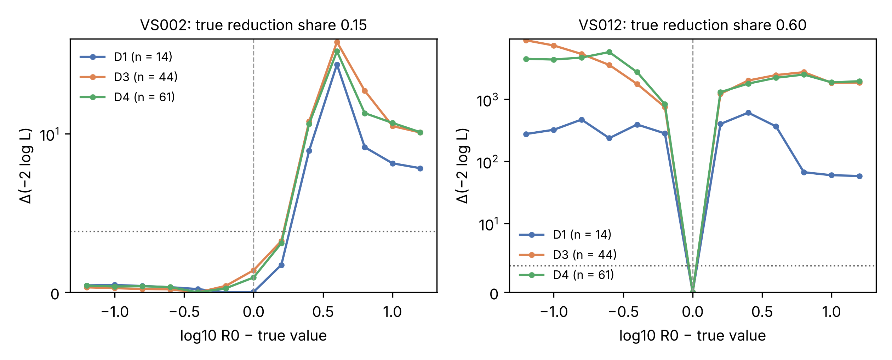

# Supplementary Material for "CASSIA: A Provenance-Aware Computational Framework for Evidence-Constrained Analysis of Cr(VI) Removal by Carbonaceous Materials"

Tables S1–S5 are generated by `scripts/run_v2.py` (CSV files in `results/v2/`); Tables S6–S10 and Fig. S1 by `scripts/run_v3.py` and `scripts/make_supp_figs.py` (CSV files in `results/v3/`). All results are synthetic or thermodynamic.

## Table S1. Simulator parameters, distributions and settings

| parameter | unit | distribution |
|---|---|---|
| qmax | mg/g | q_f * SBET/1000 * LN(0, 0.35); q_f ~ LN(ln 35, 0.3) per family and corpus |
| K0 | L/mg | 10^U(-1.3, 0) |
| ka | 1/min | 10^U(-2.3, -1.3) |
| R0 | mmol e-/g | 10^(mu_R,f + N(0, 0.3)); mu_R,f ~ U(-1.3, 0.3) per family and corpus |
| kB | L/(g min) | 10^U(-4.0, -2.3) (scenarios B, E) |
| kC | 1/min | 10^U(-3.5, -1.8) (scenarios C, E) |
| L0 | mmol e-/g | 10^(mu_L,f + N(0, 0.3)); mu_L,f ~ U(-2.5, -0.8) per family and corpus (D, E) |
| kl | 1/min | 10^U(-3.0, -1.5) |
| kD | L/(mmol e- min) | 10^U(-2.0, 0.0) (scenarios D, E) |
| pH50_red | - | U(2.0, 4.0); acid promotion h(pH) = 1/(1 + 10^(pH - pH50_red)) |
| Ea_red | kJ/mol | U(25, 50) |
| pH50_cr3 | - | U(3.5, 5.0); Cr(III) surface affinity theta3(pH) = 1/(1 + exp(-(pH - pH50_cr3)/0.5)) |
| krel | 1/min | 10^U(-3.0, -1.5); release of surface Cr(III) at rate krel (1 - theta3) q3s |
| q3max | mg/g | 0.5 qmax LN(0, 0.3) |
| K3 | L/mg | 10^U(-1.0, 0.5) |
| k3 | 1/min | 10^U(-2.5, -1.0) |
| kp | 1/min | 0.05 (fixed); precipitation/dissolution toward PHREEQC Cr(OH)3(am) solubility |
| nH | mol H+/mol Cr | U(3, 5) net protons consumed per Cr reduced (E only) |
| beta | mmol/(L pH) | 10^U(0, 1) buffer capacity (E only) |
| kbuf | 1/min | 10^U(-4.5, -3.0); proton exchange with the carbon, flux kbuf*beta*(pHpzc - pH), buffered by beta + 2.303[H+] (E only) |
| Ea_ads | kJ/mol | 15 (fixed) |
| SBET, pHpzc | m2/g, - | uniform within family ranges: AC_chemical: SBET 800-1800, pHpzc 2.5-6.0; AC_physical: SBET 400-1200, pHpzc 6.0-9.5; biochar_wood: SBET 50-500, pHpzc 6.5-9.5; biochar_manure: SBET 20-200, pHpzc 7.0-10.0; hydrochar: SBET 5-60, pHpzc 4.0-7.0; porous_carbon: SBET 800-2500, pHpzc 3.0-8.0 |
| Vp, dp | cm3/g, nm | Vp = SBET/1000 U(0.35, 0.75); dp ~ U(1.6, 6.0) |
| affinity | - | K = K0 (f_base + f[HCrO4- + Cr2O7-2]) (e_base + 1/(1 + exp((pH - pHpzc)/w_elec))); f_base 0.05, e_base 0.1, w_elec 0.8 (fixed) |
| evidence class of a study | - | C 0.40, B 0.35, A 0.25; B: total Cr on isotherm, pH-edge and dose series; A: total Cr everywhere + XPS on 3 solids + final pH |
| I | mol/L | one of 0.001, 0.005, 0.01, 0.05, 0.1; reported always (A), 50% (B), 30% (C) |
| T | K | one of 293.15-313.15 in 5 K steps |
| D | g/L | one of 0.5, 1, 2, 4 (dose series: 0.5, 1, 2, 4, 6, 8 at C0 = 20 mg/L) |
| pH_opt | - | U(1.8, 3.5): pH of isotherm, kinetic and dose series |
| t_eq | min | one of 360, 720, 1440 |
| series | - | isotherm 8 x C0 5-300 mg/L (log-spaced); pH edge 6 x pH 2-8 at 50 mg/L; kinetics 8 x t 5-t_eq; dose 6 |
| Ce_VI | - | DPC: x(1 + N(0, 0.03)) * study bias; LOD 0.01 mg/L, values < LOD reported as LOD/2 and flagged |
| Ce_total | - | AAS/ICP: (Cv + C3)(1 + N(0, 0.03)) * study bias; LOD 0.02 mg/L |
| xps_cr3_frac | - | XPS Cr(III)/(Cr(III)+Cr(VI)) on solid: true + N(0, 0.05), clipped to [0, 1] |
| pH_final | - | true final pH + N(0, 0.05) |
| study bias | - | exp(N(0, 0.05)), shared by Cr(VI) and total-Cr analyses within a study |
| numerical | - | LSODA (scipy odeint), rtol 1e-6, atol 1e-8, mxstep 20000; y0 = [C0, 0, 0, 0, 0, 0, R0, 0, 0, pH0] |

## Table S2. PHREEQC database provenance

Full SHA-256 checksums are in `databases/SHA256SUMS`.

| database | revision | sha256 | bytes | source |
|---|---|---|---|---|
| minteq.v4.dat | $Id: minteq.v4.dat 11091 2016-04-21 15:20:05Z dlpark $ | 4a48bf5c357b3da3… | 508554 | https://github.com/usgs-coupled/phreeqc3/tree/master/database |
| minteq.dat | $Id: minteq.dat 11091 2016-04-21 15:20:05Z dlpark $ | 0858232d8126f95c… | 145129 | https://github.com/usgs-coupled/phreeqc3/tree/master/database |
| llnl.dat | $Id: llnl.dat 12758 2017-08-01 22:09:36Z dlpark $ | 1324b807f0f86480… | 702804 | https://github.com/usgs-coupled/phreeqc3/tree/master/database |

## Table S3. Machine-learning settings

| model | setting |
|---|---|
| RF | n_estimators=300; min_samples_leaf=2; max_features=1.0 |
| XGB | n_estimators=500; max_depth=4; learning_rate=0.05; subsample=0.8; colsample_bytree=0.8 |
| GPR | kernel=Constant * Matern(nu=2.5, ARD) + White; n_restarts_optimizer=0; normalize_y=True; hyperparameters=optimised on a seeded 250-row subsample of each training fold, then fixed |
| tuning grid RF | [{'min_samples_leaf': 1, 'max_features': 0.33}, {'min_samples_leaf': 1, 'max_features': 0.66}, {'min_samples_leaf': 1, 'max_features': 1.0}, {'min_samples_leaf': 3, 'max_features': 0.33}, {'min_samples_leaf': 3, 'max_features': 0.66}, {'min_samples_leaf': 3, 'max_features': 1.0}, {'min_samples_leaf': 5, 'max_features': 0.33}, {'min_samples_leaf': 5, 'max_features': 0.66}, {'min_samples_leaf': 5, 'max_features': 1.0}] |
| tuning grid XGB | [{'max_depth': 3, 'learning_rate': 0.03}, {'max_depth': 3, 'learning_rate': 0.1}, {'max_depth': 5, 'learning_rate': 0.03}, {'max_depth': 5, 'learning_rate': 0.1}] |
| features (base) | C0, pH, D, t, T, log_I, I_imputed, SBET, Vp, dp, pHpzc |
| features (chem) | C0, pH, D, t, T, log_I, I_imputed, SBET, Vp, dp, pHpzc, f_HCrO4, f_CrO4, f_Cr2O7, z_mean_CrVI, pH_minus_pzc |
| target offsets | {'q_app_VI': 0.1, 'q_tot_aq': 0.1, 'Ce_VI': 0.005, 'Ce_total': 0.01} |
| seeds | random_state = 0 for all learners; corpus seeds listed in scripts/run_v2.py (SEEDS) |

## Table S4. Cr(III) solubility by direct saturation-index bisection (I = 0.01 M)

Status codes: `bracketed` (solubility found; |SI| < 0.01 at the solution); `undersaturated_to_cmax` (SI < 0 at 5,000 mg L⁻¹). No evaluation returned `speciation_failed`. All ionic strengths: `results/v2/T_cr3_solubility_SI.csv`.

| database | pH | status | S_mgL | SI_at_cmax | n_iter |
|---|---|---|---|---|---|
| minteq.v4.dat | 3.0 | undersaturated_to_cmax | undersat. ≤ 5000 | -4.36 | 0 |
| minteq.v4.dat | 3.25 | undersaturated_to_cmax | undersat. ≤ 5000 | -3.61 | 0 |
| minteq.v4.dat | 3.5 | undersaturated_to_cmax | undersat. ≤ 5000 | -2.86 | 0 |
| minteq.v4.dat | 3.75 | undersaturated_to_cmax | undersat. ≤ 5000 | -2.1 | 0 |
| minteq.v4.dat | 4.0 | undersaturated_to_cmax | undersat. ≤ 5000 | -1.35 | 0 |
| minteq.v4.dat | 4.25 | undersaturated_to_cmax | undersat. ≤ 5000 | -0.59 | 0 |
| minteq.v4.dat | 4.5 | bracketed | 15.9 | 1.22 | 10 |
| minteq.v4.dat | 4.75 | bracketed | 4.64 | 1.86 | 10 |
| minteq.v4.dat | 5.0 | bracketed | 1.42 | 1.74 | 10 |
| minteq.v4.dat | 5.25 | bracketed | 0.456 | 2.55 | 10 |
| minteq.v4.dat | 5.5 | bracketed | 0.157 | 3.32 | 10 |
| minteq.v4.dat | 5.75 | bracketed | 0.0575 | 4.0 | 10 |
| minteq.v4.dat | 6.0 | bracketed | 0.0225 | 4.6 | 10 |
| minteq.v4.dat | 6.25 | bracketed | 0.00982 | 5.13 | 10 |
| minteq.v4.dat | 6.5 | bracketed | 0.00458 | 5.61 | 10 |
| minteq.v4.dat | 6.75 | bracketed | 0.00228 | 6.04 | 10 |
| minteq.v4.dat | 7.0 | bracketed | 0.00118 | 6.41 | 10 |
| minteq.v4.dat | 7.25 | bracketed | 0.000657 | 6.72 | 10 |
| minteq.v4.dat | 7.5 | bracketed | 0.000381 | 6.99 | 10 |
| minteq.v4.dat | 7.75 | bracketed | 0.000226 | 7.24 | 10 |
| minteq.v4.dat | 8.0 | bracketed | 0.000143 | 7.46 | 10 |
| minteq.v4.dat | 8.25 | bracketed | 0.000101 | 7.64 | 10 |
| minteq.v4.dat | 8.5 | bracketed | 7.93e-05 | 7.76 | 10 |
| minteq.v4.dat | 8.75 | bracketed | 7.26e-05 | 7.81 | 10 |
| minteq.v4.dat | 9.0 | bracketed | 7.93e-05 | 7.76 | 10 |
| minteq.v4.dat | 9.25 | bracketed | 0.000103 | 7.63 | 10 |
| minteq.v4.dat | 9.5 | bracketed | 0.000146 | 7.46 | 10 |
| minteq.v4.dat | 9.75 | bracketed | 0.000231 | 7.25 | 10 |
| minteq.v4.dat | 10.0 | bracketed | 0.000381 | 7.02 | 10 |
| minteq.dat | 3.0 | undersaturated_to_cmax | undersat. ≤ 5000 | -2.1 | 0 |
| minteq.dat | 3.25 | undersaturated_to_cmax | undersat. ≤ 5000 | -1.36 | 0 |
| minteq.dat | 3.5 | undersaturated_to_cmax | undersat. ≤ 5000 | -0.62 | 0 |
| minteq.dat | 3.75 | bracketed | 4.15e+03 | 0.1 | 10 |
| minteq.dat | 4.0 | bracketed | 266 | 0.81 | 10 |
| minteq.dat | 4.25 | bracketed | 39.9 | 1.5 | 10 |
| minteq.dat | 4.5 | bracketed | 9.46 | 2.16 | 10 |
| minteq.dat | 4.75 | bracketed | 2.61 | 2.78 | 10 |
| minteq.dat | 5.0 | bracketed | 0.787 | 3.37 | 10 |
| minteq.dat | 5.25 | bracketed | 0.259 | 3.91 | 10 |
| minteq.dat | 5.5 | bracketed | 0.0949 | 4.41 | 10 |
| minteq.dat | 5.75 | bracketed | 0.038 | 4.87 | 10 |
| minteq.dat | 6.0 | bracketed | 0.0169 | 5.28 | 10 |
| minteq.dat | 6.25 | bracketed | 0.00825 | 5.64 | 10 |
| minteq.dat | 6.5 | bracketed | 0.00448 | 5.95 | 10 |
| minteq.dat | 6.75 | bracketed | 0.00271 | 6.21 | 10 |
| minteq.dat | 7.0 | bracketed | 0.00175 | 6.41 | 10 |
| minteq.dat | 7.25 | bracketed | 0.00129 | 6.57 | 10 |
| minteq.dat | 7.5 | bracketed | 0.00102 | 6.68 | 10 |
| minteq.dat | 7.75 | bracketed | 0.000873 | 6.76 | 10 |
| minteq.dat | 8.0 | bracketed | 0.000783 | 6.8 | 10 |
| minteq.dat | 8.25 | bracketed | 0.000749 | 6.83 | 10 |
| minteq.dat | 8.5 | bracketed | 0.000717 | 6.84 | 10 |
| minteq.dat | 8.75 | bracketed | 0.000717 | 6.84 | 10 |
| minteq.dat | 9.0 | bracketed | 0.000717 | 6.84 | 10 |
| minteq.dat | 9.25 | bracketed | 0.000733 | 6.83 | 10 |
| minteq.dat | 9.5 | bracketed | 0.000766 | 6.81 | 10 |
| minteq.dat | 9.75 | bracketed | 0.000836 | 6.78 | 10 |
| minteq.dat | 10.0 | bracketed | 0.000932 | 6.72 | 10 |

## Table S5. Mean per-study coverage at a nominal 90% by material family (leave-one-study-out, 10 corpora)

| target | method | AC_chemical | AC_physical | biochar_manure | biochar_wood | hydrochar | porous_carbon |
|---|---|---|---|---|---|---|---|
| Ce_VI | M0 | 0.85 | 0.9 | 0.93 | 0.92 | 0.95 | 0.86 |
| Ce_VI | M1 | 0.92 | 0.95 | 0.94 | 0.95 | 0.96 | 0.92 |
| Ce_VI | M2 | 0.98 | 0.98 | 0.97 | 0.97 | 0.98 | 0.96 |
| Ce_total | M0 | 0.78 | 0.9 | 0.98 | 0.95 | 0.99 | 0.83 |
| Ce_total | M1 | 0.87 | 0.95 | 0.98 | 0.97 | 1.0 | 0.93 |
| Ce_total | M2 | 0.92 | 0.97 | 0.99 | 0.98 | 1.0 | 0.98 |
| q_app_VI | M0 | 0.96 | 0.97 | 0.83 | 0.88 | 0.77 | 0.97 |
| q_app_VI | M1 | 0.98 | 0.99 | 0.9 | 0.92 | 0.85 | 0.98 |
| q_app_VI | M2 | 0.98 | 0.99 | 0.94 | 0.95 | 0.91 | 0.99 |
| q_tot_aq | M0 | 0.97 | 0.98 | 0.85 | 0.89 | 0.63 | 0.98 |
| q_tot_aq | M1 | 0.99 | 0.99 | 0.95 | 0.94 | 0.83 | 0.99 |
| q_tot_aq | M2 | 0.99 | 1.0 | 0.97 | 0.96 | 0.93 | 0.99 |

## Table S6. ML validation by mechanism scenario (5 corpora per scenario; R² mean ± SD)

'transfer_from_E': model trained on scenario-E corpora and tested on corpora of the given scenario.

| scenario | model | features | LOFO | LOSO | random | transfer_from_E |
|---|---|---|---|---|---|---|
| A | RF | base | 0.590 ± 0.135 | 0.679 ± 0.090 | 0.879 ± 0.021 | – |
| A | RF | chem | 0.591 ± 0.137 | 0.651 ± 0.100 | 0.865 ± 0.028 | 0.653 ± 0.070 |
| A | XGB | base | 0.432 ± 0.241 | 0.550 ± 0.188 | 0.866 ± 0.035 | – |
| A | XGB | chem | 0.504 ± 0.137 | 0.605 ± 0.102 | 0.830 ± 0.032 | 0.661 ± 0.046 |
| B | RF | base | 0.496 ± 0.101 | 0.617 ± 0.075 | 0.871 ± 0.016 | – |
| B | RF | chem | 0.461 ± 0.091 | 0.588 ± 0.085 | 0.864 ± 0.020 | 0.533 ± 0.152 |
| B | XGB | base | 0.428 ± 0.085 | 0.558 ± 0.037 | 0.850 ± 0.045 | – |
| B | XGB | chem | 0.382 ± 0.079 | 0.526 ± 0.049 | 0.858 ± 0.018 | 0.489 ± 0.109 |
| C | RF | base | 0.530 ± 0.068 | 0.566 ± 0.114 | 0.890 ± 0.031 | – |
| C | RF | chem | 0.516 ± 0.041 | 0.538 ± 0.112 | 0.878 ± 0.035 | 0.595 ± 0.100 |
| C | XGB | base | 0.511 ± 0.118 | 0.564 ± 0.119 | 0.860 ± 0.089 | – |
| C | XGB | chem | 0.466 ± 0.082 | 0.520 ± 0.106 | 0.838 ± 0.078 | 0.589 ± 0.133 |
| D | RF | base | 0.638 ± 0.132 | 0.659 ± 0.167 | 0.869 ± 0.018 | – |
| D | RF | chem | 0.632 ± 0.135 | 0.649 ± 0.174 | 0.856 ± 0.021 | 0.547 ± 0.183 |
| D | XGB | base | 0.587 ± 0.117 | 0.647 ± 0.118 | 0.867 ± 0.038 | – |
| D | XGB | chem | 0.528 ± 0.099 | 0.603 ± 0.134 | 0.846 ± 0.029 | 0.540 ± 0.131 |
| E | RF | base | 0.449 ± 0.149 | 0.515 ± 0.128 | 0.856 ± 0.040 | – |
| E | RF | chem | 0.404 ± 0.168 | 0.482 ± 0.136 | 0.855 ± 0.030 | – |
| E | XGB | base | 0.415 ± 0.154 | 0.512 ± 0.170 | 0.857 ± 0.022 | – |
| E | XGB | chem | 0.339 ± 0.130 | 0.459 ± 0.172 | 0.857 ± 0.038 | – |

**Table S6b.** Study-level coverage of apparent uptake at nominal 90% by scenario (RF, speciation features). mean_cov: mean within-study coverage; frac_ge_0.9: fraction of studies with ≥ 90% coverage; width in log₁₀ units.

| scenario | method | mean_cov | frac_ge_0.9 | width |
|---|---|---|---|---|
| A | M0 | 0.897 | 0.720 | 1.706 |
| A | M1 | 0.935 | 0.813 | 2.078 |
| A | M2 | 0.965 | 0.880 | 2.568 |
| A | M2s | 0.979 | 0.953 | 3.446 |
| B | M0 | 0.901 | 0.660 | 1.357 |
| B | M1 | 0.936 | 0.780 | 1.712 |
| B | M2 | 0.962 | 0.887 | 2.480 |
| B | M2s | 0.976 | 0.927 | 2.877 |
| C | M0 | 0.901 | 0.733 | 1.881 |
| C | M1 | 0.935 | 0.820 | 2.211 |
| C | M2 | 0.965 | 0.893 | 2.743 |
| C | M2s | 0.972 | 0.927 | 3.211 |
| D | M0 | 0.897 | 0.707 | 1.533 |
| D | M1 | 0.935 | 0.820 | 1.968 |
| D | M2 | 0.964 | 0.893 | 2.549 |
| D | M2s | 0.980 | 0.920 | 3.008 |
| E | M0 | 0.895 | 0.640 | 1.353 |
| E | M1 | 0.939 | 0.780 | 1.777 |
| E | M2 | 0.967 | 0.880 | 2.603 |
| E | M2s | 0.983 | 0.947 | 3.281 |

## Table S7. Sensitivity to the treatment of negative apparent uptake (RF, LOSO)

n_censored: observations with negative apparent uptake per corpus. 'log_LOD_full': values below LOD set to LOD; 'log_censor_LODhalf': set to LOD/2; 'log_drop_censored': removed; 'asinh_keep_negative': asinh transform without censoring.

| variant | R2 | RMSE | bias | M1_mean_cov | M1_frac_ge_0.9 | n_censored |
|---|---|---|---|---|---|---|
| asinh_keep_negative | 0.575 | 8.793 | -2.286 | 0.943 | 0.813 | 44.000 |
| log_LOD_full | 0.612 | 8.514 | -1.328 | 0.941 | 0.813 | 44.000 |
| log_censor_LODhalf | 0.610 | 8.526 | -1.332 | 0.941 | 0.813 | 44.000 |
| log_drop_censored | 0.684 | 7.783 | -1.257 | 0.939 | 0.807 | 44.000 |

## Table S8. Calibrated rejection and equivalence tests of the adsorption-only model (120 studies with paired controls; α = 0.05)

Power and equivalence rates are for studies with true reduction share 5–30% (n = 50) or > 30% (n = 51). False equivalence: fraction declared equivalent among studies whose noise-free misfit exceeds the margin; empty when no such study existed.

| noise | design | ν | χ²₀.₉₅ nominal | calibrated | type-I nominal | type-I calibrated (CV) | power 5–30% | power >30% | equiv >30% ε=0.05 | equiv >30% ε=0.10 | inconcl. >30% ε=0.10 | false equiv ε=0.05 | false equiv ε=0.10 | equiv power ε=0.10 | truly within ε=0.10 (>30%) |
|---|---|---|---|---|---|---|---|---|---|---|---|---|---|---|---|
| 0.030 | D1 | 7 | 14.067 | 14.875 | 0.092 | 0.067 | 0.280 | 0.373 | 0.588 | 0.627 | 0.000 | 0.000 | 0.000 | 0.987 | 0.902 |
| 0.030 | D2 | 12 | 21.026 | 35.475 | 0.142 | 0.100 | 0.200 | 0.353 | 0.647 | 0.647 | 0.000 | 0.000 | 0.000 | 0.991 | 0.922 |
| 0.030 | D3 | 34 | 48.602 | 68.277 | 0.150 | 0.050 | 0.760 | 0.882 | 0.118 | 0.118 | 0.000 | 0.013 | 0.000 | 0.978 | 0.392 |
| 0.030 | D4n | 49 | 66.339 | 96.760 | 0.133 | 0.125 | 0.780 | 0.941 | 0.059 | 0.059 | 0.000 | 0.012 | 0.000 | 0.982 | 0.275 |
| 0.030 | D4x | 49 | 66.339 | 85.451 | 0.108 | 0.058 | 0.800 | 0.961 | 0.039 | 0.039 | 0.000 | 0.000 | 0.000 | 0.994 | 0.294 |
| 0.030 | D5 | 52 | 69.832 | 97.174 | 0.133 | 0.067 | 0.800 | 0.961 | 0.039 | 0.039 | 0.000 | 0.011 | 0.000 | 0.988 | 0.235 |
| 0.100 | D1 | 7 | 14.067 | 15.186 | 0.092 | 0.058 | 0.140 | 0.255 | 0.039 | 0.431 | 0.314 | 0.043 | 0.000 | 0.622 | 0.843 |
| 0.100 | D2 | 12 | 21.026 | 23.453 | 0.108 | 0.083 | 0.160 | 0.235 | 0.078 | 0.627 | 0.137 | 0.000 | 0.000 | 0.821 | 0.863 |
| 0.100 | D3 | 34 | 48.602 | 56.733 | 0.083 | 0.033 | 0.580 | 0.804 | 0.000 | 0.196 | 0.000 | 0.012 | 0.000 | 0.892 | 0.392 |
| 0.100 | D4n | 49 | 66.339 | 70.114 | 0.092 | 0.033 | 0.760 | 0.922 | 0.020 | 0.078 | 0.000 | 0.000 | 0.000 | 0.975 | 0.157 |
| 0.100 | D4x | 49 | 66.339 | 68.844 | 0.067 | 0.067 | 0.700 | 0.902 | 0.000 | 0.098 | 0.000 | 0.000 | 0.000 | 0.957 | 0.196 |
| 0.100 | D5 | 52 | 69.832 | 74.822 | 0.092 | 0.067 | 0.740 | 0.922 | 0.020 | 0.078 | 0.000 | 0.000 | 0.000 | 0.956 | 0.176 |

## Table S9. Operating characteristic of the sequential verification rules

Probability of accepting a design within four rounds when both true concentrations are at the stated ratio to their limits (20,000 simulated sequences per point, `scripts/seqver_oc.py`; 3% random and 5% calibration error). v2_ratio_n2: duplicates, mean ≤ 0.9·limit; ucb_n3_bonf: triplicates, Bonferroni upper confidence bound ≤ limit.

| true / limit | ucb_n3_bonf (independent) | ucb_n3_bonf (shared) | v2_ratio_n2 (independent) | v2_ratio_n2 (shared) |
|---|---|---|---|---|
| 0.700 | 1.000 | 1.000 | 1.000 | 1.000 |
| 0.800 | 0.964 | 0.973 | 0.992 | 0.992 |
| 0.900 | 0.166 | 0.366 | 0.407 | 0.590 |
| 0.950 | 0.009 | 0.081 | 0.057 | 0.203 |
| 1.000 | 0.000 | 0.008 | 0.002 | 0.037 |
| 1.050 | 0.000 | 0.000 | 0.000 | 0.002 |
| 1.100 | 0.000 | 0.000 | 0.000 | 0.000 |
| 1.200 | 0.000 | 0.000 | 0.000 | 0.000 |
| 1.300 | 0.000 | 0.000 | 0.000 | 0.000 |
| 1.500 | 0.000 | 0.000 | 0.000 | 0.000 |

## Table S10. Cr(VI) speciation by background electrolyte (minteq.v4; total Cr(VI) 10 mg L⁻¹)

| electrolyte | I | pH | f_HCrO4 | f_CrO4 | f_Cr2O7 | f_CrO3SO4 |
|---|---|---|---|---|---|---|
| NaCl | 0.010 | 3.000 | 0.982 | 0.000 | 0.017 | 0.000 |
| NaCl | 0.010 | 5.000 | 0.944 | 0.039 | 0.015 | 0.000 |
| NaCl | 0.010 | 6.500 | 0.422 | 0.556 | 0.003 | 0.000 |
| NaCl | 0.100 | 3.000 | 0.972 | 0.001 | 0.027 | 0.000 |
| NaCl | 0.100 | 5.000 | 0.913 | 0.052 | 0.023 | 0.000 |
| NaCl | 0.100 | 6.500 | 0.313 | 0.566 | 0.003 | 0.000 |
| NaNO3 | 0.010 | 3.000 | 0.982 | 0.000 | 0.017 | 0.000 |
| NaNO3 | 0.010 | 5.000 | 0.944 | 0.039 | 0.015 | 0.000 |
| NaNO3 | 0.010 | 6.500 | 0.422 | 0.556 | 0.003 | 0.000 |
| NaNO3 | 0.100 | 3.000 | 0.972 | 0.001 | 0.027 | 0.000 |
| NaNO3 | 0.100 | 5.000 | 0.913 | 0.052 | 0.023 | 0.000 |
| NaNO3 | 0.100 | 6.500 | 0.313 | 0.566 | 0.003 | 0.000 |
| Na2SO4 | 0.010 | 3.000 | 0.981 | 0.000 | 0.017 | 0.001 |
| Na2SO4 | 0.010 | 5.000 | 0.945 | 0.039 | 0.015 | 0.000 |
| Na2SO4 | 0.010 | 6.500 | 0.425 | 0.559 | 0.003 | 0.000 |
| Na2SO4 | 0.100 | 3.000 | 0.964 | 0.001 | 0.025 | 0.010 |
| Na2SO4 | 0.100 | 5.000 | 0.918 | 0.052 | 0.023 | 0.000 |
| Na2SO4 | 0.100 | 6.500 | 0.328 | 0.590 | 0.003 | 0.000 |

## Table S11. True partition of Cr(VI) disappearance by mechanism scenario (isotherm series, mass-weighted; 3,000 virtual studies per scenario)

`scripts/bench_partition.py`. 'reduced (total)' = dissolved Cr(III) + Cr(III) on solid + precipitate.

| scenario | component | median | p05 | p95 | mean |
|---|---|---|---|---|---|
| A | adsorbed Cr(VI) | 1.000 | 1.000 | 1.000 | 1.000 |
| A | reduced (total) | 0.000 | 0.000 | 0.000 | 0.000 |
| A | dissolved Cr(III) | 0.000 | 0.000 | 0.000 | 0.000 |
| A | Cr(III) on solid | 0.000 | 0.000 | 0.000 | 0.000 |
| A | precipitated Cr(III) | 0.000 | 0.000 | 0.000 | 0.000 |
| B | adsorbed Cr(VI) | 0.755 | 0.077 | 0.981 | 0.649 |
| B | reduced (total) | 0.245 | 0.019 | 0.923 | 0.351 |
| B | dissolved Cr(III) | 0.220 | 0.007 | 0.913 | 0.331 |
| B | Cr(III) on solid | 0.010 | 0.001 | 0.073 | 0.020 |
| B | precipitated Cr(III) | 0.000 | 0.000 | 0.000 | 0.000 |
| C | adsorbed Cr(VI) | 0.781 | 0.249 | 0.969 | 0.716 |
| C | reduced (total) | 0.219 | 0.031 | 0.751 | 0.284 |
| C | dissolved Cr(III) | 0.132 | 0.008 | 0.617 | 0.199 |
| C | Cr(III) on solid | 0.051 | 0.005 | 0.299 | 0.085 |
| C | precipitated Cr(III) | 0.000 | 0.000 | 0.000 | 0.000 |
| D | adsorbed Cr(VI) | 0.961 | 0.456 | 0.998 | 0.883 |
| D | reduced (total) | 0.039 | 0.002 | 0.544 | 0.117 |
| D | dissolved Cr(III) | 0.028 | 0.001 | 0.530 | 0.109 |
| D | Cr(III) on solid | 0.003 | 0.000 | 0.035 | 0.008 |
| D | precipitated Cr(III) | 0.000 | 0.000 | 0.000 | 0.000 |
| E | adsorbed Cr(VI) | 0.623 | 0.065 | 0.949 | 0.571 |
| E | reduced (total) | 0.377 | 0.051 | 0.935 | 0.429 |
| E | dissolved Cr(III) | 0.242 | 0.006 | 0.903 | 0.338 |
| E | Cr(III) on solid | 0.045 | 0.003 | 0.247 | 0.075 |
| E | precipitated Cr(III) | 0.000 | 0.000 | 0.065 | 0.017 |

## Table S12. Monte Carlo precision of the mechanism benchmark (R = 100 replicate corpora per scenario)

MCSE = between-replicate SD/√R; R_needed = (1.96·SD/h)² replicates for a 95% half-width h (target_95_halfwidth).

| scenario | quantity | estimate | between_rep_SD | R | MCSE | target_95_halfwidth | R_needed |
|---|---|---|---|---|---|---|---|
| A | P(R2>=0.95) | 0.467 | 0.077 | 100 | 0.008 | 0.010 | 228 |
| B | P(R2>=0.95) | 0.588 | 0.088 | 100 | 0.009 | 0.010 | 298 |
| B | P(R2>=0.95 given share_red>0.2) | 0.454 | 0.147 | 100 | 0.015 | 0.020 | 209 |
| B | mean reduction share | 0.351 | 0.056 | 100 | 0.006 | 0.010 | 120 |
| B | Spearman(share_red, qmax ratio) | 0.603 | 0.194 | 100 | 0.019 | 0.050 | 58 |
| C | P(R2>=0.95) | 0.496 | 0.081 | 100 | 0.008 | 0.010 | 252 |
| C | P(R2>=0.95 given share_red>0.2) | 0.408 | 0.137 | 100 | 0.014 | 0.020 | 182 |
| C | mean reduction share | 0.284 | 0.056 | 100 | 0.006 | 0.010 | 120 |
| C | Spearman(share_red, qmax ratio) | 0.320 | 0.195 | 100 | 0.019 | 0.050 | 59 |
| D | P(R2>=0.95) | 0.467 | 0.083 | 100 | 0.008 | 0.010 | 268 |
| D | P(R2>=0.95 given share_red>0.2) | 0.161 | 0.183 | 100 | 0.018 | 0.020 | 323 |
| D | mean reduction share | 0.117 | 0.047 | 100 | 0.005 | 0.010 | 85 |
| D | Spearman(share_red, qmax ratio) | 0.129 | 0.203 | 100 | 0.020 | 0.050 | 64 |
| E | P(R2>=0.95) | 0.593 | 0.096 | 100 | 0.010 | 0.010 | 357 |
| E | P(R2>=0.95 given share_red>0.2) | 0.518 | 0.125 | 100 | 0.013 | 0.020 | 151 |
| E | mean reduction share | 0.429 | 0.057 | 100 | 0.006 | 0.010 | 127 |
| E | Spearman(share_red, qmax ratio) | 0.632 | 0.174 | 100 | 0.017 | 0.050 | 47 |

## Table S13. Out-of-study accuracy of the four endpoint models (RF, speciation features; 10 corpora; mean over corpora)

`scripts/endpoint_validation.py`. Total-Cr models are trained only on rows with a total-Cr measurement (Class A/B studies; n_studies per corpus). R² and errors on the log₁₀ scale of the modelled transform, and R² on the linear scale.

| target | scheme | n_studies | R2_log10 | R2_log10_sd | R2_linear | RMSE_log10 | MedAE_log10 | bias_log10 |
|---|---|---|---|---|---|---|---|---|
| Ce_VI | LOSO | 30.000 | 0.736 | 0.063 | 0.872 | 0.494 | 0.175 | -0.002 |
| Ce_VI | random | 30.000 | 0.938 | 0.012 | 0.942 | 0.241 | 0.067 | 0.000 |
| Ce_total | LOSO | 17.900 | 0.645 | 0.093 | 0.847 | 0.366 | 0.142 | -0.011 |
| Ce_total | random | 17.900 | 0.911 | 0.014 | 0.925 | 0.185 | 0.058 | 0.001 |
| q_app_VI | LOSO | 30.000 | 0.386 | 0.161 | 0.558 | 0.505 | 0.166 | -0.009 |
| q_app_VI | random | 30.000 | 0.767 | 0.048 | 0.836 | 0.310 | 0.073 | 0.003 |
| q_tot_aq | LOSO | 17.900 | 0.416 | 0.169 | 0.524 | 0.523 | 0.221 | -0.006 |
| q_tot_aq | random | 17.900 | 0.753 | 0.065 | 0.827 | 0.338 | 0.109 | 0.001 |

## Fig. S1. Profile likelihoods of the reductant capacity

**Fig. S1.** Profile of Δ(−2 log L) against log₁₀ R₀ relative to its true value for two virtual studies (true reduction share 0.15 and 0.60) under designs D1, D3 and D4u (D4u: unbiased solid oxidation state). Dotted line: χ²₁ 95% threshold (3.84); symmetric-log axis. Non-smooth peaks indicate local optima at individual profile points; the true profile lies at or below the plotted curve, so the profiles are indicative only. The mechanistic model structure is assumed known.
