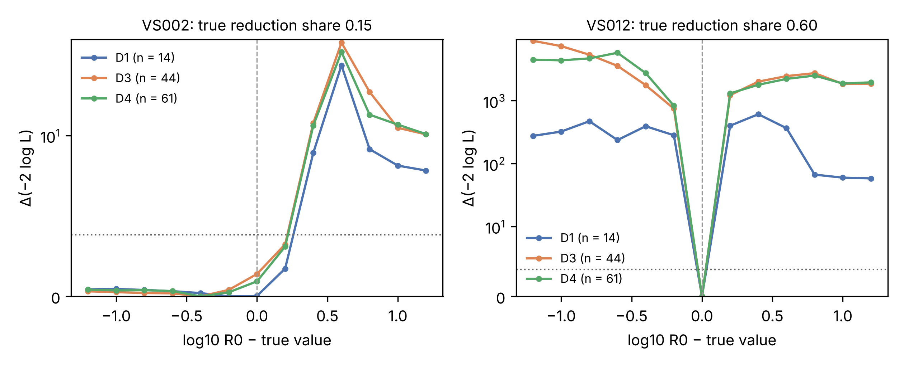
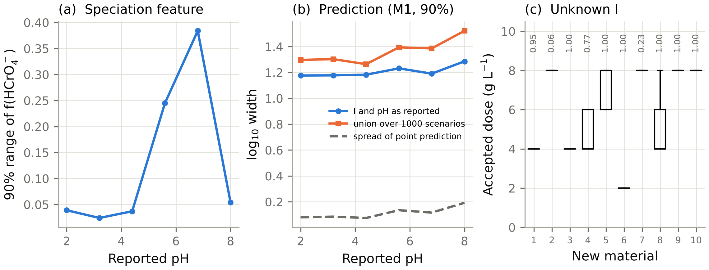

# Supplementary Material for "CASSIA: A Provenance-Aware Computational Framework and Known-Truth Benchmark for Evidence-Constrained Analysis of Cr(VI) Removal by Carbonaceous Materials"

All results in this supplement are synthetic (known-truth simulations) or thermodynamic (PHREEQC); none is an empirical result. Every table is regenerated by `scripts/reproduce_all.sh` (manuscript Table 2). Sources by table:

| Tables | Generating script | CSV files |
|---|---|---|
| S1 | `scripts/make_table_s1.py` (from `cassia.simulate.parameter_table()`, CASSIA 0.3.8) | `results/v3/T_S1_simulator_parameters.csv` |
| S2–S5 | `scripts/run_v2.py` | `results/v2/` |
| S5b | `scripts/m2s_family.py` (from `run_v3.py` stage m2s) | `results/v3/T_m2s_family_full.csv` |
| S5c | `scripts/m2s_exchangeability.py` | `results/v3/T_m2s_exchangeability.csv` |
| S5d | `scripts/m2s_exchangeability.py` | `results/v3/T_m2s_roles_summary.csv` |
| S6–S8, S10 | `scripts/run_v3.py` (stages mlscen, censor, equiv3, chem3) | `results/v3/` |
| S9 | `scripts/seqver_oc.py` | `results/v3/T_seqver_oc.csv` |
| S11–S12 | `scripts/bench_partition.py` | `results/v3/T_bench_partition.csv`, `T_bench_mcse.csv` |
| S13 | `scripts/endpoint_validation.py` | `results/v3/T_endpoint_validation.csv` |
| S14 | `scripts/typeI_validation.py` | `results/v3/T_typeI_validation.csv` |
| S14b | `scripts/typeI_corpus.py` (from the S14 controls; no refitting) | `results/v3/T_typeI_corpus.csv`, `typeI_corpus.json` |
| S16 | `scripts/meas_sensitivity.py` | `results/v3/T_meas_sensitivity.csv`, `meas_sens_*.csv.gz` |
| S15 (Note S3) | `scripts/run_v3.py` (stage seqver) | `results/v3/T_seqver_summary.csv`, `seqver.csv` |
| Fig. S1 | `scripts/make_supp_figs.py` | `results/v2/ident_profiles.csv` |
| Fig. S2 (Note S2) | `scripts/run_v3.py` (stage figures) | `results/v2/` (missing chemistry) |

Supplementary Notes S1–S3 give the goodness-of-fit and equivalence tests of the adsorption-only model, the full methods and results of the propagation of unreported chemistry (manuscript §2.10 and §3.7) and the sequential verification of accepted designs (§3.6).

## Table S1. Simulator parameters, distributions, measurement models, evidence-class probabilities and numerical settings (CASSIA 0.3.8)

Generated from the implementation by `scripts/make_table_s1.py`; a unit test checks that the evidence-class probabilities and measurement-model constants in this table are those used by the code. LN(m, s): log-normal with log-mean m and log-SD s; U(a, b): uniform; N(0, s): normal.

| parameter | unit | distribution |
|---|---|---|
| qmax | mg/g | q_f * SBET/1000 * LN(0, 0.35); q_f ~ LN(ln 35, 0.3) per family and corpus |
| K0 | L/mg | 10^U(-1.3, 0) |
| ka | 1/min | 10^U(-2.3, -1.3) |
| R0 | mmol e-/g | 10^(mu_R,f + N(0, 0.3)); mu_R,f ~ U(-1.3, 0.3) per family and corpus |
| kB | L/(g min) | 10^U(-4.0, -2.3) (scenarios B, E) |
| kC | 1/min | 10^U(-3.5, -1.8) (scenarios C, E) |
| L0 | mmol e-/g | 10^(mu_L,f + N(0, 0.3)); mu_L,f ~ U(-2.5, -0.8) per family and corpus (D, E) |
| kl | 1/min | 10^U(-3.0, -1.5) |
| kD | L/(mmol e- min) | 10^U(-2.0, 0.0) (scenarios D, E) |
| pH50_red | - | U(2.0, 4.0); acid promotion h(pH) = 1/(1 + 10^(pH - pH50_red)) |
| Ea_red | kJ/mol | U(25, 50) |
| pH50_cr3 | - | U(3.5, 5.0); Cr(III) surface affinity theta3(pH) = 1/(1 + exp(-(pH - pH50_cr3)/0.5)) |
| krel | 1/min | 10^U(-3.0, -1.5); release of surface Cr(III) at rate krel (1 - theta3) q3s |
| q3max | mg/g | 0.5 qmax LN(0, 0.3) |
| K3 | L/mg | 10^U(-1.0, 0.5) |
| k3 | 1/min | 10^U(-2.5, -1.0) |
| kp | 1/min | 0.05 (fixed); precipitation/dissolution toward PHREEQC Cr(OH)3(am) solubility |
| nH | mol H+/mol Cr | U(3, 5) net protons consumed per Cr reduced (E only) |
| beta | mmol/(L pH) | 10^U(0, 1) buffer capacity (E only) |
| kbuf | 1/min | 10^U(-4.5, -3.0); proton exchange with the carbon, flux kbuf*beta*(pHpzc - pH), buffered by beta + 2.303[H+] (E only) |
| Ea_ads | kJ/mol | 15 (fixed) |
| SBET, pHpzc | m2/g, - | uniform within family ranges: AC_chemical: SBET 800-1800, pHpzc 2.5-6.0; AC_physical: SBET 400-1200, pHpzc 6.0-9.5; biochar_wood: SBET 50-500, pHpzc 6.5-9.5; biochar_manure: SBET 20-200, pHpzc 7.0-10.0; hydrochar: SBET 5-60, pHpzc 4.0-7.0; porous_carbon: SBET 800-2500, pHpzc 3.0-8.0 |
| Vp, dp | cm3/g, nm | Vp = SBET/1000 U(0.35, 0.75); dp ~ U(1.6, 6.0) |
| affinity | - | K = K0 (f_base + f[HCrO4- + Cr2O7-2]) (e_base + 1/(1 + exp((pH - pHpzc)/w_elec))); f_base 0.05, e_base 0.1, w_elec 0.8 (fixed) |
| evidence class of a study | - | C 0.40, B 0.30, A1 0.20, A2 0.10; B: total aqueous Cr on isotherm, pH-edge and dose series; A1: B + solid oxidation state on 3 solids (XPS or XANES, probability 0.5 each) + final pH + total Cr on kinetics; A2: A1 with XANES + solid Cr inventory + phase evidence on the same 3 solids |
| I | mol/L | one of 0.001, 0.005, 0.01, 0.05, 0.1; reported always (A1, A2), 50% (B), 30% (C) |
| final pH reported | - | always (A1, A2), 50% (B), never (C) |
| corpus composition | - | 30 studies per corpus, families assigned in rotation (5 studies per family); one material per study |
| family hyper-priors | - | redrawn per corpus and family: q_f ~ LN(ln 35, 0.3), mu_R,f ~ U(-1.3, 0.3), mu_L,f ~ U(-2.5, -0.8) |
| scenario switches | - | A: kB = kC = kD = 0; B: kC = kD = 0; C: kB = kD = 0; D: kB = kC = 0; E: all pathways |
| T | K | one of 293.15-313.15 in 5 K steps |
| D | g/L | one of 0.5, 1, 2, 4 (dose series: 0.5, 1, 2, 4, 6, 8 at C0 = 20 mg/L) |
| pH_opt | - | U(1.8, 3.5): pH of isotherm, kinetic and dose series |
| t_eq | min | one of 360, 720, 1440 |
| series | - | isotherm 8 x C0 5-300 mg/L (log-spaced); pH edge 6 x pH 2-8 at 50 mg/L; kinetics 8 x t 5-t_eq; dose 6 |
| Ce_VI | - | DPC: x(1 + N(0, 0.03)) * study bias; LOD 0.01 mg/L, values < LOD reported as LOD/2 and flagged |
| Ce_total | - | AAS/ICP: (Cv + C3)(1 + N(0, 0.03)) * study bias; LOD 0.02 mg/L |
| xps_cr3_frac | - | XPS (surface): f_obs = f_s + b (1 - f_s) + N(0, 0.05), clipped to [0, 1]; f_s = e f/(e f + 1 - f); per-study enrichment e ~ LN(0, 0.4), beam/vacuum reduction b ~ U(0, 0.15) |
| xanes_cr3_frac | - | XANES (bulk, LCF): f_obs = f + b (1 - f) + N(0, 0.03), clipped; b ~ U(0, 0.03); no enrichment |
| solid_cr_mgg | - | solid Cr inventory (digestion + total-Cr analysis): true inventory (1 + N(0, 0.05)) |
| cr3_precip_frac | - | phase/coordination evidence: precipitated share of solid Cr(III) + N(0, 0.1), clipped |
| pH_final | - | true final pH + N(0, 0.05) |
| study bias | - | exp(N(0, 0.05)), shared by Cr(VI) and total-Cr analyses within a study |
| numerical | - | LSODA (scipy odeint), rtol 1e-6, atol 1e-8, mxstep 20000; y0 = [C0, 0, 0, 0, 0, 0, R0, 0, 0, pH0] |

## Table S2. PHREEQC database provenance

Full SHA-256 checksums are in `databases/SHA256SUMS`.

| database | revision | sha256 | bytes | source |
|---|---|---|---|---|
| minteq.v4.dat | $Id: minteq.v4.dat 11091 2016-04-21 15:20:05Z dlpark $ | 4a48bf5c357b3da3… | 508554 | https://github.com/usgs-coupled/phreeqc3/tree/master/database |
| minteq.dat | $Id: minteq.dat 11091 2016-04-21 15:20:05Z dlpark $ | 0858232d8126f95c… | 145129 | https://github.com/usgs-coupled/phreeqc3/tree/master/database |
| llnl.dat | $Id: llnl.dat 12758 2017-08-01 22:09:36Z dlpark $ | 1324b807f0f86480… | 702804 | https://github.com/usgs-coupled/phreeqc3/tree/master/database |

## Table S3. Machine-learning settings

| model | setting |
|---|---|
| RF | n_estimators=300; min_samples_leaf=2; max_features=1.0 |
| XGB | n_estimators=500; max_depth=4; learning_rate=0.05; subsample=0.8; colsample_bytree=0.8 |
| GPR | kernel=Constant * Matern(nu=2.5, ARD) + White; n_restarts_optimizer=0; normalize_y=True; hyperparameters=optimised on a seeded 250-row subsample of each training fold, then fixed |
| tuning grid RF | [{'min_samples_leaf': 1, 'max_features': 0.33}, {'min_samples_leaf': 1, 'max_features': 0.66}, {'min_samples_leaf': 1, 'max_features': 1.0}, {'min_samples_leaf': 3, 'max_features': 0.33}, {'min_samples_leaf': 3, 'max_features': 0.66}, {'min_samples_leaf': 3, 'max_features': 1.0}, {'min_samples_leaf': 5, 'max_features': 0.33}, {'min_samples_leaf': 5, 'max_features': 0.66}, {'min_samples_leaf': 5, 'max_features': 1.0}] |
| tuning grid XGB | [{'max_depth': 3, 'learning_rate': 0.03}, {'max_depth': 3, 'learning_rate': 0.1}, {'max_depth': 5, 'learning_rate': 0.03}, {'max_depth': 5, 'learning_rate': 0.1}] |
| features (base) | C0, pH, D, t, T, log_I, I_imputed, SBET, Vp, dp, pHpzc |
| features (chem) | C0, pH, D, t, T, log_I, I_imputed, SBET, Vp, dp, pHpzc, f_HCrO4, f_CrO4, f_Cr2O7, z_mean_CrVI, pH_minus_pzc |
| target offsets | {'q_app_VI': 0.1, 'q_tot_aq': 0.1, 'Ce_VI': 0.005, 'Ce_total': 0.01} |
| seeds | random_state = 0 for all learners; corpus seeds listed in scripts/run_v2.py (SEEDS) |

## Table S4. Cr(III) solubility by direct saturation-index bisection (I = 0.01 M)

Status codes: `bracketed` (solubility found; |SI| < 0.01 at the solution); `undersaturated_to_cmax` (SI < 0 at 5,000 mg L⁻¹). No evaluation returned `speciation_failed`. All ionic strengths: `results/v2/T_cr3_solubility_SI.csv`.

| database | pH | status | S_mgL | SI_at_cmax | n_iter |
|---|---|---|---|---|---|
| minteq.v4.dat | 3.0 | undersaturated_to_cmax | undersat. ≤ 5000 | -4.36 | 0 |
| minteq.v4.dat | 3.25 | undersaturated_to_cmax | undersat. ≤ 5000 | -3.61 | 0 |
| minteq.v4.dat | 3.5 | undersaturated_to_cmax | undersat. ≤ 5000 | -2.86 | 0 |
| minteq.v4.dat | 3.75 | undersaturated_to_cmax | undersat. ≤ 5000 | -2.1 | 0 |
| minteq.v4.dat | 4.0 | undersaturated_to_cmax | undersat. ≤ 5000 | -1.35 | 0 |
| minteq.v4.dat | 4.25 | undersaturated_to_cmax | undersat. ≤ 5000 | -0.59 | 0 |
| minteq.v4.dat | 4.5 | bracketed | 15.9 | 1.22 | 10 |
| minteq.v4.dat | 4.75 | bracketed | 4.64 | 1.86 | 10 |
| minteq.v4.dat | 5.0 | bracketed | 1.42 | 1.74 | 10 |
| minteq.v4.dat | 5.25 | bracketed | 0.456 | 2.55 | 10 |
| minteq.v4.dat | 5.5 | bracketed | 0.157 | 3.32 | 10 |
| minteq.v4.dat | 5.75 | bracketed | 0.0575 | 4.0 | 10 |
| minteq.v4.dat | 6.0 | bracketed | 0.0225 | 4.6 | 10 |
| minteq.v4.dat | 6.25 | bracketed | 0.00982 | 5.13 | 10 |
| minteq.v4.dat | 6.5 | bracketed | 0.00458 | 5.61 | 10 |
| minteq.v4.dat | 6.75 | bracketed | 0.00228 | 6.04 | 10 |
| minteq.v4.dat | 7.0 | bracketed | 0.00118 | 6.41 | 10 |
| minteq.v4.dat | 7.25 | bracketed | 0.000657 | 6.72 | 10 |
| minteq.v4.dat | 7.5 | bracketed | 0.000381 | 6.99 | 10 |
| minteq.v4.dat | 7.75 | bracketed | 0.000226 | 7.24 | 10 |
| minteq.v4.dat | 8.0 | bracketed | 0.000143 | 7.46 | 10 |
| minteq.v4.dat | 8.25 | bracketed | 0.000101 | 7.64 | 10 |
| minteq.v4.dat | 8.5 | bracketed | 7.93e-05 | 7.76 | 10 |
| minteq.v4.dat | 8.75 | bracketed | 7.26e-05 | 7.81 | 10 |
| minteq.v4.dat | 9.0 | bracketed | 7.93e-05 | 7.76 | 10 |
| minteq.v4.dat | 9.25 | bracketed | 0.000103 | 7.63 | 10 |
| minteq.v4.dat | 9.5 | bracketed | 0.000146 | 7.46 | 10 |
| minteq.v4.dat | 9.75 | bracketed | 0.000231 | 7.25 | 10 |
| minteq.v4.dat | 10.0 | bracketed | 0.000381 | 7.02 | 10 |
| minteq.dat | 3.0 | undersaturated_to_cmax | undersat. ≤ 5000 | -2.1 | 0 |
| minteq.dat | 3.25 | undersaturated_to_cmax | undersat. ≤ 5000 | -1.36 | 0 |
| minteq.dat | 3.5 | undersaturated_to_cmax | undersat. ≤ 5000 | -0.62 | 0 |
| minteq.dat | 3.75 | bracketed | 4.15e+03 | 0.1 | 10 |
| minteq.dat | 4.0 | bracketed | 266 | 0.81 | 10 |
| minteq.dat | 4.25 | bracketed | 39.9 | 1.5 | 10 |
| minteq.dat | 4.5 | bracketed | 9.46 | 2.16 | 10 |
| minteq.dat | 4.75 | bracketed | 2.61 | 2.78 | 10 |
| minteq.dat | 5.0 | bracketed | 0.787 | 3.37 | 10 |
| minteq.dat | 5.25 | bracketed | 0.259 | 3.91 | 10 |
| minteq.dat | 5.5 | bracketed | 0.0949 | 4.41 | 10 |
| minteq.dat | 5.75 | bracketed | 0.038 | 4.87 | 10 |
| minteq.dat | 6.0 | bracketed | 0.0169 | 5.28 | 10 |
| minteq.dat | 6.25 | bracketed | 0.00825 | 5.64 | 10 |
| minteq.dat | 6.5 | bracketed | 0.00448 | 5.95 | 10 |
| minteq.dat | 6.75 | bracketed | 0.00271 | 6.21 | 10 |
| minteq.dat | 7.0 | bracketed | 0.00175 | 6.41 | 10 |
| minteq.dat | 7.25 | bracketed | 0.00129 | 6.57 | 10 |
| minteq.dat | 7.5 | bracketed | 0.00102 | 6.68 | 10 |
| minteq.dat | 7.75 | bracketed | 0.000873 | 6.76 | 10 |
| minteq.dat | 8.0 | bracketed | 0.000783 | 6.8 | 10 |
| minteq.dat | 8.25 | bracketed | 0.000749 | 6.83 | 10 |
| minteq.dat | 8.5 | bracketed | 0.000717 | 6.84 | 10 |
| minteq.dat | 8.75 | bracketed | 0.000717 | 6.84 | 10 |
| minteq.dat | 9.0 | bracketed | 0.000717 | 6.84 | 10 |
| minteq.dat | 9.25 | bracketed | 0.000733 | 6.83 | 10 |
| minteq.dat | 9.5 | bracketed | 0.000766 | 6.81 | 10 |
| minteq.dat | 9.75 | bracketed | 0.000836 | 6.78 | 10 |
| minteq.dat | 10.0 | bracketed | 0.000932 | 6.72 | 10 |

## Table S5. Mean per-study coverage at a nominal 90% by material family (leave-one-study-out, 10 corpora)

| target | method | AC_chemical | AC_physical | biochar_manure | biochar_wood | hydrochar | porous_carbon |
|---|---|---|---|---|---|---|---|
| Ce_VI | M0 | 0.85 | 0.9 | 0.93 | 0.92 | 0.95 | 0.86 |
| Ce_VI | M1 | 0.92 | 0.95 | 0.94 | 0.95 | 0.96 | 0.92 |
| Ce_VI | M2 | 0.98 | 0.98 | 0.97 | 0.97 | 0.98 | 0.96 |
| Ce_total | M0 | 0.78 | 0.9 | 0.98 | 0.95 | 0.99 | 0.83 |
| Ce_total | M1 | 0.87 | 0.95 | 0.98 | 0.97 | 1.0 | 0.93 |
| Ce_total | M2 | 0.92 | 0.97 | 0.99 | 0.98 | 1.0 | 0.98 |
| q_app_VI | M0 | 0.96 | 0.97 | 0.83 | 0.88 | 0.77 | 0.97 |
| q_app_VI | M1 | 0.98 | 0.99 | 0.9 | 0.92 | 0.85 | 0.98 |
| q_app_VI | M2 | 0.98 | 0.99 | 0.94 | 0.95 | 0.91 | 0.99 |
| q_tot_aq | M0 | 0.97 | 0.98 | 0.85 | 0.89 | 0.63 | 0.98 |
| q_tot_aq | M1 | 0.99 | 0.99 | 0.95 | 0.94 | 0.83 | 0.99 |
| q_tot_aq | M2 | 0.99 | 1.0 | 0.97 | 0.96 | 0.93 | 0.99 |

## Table S5b. M2s (exact study-level split conformal) by material family at nominal 90% (10 corpora, outer leave-one-study-out; one fixed-seed calibration split per corpus, a single realisation of the role assignment; role-averaged family rates are in Table S5c)

Fraction of test studies with ≥ 90% within-study coverage, mean within-study coverage, fraction of unbounded intervals (counted as full coverage) and mean width of bounded intervals (on the modelling scale log₁₀(y + c), manuscript §2.7). Three 95% intervals for the fraction: a corpus-cluster percentile bootstrap (the contributing corpora, number in parentheses: 10, or 9 for hydrochar on the total-Cr endpoints, resampled with replacement, 4,000 resamples), which respects the sharing of family hyper-priors by the studies of a corpus; the Wilson interval, descriptive only, which treats the studies of a family as independent Bernoulli observations; and the envelope of the two (lower = smaller, upper = larger), which is the interval reported in the text. With only 10 independent corpora the cluster bootstrap is itself imprecise and collapses to a point when every study of a family covers, so the family comparisons remain descriptive.

| target | family | studies (corpora) | mean coverage | fraction ≥ 0.90 | 95% envelope (reported) | 95% cluster bootstrap | 95% Wilson (descriptive) | fraction unbounded | mean width (log₁₀, bounded) |
|---|---|---|---|---|---|---|---|---|---|
| Ce VI | AC chemical | 50 (10) | 0.99 | 0.960 | 0.86–1.00 | 0.90–1.00 | 0.86–0.99 | 0.00 | 4.00 |
| Ce VI | AC physical | 50 (10) | 1.00 | 1.000 | 0.93–1.00 | 1.00–1.00 | 0.93–1.00 | 0.00 | 4.01 |
| Ce VI | biochar manure | 50 (10) | 0.99 | 0.960 | 0.86–1.00 | 0.90–1.00 | 0.86–0.99 | 0.00 | 3.92 |
| Ce VI | biochar wood | 50 (10) | 0.98 | 0.920 | 0.81–0.98 | 0.86–0.98 | 0.81–0.97 | 0.00 | 3.91 |
| Ce VI | hydrochar | 50 (10) | 0.99 | 0.940 | 0.84–1.00 | 0.88–1.00 | 0.84–0.98 | 0.00 | 3.94 |
| Ce VI | porous carbon | 50 (10) | 0.96 | 0.900 | 0.79–0.98 | 0.80–0.98 | 0.79–0.96 | 0.00 | 3.88 |
| Ce total | AC chemical | 29 (10) | 0.99 | 1.000 | 0.88–1.00 | 1.00–1.00 | 0.88–1.00 | 0.62 | 2.04 |
| Ce total | AC physical | 29 (10) | 0.99 | 0.931 | 0.78–1.00 | 0.84–1.00 | 0.78–0.98 | 0.66 | 2.12 |
| Ce total | biochar manure | 31 (10) | 1.00 | 0.968 | 0.84–1.00 | 0.91–1.00 | 0.84–0.99 | 0.65 | 2.24 |
| Ce total | biochar wood | 29 (10) | 1.00 | 1.000 | 0.88–1.00 | 1.00–1.00 | 0.88–1.00 | 0.66 | 2.28 |
| Ce total | hydrochar | 31 (9) | 0.99 | 1.000 | 0.89–1.00 | 1.00–1.00 | 0.89–1.00 | 0.65 | 2.16 |
| Ce total | porous carbon | 30 (10) | 0.99 | 0.967 | 0.83–1.00 | 0.91–1.00 | 0.83–0.99 | 0.53 | 2.21 |
| q app VI | AC chemical | 50 (10) | 0.99 | 0.980 | 0.90–1.00 | 0.94–1.00 | 0.90–1.00 | 0.00 | 3.27 |
| q app VI | AC physical | 50 (10) | 0.98 | 0.960 | 0.86–1.00 | 0.90–1.00 | 0.86–0.99 | 0.00 | 3.26 |
| q app VI | biochar manure | 50 (10) | 0.97 | 0.900 | 0.79–0.98 | 0.80–0.98 | 0.79–0.96 | 0.00 | 3.39 |
| q app VI | biochar wood | 50 (10) | 0.98 | 0.900 | 0.79–0.96 | 0.84–0.96 | 0.79–0.96 | 0.00 | 3.32 |
| q app VI | hydrochar | 50 (10) | 0.95 | 0.840 | 0.71–0.92 | 0.76–0.90 | 0.71–0.92 | 0.00 | 3.23 |
| q app VI | porous carbon | 50 (10) | 0.99 | 0.980 | 0.90–1.00 | 0.94–1.00 | 0.90–1.00 | 0.00 | 3.24 |
| q tot aq | AC chemical | 29 (10) | 1.00 | 1.000 | 0.88–1.00 | 1.00–1.00 | 0.88–1.00 | 0.62 | 3.81 |
| q tot aq | AC physical | 29 (10) | 0.99 | 0.966 | 0.83–1.00 | 0.90–1.00 | 0.83–0.99 | 0.66 | 3.73 |
| q tot aq | biochar manure | 31 (10) | 0.98 | 0.968 | 0.84–1.00 | 0.90–1.00 | 0.84–0.99 | 0.65 | 3.84 |
| q tot aq | biochar wood | 29 (10) | 1.00 | 1.000 | 0.88–1.00 | 1.00–1.00 | 0.88–1.00 | 0.66 | 3.97 |
| q tot aq | hydrochar | 31 (9) | 0.99 | 0.903 | 0.68–1.00 | 0.68–1.00 | 0.75–0.97 | 0.65 | 3.82 |
| q tot aq | porous carbon | 30 (10) | 0.99 | 0.967 | 0.83–1.00 | 0.91–1.00 | 0.83–0.99 | 0.53 | 3.73 |

## Table S5c. M2s coverage under the hierarchical simulator design (nominal 90%, β = 0.9; 10 corpora × 50 random proper-training sets, every role assignment enumerated)

`scripts/m2s_exchangeability.py`. Fraction of test studies with ≥ 90% of their observations covered, averaged over role assignments. Within corpus: the test study and the J calibration studies are the studies of the same corpus not used for model fitting, with every one of them taken as test in turn; this is the role assignment under which Appendix A proves coverage ≥ 0.90 for a randomly selected held-out study of the same realised corpus, and the enumerated rate equals k/(J + 1) by construction. Family columns: the same rate conditional on the test study's family, which the theorem does not cover. Estimand: the coverage probability of a test-study role drawn at random from all role assignments of that family, pooled over corpora, so that each corpus is weighted by the number of role assignments it contributes; the point estimate is this pooled rate. In parentheses: a corpus-cluster percentile bootstrap 95% interval for the same pooled estimator (corpora resampled with replacement and the pooled rate recomputed in each of 4,000 resamples, as in Table S5b) and the number of contributing corpora. The alternative estimand, the unweighted mean of the per-corpus rates, differs from the pooled rate by at most 0.024 (column family_<family>_equal_corpus_mean of the CSV file). Only corpora that contain test studies of the family contribute, and these are the clusters resampled: 10 for every family and endpoint except hydrochar on the two total-Cr endpoints, where 9 corpora have hydrochar studies with total-Cr data (total Cr is measured only in Class A/B studies). With 9–10 clusters the bootstrap intervals are themselves imprecise. New corpus: model and calibration from one corpus, test studies from the next corpus (different hyper-prior draws), also not covered. Unbounded intervals count as covering.

| quantity | Ce VI | Ce total | q app VI | q tot aq |
|---|---|---|---|---|
| calibration studies J (mean) | 14.000 | 8.300 | 14.000 | 8.300 |
| fraction unbounded | 0.000 | 0.624 | 0.000 | 0.624 |
| within corpus (guaranteed ≥ 0.90) | 0.933 | 0.968 | 0.933 | 0.968 |
| within: lowest corpus | 0.933 | 0.909 | 0.933 | 0.909 |
| within: highest corpus | 0.933 | 1.000 | 0.933 | 1.000 |
| family: AC chemical | 0.936 (0.89–0.97; 10 corpora) | 0.934 (0.88–1.00; 10 corpora) | 0.983 (0.96–1.00; 10 corpora) | 1.000 (1.00–1.00; 10 corpora) |
| family: AC physical | 0.952 (0.90–0.99; 10 corpora) | 0.965 (0.91–1.00; 10 corpora) | 0.973 (0.94–1.00; 10 corpora) | 0.971 (0.93–1.00; 10 corpora) |
| family: biochar manure | 0.952 (0.92–0.98; 10 corpora) | 0.993 (0.98–1.00; 10 corpora) | 0.891 (0.85–0.93; 10 corpora) | 0.972 (0.93–1.00; 10 corpora) |
| family: biochar wood | 0.907 (0.85–0.96; 10 corpora) | 1.000 (1.00–1.00; 10 corpora) | 0.923 (0.88–0.96; 10 corpora) | 0.987 (0.97–1.00; 10 corpora) |
| family: hydrochar | 0.955 (0.91–0.99; 10 corpora) | 0.979 (0.95–1.00; 9 corpora) | 0.846 (0.77–0.91; 10 corpora) | 0.917 (0.81–0.99; 9 corpora) |
| family: porous carbon | 0.899 (0.84–0.95; 10 corpora) | 0.932 (0.87–1.00; 10 corpora) | 0.981 (0.95–1.00; 10 corpora) | 0.962 (0.90–1.00; 10 corpora) |
| new corpus | 0.928 | 0.979 | 0.930 | 0.984 |
| new corpus: lowest corpus pair | 0.885 | 0.901 | 0.844 | 0.927 |

## Table S5d. M2s by random role assignment at all nominal levels (10 corpora × 50 proper-training sets)

`scripts/m2s_exchangeability.py`; source of Table 7b. The observed fraction equals k/(J + 1) by construction once every role assignment is enumerated (Appendix A); it confirms the implementation, not the usefulness of the intervals. Unbounded intervals count as covering; read the coverage together with the unbounded fraction. Widths are on the modelling scale log₁₀(y + c).

| target | nominal 1 − α | calibration studies J (mean) | studies with ≥ 90% covered | k/(J + 1) | lowest corpus | fraction unbounded | mean within-study coverage | mean width, bounded (log₁₀) |
|---|---|---|---|---|---|---|---|---|
| Ce VI | 0.500 | 14.000 | 0.533 | 0.533 | 0.533 | 0.000 | 0.837 | 1.50 |
| Ce VI | 0.700 | 14.000 | 0.733 | 0.733 | 0.733 | 0.000 | 0.916 | 2.14 |
| Ce VI | 0.800 | 14.000 | 0.800 | 0.800 | 0.800 | 0.000 | 0.938 | 2.44 |
| Ce VI | 0.900 | 14.000 | 0.933 | 0.933 | 0.933 | 0.000 | 0.981 | 3.71 |
| Ce VI | 0.950 | 14.000 | 1.000 | 1.000 | 1.000 | 1.000 | 1.000 | all unbounded |
| Ce total | 0.500 | 8.300 | 0.548 | 0.548 | 0.500 | 0.000 | 0.810 | 0.98 |
| Ce total | 0.700 | 8.300 | 0.753 | 0.753 | 0.714 | 0.000 | 0.909 | 1.51 |
| Ce total | 0.800 | 8.300 | 0.860 | 0.860 | 0.818 | 0.000 | 0.952 | 2.07 |
| Ce total | 0.900 | 8.300 | 0.968 | 0.968 | 0.909 | 0.624 | 0.990 | 2.10 |
| Ce total | 0.950 | 8.300 | 1.000 | 1.000 | 1.000 | 1.000 | 1.000 | all unbounded |
| q app VI | 0.500 | 14.000 | 0.533 | 0.533 | 0.533 | 0.000 | 0.837 | 1.20 |
| q app VI | 0.700 | 14.000 | 0.733 | 0.733 | 0.733 | 0.000 | 0.915 | 1.97 |
| q app VI | 0.800 | 14.000 | 0.800 | 0.800 | 0.800 | 0.000 | 0.936 | 2.33 |
| q app VI | 0.900 | 14.000 | 0.933 | 0.933 | 0.933 | 0.000 | 0.979 | 3.46 |
| q app VI | 0.950 | 14.000 | 1.000 | 1.000 | 1.000 | 1.000 | 1.000 | all unbounded |
| q tot aq | 0.500 | 8.300 | 0.548 | 0.548 | 0.500 | 0.000 | 0.825 | 1.51 |
| q tot aq | 0.700 | 8.300 | 0.753 | 0.753 | 0.714 | 0.000 | 0.915 | 2.31 |
| q tot aq | 0.800 | 8.300 | 0.860 | 0.860 | 0.818 | 0.000 | 0.954 | 3.08 |
| q tot aq | 0.900 | 8.300 | 0.968 | 0.968 | 0.909 | 0.624 | 0.989 | 3.68 |
| q tot aq | 0.950 | 8.300 | 1.000 | 1.000 | 1.000 | 1.000 | 1.000 | all unbounded |

## Table S6. ML validation by mechanism scenario (5 corpora per scenario; R² mean ± SD)

'transfer_from_E': model trained on scenario-E corpora and tested on corpora of the given scenario.

| scenario | model | features | LOFO | LOSO | random | transfer_from_E |
|---|---|---|---|---|---|---|
| A | RF | base | 0.590 ± 0.135 | 0.679 ± 0.090 | 0.879 ± 0.021 | – |
| A | RF | chem | 0.591 ± 0.137 | 0.651 ± 0.100 | 0.865 ± 0.028 | 0.653 ± 0.070 |
| A | XGB | base | 0.432 ± 0.241 | 0.550 ± 0.188 | 0.866 ± 0.035 | – |
| A | XGB | chem | 0.504 ± 0.137 | 0.605 ± 0.102 | 0.830 ± 0.032 | 0.661 ± 0.046 |
| B | RF | base | 0.496 ± 0.101 | 0.617 ± 0.075 | 0.871 ± 0.016 | – |
| B | RF | chem | 0.461 ± 0.091 | 0.588 ± 0.085 | 0.864 ± 0.020 | 0.533 ± 0.152 |
| B | XGB | base | 0.428 ± 0.085 | 0.558 ± 0.037 | 0.850 ± 0.045 | – |
| B | XGB | chem | 0.382 ± 0.079 | 0.526 ± 0.049 | 0.858 ± 0.018 | 0.489 ± 0.109 |
| C | RF | base | 0.530 ± 0.068 | 0.566 ± 0.114 | 0.890 ± 0.031 | – |
| C | RF | chem | 0.516 ± 0.041 | 0.538 ± 0.112 | 0.878 ± 0.035 | 0.595 ± 0.100 |
| C | XGB | base | 0.511 ± 0.118 | 0.564 ± 0.119 | 0.860 ± 0.089 | – |
| C | XGB | chem | 0.466 ± 0.082 | 0.520 ± 0.106 | 0.838 ± 0.078 | 0.589 ± 0.133 |
| D | RF | base | 0.638 ± 0.132 | 0.659 ± 0.167 | 0.869 ± 0.018 | – |
| D | RF | chem | 0.632 ± 0.135 | 0.649 ± 0.174 | 0.856 ± 0.021 | 0.547 ± 0.183 |
| D | XGB | base | 0.587 ± 0.117 | 0.647 ± 0.118 | 0.867 ± 0.038 | – |
| D | XGB | chem | 0.528 ± 0.099 | 0.603 ± 0.134 | 0.846 ± 0.029 | 0.540 ± 0.131 |
| E | RF | base | 0.449 ± 0.149 | 0.515 ± 0.128 | 0.856 ± 0.040 | – |
| E | RF | chem | 0.404 ± 0.168 | 0.482 ± 0.136 | 0.855 ± 0.030 | – |
| E | XGB | base | 0.415 ± 0.154 | 0.512 ± 0.170 | 0.857 ± 0.022 | – |
| E | XGB | chem | 0.339 ± 0.130 | 0.459 ± 0.172 | 0.857 ± 0.038 | – |

**Table S6b.** Study-level coverage of apparent uptake at nominal 90% by scenario (RF, speciation features). mean_cov: mean within-study coverage; frac_ge_0.9: fraction of studies with ≥ 90% coverage; width in log₁₀ units.

| scenario | method | mean_cov | frac_ge_0.9 | width |
|---|---|---|---|---|
| A | M0 | 0.897 | 0.720 | 1.706 |
| A | M1 | 0.935 | 0.813 | 2.078 |
| A | M2 | 0.965 | 0.880 | 2.568 |
| A | M2s | 0.979 | 0.953 | 3.446 |
| B | M0 | 0.901 | 0.660 | 1.357 |
| B | M1 | 0.936 | 0.780 | 1.712 |
| B | M2 | 0.962 | 0.887 | 2.480 |
| B | M2s | 0.976 | 0.927 | 2.877 |
| C | M0 | 0.901 | 0.733 | 1.881 |
| C | M1 | 0.935 | 0.820 | 2.211 |
| C | M2 | 0.965 | 0.893 | 2.743 |
| C | M2s | 0.972 | 0.927 | 3.211 |
| D | M0 | 0.897 | 0.707 | 1.533 |
| D | M1 | 0.935 | 0.820 | 1.968 |
| D | M2 | 0.964 | 0.893 | 2.549 |
| D | M2s | 0.980 | 0.920 | 3.008 |
| E | M0 | 0.895 | 0.640 | 1.353 |
| E | M1 | 0.939 | 0.780 | 1.777 |
| E | M2 | 0.967 | 0.880 | 2.603 |
| E | M2s | 0.983 | 0.947 | 3.281 |

## Table S7. Sensitivity to the treatment of negative apparent uptake (RF, LOSO)

n_censored: observations with negative apparent uptake per corpus. 'log_LOD_full': values below LOD set to LOD; 'log_censor_LODhalf': set to LOD/2; 'log_drop_censored': removed; 'asinh_keep_negative': asinh transform without censoring.

| variant | R2 | RMSE | bias | M1_mean_cov | M1_frac_ge_0.9 | n_censored |
|---|---|---|---|---|---|---|
| asinh_keep_negative | 0.575 | 8.793 | -2.286 | 0.943 | 0.813 | 44.000 |
| log_LOD_full | 0.612 | 8.514 | -1.328 | 0.941 | 0.813 | 44.000 |
| log_censor_LODhalf | 0.610 | 8.526 | -1.332 | 0.941 | 0.813 | 44.000 |
| log_drop_censored | 0.684 | 7.783 | -1.257 | 0.939 | 0.807 | 44.000 |

## Table S8. Calibrated rejection and equivalence tests of the adsorption-only model (120 studies with paired controls; α = 0.05)

Power and equivalence rates are for studies with true reduction share 5–30% (n = 50) or > 30% (n = 51). False equivalence: fraction declared equivalent among studies whose noise-free misfit exceeds the margin; empty when no such study existed. Thresholds, type-I errors and power in this table use the 95th percentile of the 120 paired controls (6 corpora) with a split-half type-I estimate; that calibration did not transfer to new corpora for D1 and is superseded by the conformal, cross-corpus calibration of Table S14 and main-text Table 5. Equivalence and false-equivalence rates do not depend on the rejection threshold.

| noise | design | ν | χ²₀.₉₅ nominal | calibrated | type-I nominal | type-I calibrated (CV) | power 5–30% | power >30% | equiv >30% ε=0.05 | equiv >30% ε=0.10 | inconcl. >30% ε=0.10 | false equiv ε=0.05 | false equiv ε=0.10 | equiv power ε=0.10 | truly within ε=0.10 (>30%) |
|---|---|---|---|---|---|---|---|---|---|---|---|---|---|---|---|
| 0.030 | D1 | 7 | 14.067 | 14.875 | 0.092 | 0.067 | 0.280 | 0.373 | 0.588 | 0.627 | 0.000 | 0.000 | 0.000 | 0.987 | 0.902 |
| 0.030 | D2 | 12 | 21.026 | 35.475 | 0.142 | 0.100 | 0.200 | 0.353 | 0.647 | 0.647 | 0.000 | 0.000 | 0.000 | 0.991 | 0.922 |
| 0.030 | D3 | 34 | 48.602 | 68.277 | 0.150 | 0.050 | 0.760 | 0.882 | 0.118 | 0.118 | 0.000 | 0.013 | 0.000 | 0.978 | 0.392 |
| 0.030 | D4n | 49 | 66.339 | 96.760 | 0.133 | 0.125 | 0.780 | 0.941 | 0.059 | 0.059 | 0.000 | 0.012 | 0.000 | 0.982 | 0.275 |
| 0.030 | D4x | 49 | 66.339 | 85.451 | 0.108 | 0.058 | 0.800 | 0.961 | 0.039 | 0.039 | 0.000 | 0.000 | 0.000 | 0.994 | 0.294 |
| 0.030 | D5 | 52 | 69.832 | 97.174 | 0.133 | 0.067 | 0.800 | 0.961 | 0.039 | 0.039 | 0.000 | 0.011 | 0.000 | 0.988 | 0.235 |
| 0.100 | D1 | 7 | 14.067 | 15.186 | 0.092 | 0.058 | 0.140 | 0.255 | 0.039 | 0.431 | 0.314 | 0.043 | 0.000 | 0.622 | 0.843 |
| 0.100 | D2 | 12 | 21.026 | 23.453 | 0.108 | 0.083 | 0.160 | 0.235 | 0.078 | 0.627 | 0.137 | 0.000 | 0.000 | 0.821 | 0.863 |
| 0.100 | D3 | 34 | 48.602 | 56.733 | 0.083 | 0.033 | 0.580 | 0.804 | 0.000 | 0.196 | 0.000 | 0.012 | 0.000 | 0.892 | 0.392 |
| 0.100 | D4n | 49 | 66.339 | 70.114 | 0.092 | 0.033 | 0.760 | 0.922 | 0.020 | 0.078 | 0.000 | 0.000 | 0.000 | 0.975 | 0.157 |
| 0.100 | D4x | 49 | 66.339 | 68.844 | 0.067 | 0.067 | 0.700 | 0.902 | 0.000 | 0.098 | 0.000 | 0.000 | 0.000 | 0.957 | 0.196 |
| 0.100 | D5 | 52 | 69.832 | 74.822 | 0.092 | 0.067 | 0.740 | 0.922 | 0.020 | 0.078 | 0.000 | 0.000 | 0.000 | 0.956 | 0.176 |

## Table S9. Operating characteristic of the sequential verification rules

Probability of accepting a design within four rounds when both true concentrations are at the stated ratio to their limits (20,000 simulated sequences per point, `scripts/seqver_oc.py`; 3% random and 5% calibration error). v2_ratio_n2: duplicates, mean ≤ 0.9·limit; ucb_n3_bonf: triplicates, Bonferroni upper confidence bound ≤ limit.

| true / limit | ucb_n3_bonf (independent) | ucb_n3_bonf (shared) | v2_ratio_n2 (independent) | v2_ratio_n2 (shared) |
|---|---|---|---|---|
| 0.700 | 1.000 | 1.000 | 1.000 | 1.000 |
| 0.800 | 0.964 | 0.973 | 0.992 | 0.992 |
| 0.900 | 0.166 | 0.366 | 0.407 | 0.590 |
| 0.950 | 0.009 | 0.081 | 0.057 | 0.203 |
| 1.000 | 0.000 | 0.008 | 0.002 | 0.037 |
| 1.050 | 0.000 | 0.000 | 0.000 | 0.002 |
| 1.100 | 0.000 | 0.000 | 0.000 | 0.000 |
| 1.200 | 0.000 | 0.000 | 0.000 | 0.000 |
| 1.300 | 0.000 | 0.000 | 0.000 | 0.000 |
| 1.500 | 0.000 | 0.000 | 0.000 | 0.000 |

## Table S10. Cr(VI) speciation by background electrolyte (minteq.v4; total Cr(VI) 10 mg L⁻¹)

| electrolyte | I | pH | f_HCrO4 | f_CrO4 | f_Cr2O7 | f_CrO3SO4 |
|---|---|---|---|---|---|---|
| NaCl | 0.010 | 3.000 | 0.982 | 0.000 | 0.017 | 0.000 |
| NaCl | 0.010 | 5.000 | 0.944 | 0.039 | 0.015 | 0.000 |
| NaCl | 0.010 | 6.500 | 0.422 | 0.556 | 0.003 | 0.000 |
| NaCl | 0.100 | 3.000 | 0.972 | 0.001 | 0.027 | 0.000 |
| NaCl | 0.100 | 5.000 | 0.913 | 0.052 | 0.023 | 0.000 |
| NaCl | 0.100 | 6.500 | 0.313 | 0.566 | 0.003 | 0.000 |
| NaNO3 | 0.010 | 3.000 | 0.982 | 0.000 | 0.017 | 0.000 |
| NaNO3 | 0.010 | 5.000 | 0.944 | 0.039 | 0.015 | 0.000 |
| NaNO3 | 0.010 | 6.500 | 0.422 | 0.556 | 0.003 | 0.000 |
| NaNO3 | 0.100 | 3.000 | 0.972 | 0.001 | 0.027 | 0.000 |
| NaNO3 | 0.100 | 5.000 | 0.913 | 0.052 | 0.023 | 0.000 |
| NaNO3 | 0.100 | 6.500 | 0.313 | 0.566 | 0.003 | 0.000 |
| Na2SO4 | 0.010 | 3.000 | 0.981 | 0.000 | 0.017 | 0.001 |
| Na2SO4 | 0.010 | 5.000 | 0.945 | 0.039 | 0.015 | 0.000 |
| Na2SO4 | 0.010 | 6.500 | 0.425 | 0.559 | 0.003 | 0.000 |
| Na2SO4 | 0.100 | 3.000 | 0.964 | 0.001 | 0.025 | 0.010 |
| Na2SO4 | 0.100 | 5.000 | 0.918 | 0.052 | 0.023 | 0.000 |
| Na2SO4 | 0.100 | 6.500 | 0.328 | 0.590 | 0.003 | 0.000 |

## Table S11. True partition of Cr(VI) disappearance by mechanism scenario (isotherm series, mass-weighted; 3,000 virtual studies per scenario)

`scripts/bench_partition.py`. 'reduced (total)' = dissolved Cr(III) + Cr(III) on solid + precipitate.

| scenario | component | median | p05 | p95 | mean |
|---|---|---|---|---|---|
| A | adsorbed Cr(VI) | 1.000 | 1.000 | 1.000 | 1.000 |
| A | reduced (total) | 0.000 | 0.000 | 0.000 | 0.000 |
| A | dissolved Cr(III) | 0.000 | 0.000 | 0.000 | 0.000 |
| A | Cr(III) on solid | 0.000 | 0.000 | 0.000 | 0.000 |
| A | precipitated Cr(III) | 0.000 | 0.000 | 0.000 | 0.000 |
| B | adsorbed Cr(VI) | 0.755 | 0.077 | 0.981 | 0.649 |
| B | reduced (total) | 0.245 | 0.019 | 0.923 | 0.351 |
| B | dissolved Cr(III) | 0.220 | 0.007 | 0.913 | 0.331 |
| B | Cr(III) on solid | 0.010 | 0.001 | 0.073 | 0.020 |
| B | precipitated Cr(III) | 0.000 | 0.000 | 0.000 | 0.000 |
| C | adsorbed Cr(VI) | 0.781 | 0.249 | 0.969 | 0.716 |
| C | reduced (total) | 0.219 | 0.031 | 0.751 | 0.284 |
| C | dissolved Cr(III) | 0.132 | 0.008 | 0.617 | 0.199 |
| C | Cr(III) on solid | 0.051 | 0.005 | 0.299 | 0.085 |
| C | precipitated Cr(III) | 0.000 | 0.000 | 0.000 | 0.000 |
| D | adsorbed Cr(VI) | 0.961 | 0.456 | 0.998 | 0.883 |
| D | reduced (total) | 0.039 | 0.002 | 0.544 | 0.117 |
| D | dissolved Cr(III) | 0.028 | 0.001 | 0.530 | 0.109 |
| D | Cr(III) on solid | 0.003 | 0.000 | 0.035 | 0.008 |
| D | precipitated Cr(III) | 0.000 | 0.000 | 0.000 | 0.000 |
| E | adsorbed Cr(VI) | 0.623 | 0.065 | 0.949 | 0.571 |
| E | reduced (total) | 0.377 | 0.051 | 0.935 | 0.429 |
| E | dissolved Cr(III) | 0.242 | 0.006 | 0.903 | 0.338 |
| E | Cr(III) on solid | 0.045 | 0.003 | 0.247 | 0.075 |
| E | precipitated Cr(III) | 0.000 | 0.000 | 0.065 | 0.017 |

## Table S12. Monte Carlo precision of the mechanism benchmark (R = 100 replicate corpora per scenario)

MCSE = between-replicate SD/√R; R_needed = (1.96·SD/h)² replicates for a 95% half-width h (target_95_halfwidth).

| scenario | quantity | estimate | between_rep_SD | R | MCSE | target_95_halfwidth | R_needed |
|---|---|---|---|---|---|---|---|
| A | P(R2>=0.95) | 0.467 | 0.077 | 100 | 0.008 | 0.010 | 228 |
| B | P(R2>=0.95) | 0.588 | 0.088 | 100 | 0.009 | 0.010 | 298 |
| B | P(R2>=0.95 given share_red>0.2) | 0.454 | 0.147 | 100 | 0.015 | 0.020 | 209 |
| B | mean reduction share | 0.351 | 0.056 | 100 | 0.006 | 0.010 | 120 |
| B | Spearman(share_red, qmax ratio) | 0.603 | 0.194 | 100 | 0.019 | 0.050 | 58 |
| C | P(R2>=0.95) | 0.496 | 0.081 | 100 | 0.008 | 0.010 | 252 |
| C | P(R2>=0.95 given share_red>0.2) | 0.408 | 0.137 | 100 | 0.014 | 0.020 | 182 |
| C | mean reduction share | 0.284 | 0.056 | 100 | 0.006 | 0.010 | 120 |
| C | Spearman(share_red, qmax ratio) | 0.320 | 0.195 | 100 | 0.019 | 0.050 | 59 |
| D | P(R2>=0.95) | 0.467 | 0.083 | 100 | 0.008 | 0.010 | 268 |
| D | P(R2>=0.95 given share_red>0.2) | 0.161 | 0.183 | 100 | 0.018 | 0.020 | 323 |
| D | mean reduction share | 0.117 | 0.047 | 100 | 0.005 | 0.010 | 85 |
| D | Spearman(share_red, qmax ratio) | 0.129 | 0.203 | 100 | 0.020 | 0.050 | 64 |
| E | P(R2>=0.95) | 0.593 | 0.096 | 100 | 0.010 | 0.010 | 357 |
| E | P(R2>=0.95 given share_red>0.2) | 0.518 | 0.125 | 100 | 0.013 | 0.020 | 151 |
| E | mean reduction share | 0.429 | 0.057 | 100 | 0.006 | 0.010 | 127 |
| E | Spearman(share_red, qmax ratio) | 0.632 | 0.174 | 100 | 0.017 | 0.050 | 47 |

## Table S13. Out-of-study accuracy of the four endpoint models (RF, speciation features; 10 corpora; mean over corpora)

`scripts/endpoint_validation.py`. Total-Cr models are trained only on rows with a total-Cr measurement (Class A/B studies; n_studies per corpus). R² and errors on the log₁₀ scale of the modelled transform, and R² on the linear scale.

| target | scheme | n_studies | R2_log10 | R2_log10_sd | R2_linear | RMSE_log10 | MedAE_log10 | bias_log10 |
|---|---|---|---|---|---|---|---|---|
| Ce_VI | LOSO | 30.000 | 0.736 | 0.063 | 0.872 | 0.494 | 0.175 | -0.002 |
| Ce_VI | random | 30.000 | 0.938 | 0.012 | 0.942 | 0.241 | 0.067 | 0.000 |
| Ce_total | LOSO | 17.900 | 0.645 | 0.093 | 0.847 | 0.366 | 0.142 | -0.011 |
| Ce_total | random | 17.900 | 0.911 | 0.014 | 0.925 | 0.185 | 0.058 | 0.001 |
| q_app_VI | LOSO | 30.000 | 0.386 | 0.161 | 0.558 | 0.505 | 0.166 | -0.009 |
| q_app_VI | random | 30.000 | 0.767 | 0.048 | 0.836 | 0.310 | 0.073 | 0.003 |
| q_tot_aq | LOSO | 17.900 | 0.416 | 0.169 | 0.524 | 0.523 | 0.221 | -0.006 |
| q_tot_aq | random | 17.900 | 0.753 | 0.065 | 0.827 | 0.338 | 0.109 | 0.001 |

## Table S14. Type-I error of the adsorption-only rejection test on an independent cohort of negative controls

Columns typeI_nominal, typeI_empirical and typeI_conformal: thresholds from the χ²_ν 95% quantile, the empirical 95th percentile and the conformal quantile ⌈0.95(n + 1)⌉ of the 120 paired controls (6 corpora), evaluated on 240 independent controls from 12 new corpora (Wilson 95% intervals). typeI_loco: conformal threshold from 17 of 18 corpora applied to the held-out corpus (360 controls; corpus-bootstrap 95% interval); max_corpus_typeI: largest held-out-corpus value (20 controls). thr_conformal_pooled: final threshold from all 360 controls, with power for studies with reduction share > 0.3 and 5–30%. All type-I values are empirical frequencies under the simulator; the corpus-level analysis is in Table S14b. `scripts/typeI_validation.py`.

| sd_rel | design | typeI_nominal | typeI_empirical | typeI_empirical_lo | typeI_empirical_hi | typeI_conformal | typeI_conformal_lo | typeI_conformal_hi | typeI_loco | typeI_loco_lo | typeI_loco_hi | max_corpus_typeI | thr_conformal_pooled | power_conformal_pooled >30% | power_conformal_pooled 5-30% |
|---|---|---|---|---|---|---|---|---|---|---|---|---|---|---|---|
| 0.030 | D1 | 0.171 | 0.154 | 0.114 | 0.205 | 0.142 | 0.103 | 0.191 | 0.047 | 0.025 | 0.069 | 0.150 | 20.413 | 0.275 | 0.220 |
| 0.030 | D2 | 0.138 | 0.037 | 0.020 | 0.070 | 0.037 | 0.020 | 0.070 | 0.050 | 0.025 | 0.083 | 0.250 | 32.515 | 0.353 | 0.200 |
| 0.030 | D3 | 0.146 | 0.042 | 0.023 | 0.075 | 0.037 | 0.020 | 0.070 | 0.047 | 0.028 | 0.072 | 0.200 | 65.149 | 0.882 | 0.760 |
| 0.030 | D4n | 0.079 | 0.025 | 0.012 | 0.053 | 0.021 | 0.009 | 0.048 | 0.050 | 0.033 | 0.067 | 0.150 | 78.374 | 0.941 | 0.820 |
| 0.030 | D4x | 0.108 | 0.033 | 0.017 | 0.064 | 0.021 | 0.009 | 0.048 | 0.047 | 0.031 | 0.067 | 0.150 | 79.598 | 0.961 | 0.800 |
| 0.030 | D5 | 0.075 | 0.029 | 0.014 | 0.059 | 0.025 | 0.012 | 0.053 | 0.050 | 0.033 | 0.067 | 0.150 | 79.458 | 0.980 | 0.820 |
| 0.100 | D1 | 0.171 | 0.138 | 0.100 | 0.187 | 0.108 | 0.075 | 0.154 | 0.053 | 0.033 | 0.078 | 0.200 | 17.270 | 0.216 | 0.100 |
| 0.100 | D2 | 0.096 | 0.054 | 0.032 | 0.090 | 0.046 | 0.026 | 0.080 | 0.047 | 0.031 | 0.067 | 0.150 | 24.583 | 0.216 | 0.160 |
| 0.100 | D3 | 0.075 | 0.029 | 0.014 | 0.059 | 0.029 | 0.014 | 0.059 | 0.050 | 0.025 | 0.083 | 0.250 | 53.168 | 0.804 | 0.580 |
| 0.100 | D4n | 0.029 | 0.025 | 0.012 | 0.053 | 0.017 | 0.006 | 0.042 | 0.056 | 0.031 | 0.086 | 0.200 | 66.990 | 0.941 | 0.780 |
| 0.100 | D4x | 0.042 | 0.025 | 0.012 | 0.053 | 0.025 | 0.012 | 0.053 | 0.053 | 0.028 | 0.081 | 0.200 | 66.363 | 0.922 | 0.720 |
| 0.100 | D5 | 0.029 | 0.021 | 0.009 | 0.048 | 0.021 | 0.009 | 0.048 | 0.050 | 0.028 | 0.075 | 0.200 | 70.377 | 0.922 | 0.760 |

## Table S14b. Corpus-level analysis of the type-I error (360 negative controls, 18 corpora of 20 controls)

`scripts/typeI_corpus.py`; all values are simulated. (a) Study-pooled threshold (the threshold used in the main text) computed from 17 corpora and applied to the held-out corpus (leave-one-corpus-out, LOCO): mean type-I error (95% interval in Table S14), largest per-corpus value and number of corpora at ≥ 15%. Binomial P(max ≥ observed): probability that the largest of 18 per-corpus rates reaches the observed maximum if each control were rejected independently with probability 0.05 (20 controls per corpus). Extra-binomial p: test of extra-binomial variation of the per-corpus rejection counts. ICC log χ²: between-corpus share of the variance of log χ² (one-way ANOVA), with its F test. 6-corpus calibration: type-I error on 12 corpora when the threshold is calibrated on 6, observed for the calibration cohort of Table S14, and its 2.5–97.5% range and the probability of a value at least as large over 2,000 random choices of 6 corpora. (b) Corpus-level split conformal (one randomly drawn control per corpus; Supplementary Note S1). At α = 0.05 its threshold is unbounded for every design, because a finite threshold needs ≥ 19 corpora. At the smallest attainable level, 1/19 = 5.3%, the threshold is the largest of the 18 draws (5th–95th percentiles over 2,000 draws shown). LOCO type-I uses 17 corpora (level 1/18 = 5.6%), averaged over draws. Power is for the reduction studies of stage equiv3 (share 5–30%, n = 50; > 30%, n = 51), against the study-pooled threshold from all 360 controls.

**(a) Study-pooled threshold: empirical cross-corpus performance, heterogeneity and calibration-set sensitivity**

| noise | design | LOCO type-I (mean) | max per corpus | corpora ≥ 0.15 | binomial P(max ≥ observed) | extra-binomial p | ICC log χ² | ICC F-test p | 6-corpus calibration: observed | 6-corpus: 2.5–97.5% | 6-corpus: P(≥ observed) |
|---|---|---|---|---|---|---|---|---|---|---|---|
| 3% | D1 | 0.047 | 0.150 | 2 | 0.757 | 0.338 | 0.008 | 0.299 | 0.142 | 0.008–0.121 | 0.001 |
| 3% | D2 | 0.050 | 0.250 | 2 | 0.045 | 0.017 | -0.003 | 0.521 | 0.037 | 0.008–0.104 | 0.674 |
| 3% | D3 | 0.047 | 0.200 | 1 | 0.251 | 0.338 | -0.015 | 0.789 | 0.037 | 0.017–0.083 | 0.695 |
| 3% | D4n | 0.050 | 0.150 | 1 | 0.757 | 0.880 | -0.007 | 0.611 | 0.021 | 0.017–0.092 | 0.957 |
| 3% | D4x | 0.047 | 0.150 | 1 | 0.757 | 0.790 | -0.009 | 0.664 | 0.021 | 0.017–0.092 | 0.965 |
| 3% | D5 | 0.050 | 0.150 | 1 | 0.757 | 0.880 | -0.005 | 0.564 | 0.025 | 0.017–0.096 | 0.939 |
| 10% | D1 | 0.053 | 0.200 | 1 | 0.251 | 0.458 | -0.007 | 0.621 | 0.108 | 0.017–0.092 | 0.007 |
| 10% | D2 | 0.047 | 0.150 | 1 | 0.757 | 0.790 | -0.022 | 0.919 | 0.046 | 0.017–0.092 | 0.598 |
| 10% | D3 | 0.050 | 0.250 | 2 | 0.045 | 0.030 | -0.009 | 0.670 | 0.029 | 0.017–0.108 | 0.794 |
| 10% | D4n | 0.056 | 0.200 | 2 | 0.251 | 0.105 | -0.022 | 0.914 | 0.017 | 0.008–0.117 | 0.948 |
| 10% | D4x | 0.053 | 0.200 | 2 | 0.251 | 0.096 | -0.024 | 0.934 | 0.025 | 0.008–0.096 | 0.876 |
| 10% | D5 | 0.050 | 0.200 | 2 | 0.251 | 0.224 | -0.020 | 0.879 | 0.021 | 0.008–0.125 | 0.879 |

**(b) Corpus-level split conformal at level 1/19 against the study-pooled threshold**

| noise | design | LOCO type-I (level 1/18) | max per corpus | threshold, 5th–95th pct | power >30%, study-pooled | power >30%, corpus-level | power 5–30%, study-pooled | power 5–30%, corpus-level |
|---|---|---|---|---|---|---|---|---|
| 3% | D1 | 0.056 | 0.123 | 13–50 | 0.275 | 0.299 | 0.220 | 0.204 |
| 3% | D2 | 0.055 | 0.155 | 21–3996 | 0.353 | 0.234 | 0.200 | 0.160 |
| 3% | D3 | 0.053 | 0.155 | 47–7882 | 0.882 | 0.748 | 0.760 | 0.617 |
| 3% | D4n | 0.056 | 0.148 | 62–9752 | 0.941 | 0.808 | 0.820 | 0.669 |
| 3% | D4x | 0.056 | 0.139 | 63–7640 | 0.961 | 0.799 | 0.800 | 0.652 |
| 3% | D5 | 0.057 | 0.144 | 64–7061 | 0.980 | 0.848 | 0.820 | 0.671 |
| 10% | D1 | 0.054 | 0.123 | 14–26 | 0.216 | 0.178 | 0.100 | 0.082 |
| 10% | D2 | 0.055 | 0.135 | 19–601 | 0.216 | 0.159 | 0.160 | 0.120 |
| 10% | D3 | 0.056 | 0.192 | 43–1177 | 0.804 | 0.590 | 0.580 | 0.442 |
| 10% | D4n | 0.054 | 0.181 | 59–1222 | 0.941 | 0.857 | 0.780 | 0.665 |
| 10% | D4x | 0.055 | 0.141 | 59–1036 | 0.922 | 0.816 | 0.720 | 0.611 |
| 10% | D5 | 0.055 | 0.152 | 62–1078 | 0.922 | 0.877 | 0.760 | 0.676 |

## Table S16. Rejection test under XPS and XANES error models larger than assumed (designs D4x and D4n, 3% analytical noise)

`scripts/meas_sensitivity.py`. The 120 studies and paired adsorption-only controls of Table S8 were re-simulated with the stated changes to the technique model of Table S1 (XPS nominal: enrichment log-SD 0.4, beam reduction up to 0.15, noise 0.05; XANES nominal: no enrichment, beam reduction up to 0.03, noise 0.03). The analyst's adsorption-only fit keeps the nominal model, so the true error is misspecified. Published threshold: the study-pooled threshold from 360 nominal controls (Table S14b), applied unchanged. Recalibrated: 95th percentile of the 120 perturbed controls, with split-half cross-validated type-I error. Power: fraction of studies with a reduction share of 5–30% or > 30% in which adsorption-only was rejected. Nominal rows repeat the procedure with the nominal model as reference; with the same optimiser start values as Table S8 they reproduce its fits. Synthetic; 120 controls per setting, so type-I errors carry a binomial SE of about 2 percentage points.

| setting | design | true error model (changed values) | type-I, published threshold | type-I, recalibrated (split-half) | power 5–30%, published | power > 30%, published | power 5–30%, recalibrated | power > 30%, recalibrated | n 5–30% | n > 30% |
|---|---|---|---|---|---|---|---|---|---|---|
| XPS nominal | D4x | none | 0.058 | 0.042 | 0.800 | 0.961 | 0.800 | 0.961 | 50 | 51 |
| XPS noise x2 | D4x | noise: 0.1 | 0.117 | 0.075 | 0.800 | 0.961 | 0.800 | 0.961 | 50 | 51 |
| XPS enrichment sd x2 | D4x | enrich logsd: 0.8 | 0.058 | 0.050 | 0.800 | 0.961 | 0.800 | 0.961 | 50 | 51 |
| XPS beam x2 | D4x | beam max: 0.3 | 0.117 | 0.083 | 0.800 | 0.961 | 0.760 | 0.941 | 50 | 51 |
| XANES nominal | D4n | none | 0.067 | 0.033 | 0.820 | 0.941 | 0.780 | 0.941 | 50 | 51 |
| XANES beam 0.10 | D4n | beam max: 0.1 | 0.092 | 0.058 | 0.840 | 0.941 | 0.800 | 0.941 | 50 | 51 |
| XANES noise x2 | D4n | noise: 0.06 | 0.108 | 0.058 | 0.840 | 0.961 | 0.780 | 0.922 | 50 | 51 |

## Fig. S1. Profile likelihoods of the reductant capacity

**Fig. S1.** Profile of Δ(−2 log L) against log₁₀ R₀ relative to its true value for two virtual studies (true reduction share 0.15 and 0.60) under designs D1, D3 and D4u (D4u: unbiased solid oxidation state). Dotted line: χ²₁ 95% threshold (3.84); symmetric-log axis. Non-smooth peaks indicate local optima at individual profile points; the true profile lies at or below the plotted curve, so the profiles are indicative only. The mechanistic model structure is assumed known.

## Supplementary Note S1. Goodness-of-fit and equivalence tests of the adsorption-only model

Section, table and figure numbers without the prefix S refer to the manuscript.

**Observations and weights.**
- *Vector.* The observation vector of a design (§2.6) contains residual Cr(VI) and, as the design requires, total aqueous Cr, the solid oxidation-state fraction, final pH and solid Cr inventory. Phase evidence is excluded, because the precipitated share of solid Cr(III) is undefined under adsorption only (there is no Cr(III)). For D5 the test therefore uses D4n + solid Cr inventory; phase evidence enters only the Fisher analysis of the precipitation share (§2.6, §3.3). No observation model for phase evidence under the null is assumed.
- *Error model.* Each observation y_{i} carries an independent error with SD σ_{i}:
  - σ_{rel}y_{i}+0.01 mg L⁻¹ for Cr(VI), with σ_{rel} = 0.03 or 0.10;
  - σ_{rel}y_{i}+0.02 mg L⁻¹ for total Cr;
  - the technique noise (0.05 XPS, 0.03 XANES) for oxidation state;
  - 0.05 for pH;
  - 5% + 0.01 mg g⁻¹ for inventory.
- *Shared calibration error.* A calibration bias shared by all concentrations of a study is a free parameter, so residual correlation from calibration is absorbed rather than ignored.
- *Below the detection limit.* Observations below the limit of detection are set to LOD/2 with σ_{i} = LOD.

**The adsorption-only model and its fit.**
- *Model.* The empirical adsorption-only model (§2.6) has:
  - a pH-dependent Sips equilibrium (5 parameters plus q_{max});
  - a free kinetic curve (3 parameters; D2 and later);
  - the study bias;
  - a free pH-relaxation fraction (A1/A2 designs);
  - a free apparent solid Cr(III) fraction produced by the measurement itself, bounded by the technique's assumed maximum beam reduction (A1/A2).
- *Fit.* The model is fitted by bounded weighted least squares with two to three random starts.
- *Statistic.* The misfit statistic is χ^{2}=Σ_{i} r_{i}^{2}/σ_{i}^{2} at the optimum, with ν=n_{obs}−n_{free} degrees of freedom.

**Rejection threshold: study-pooled empirical calibration and corpus-level conformal calibration.**
- *Why the nominal test fails.* The empirical model is not exactly the data-generating adsorption model, so χ^{2} under the null is inflated relative to χ^{2}_{ν}. The nominal test therefore over-rejects (6.7–15% at nominal 5%; §3.3).
- *Study-pooled threshold (primary analysis).* For each design and noise level the threshold is t=χ^{2}_{(k)}, the k-th smallest of the n=360 negative-control statistics pooled over studies, with k=⌈ 0.95(n+1)⌉. The split-conformal rank argument (Vovk et al., 2005) gives P(χ^{2}_{new}>t)≤ 0.05 only if the new null statistic is exchangeable with the n calibration statistics. That premise is not assumed here. The negative controls of one corpus share its redrawn family hyper-priors, so a study from a new corpus is exchangeable with the pooled calibration studies only if those corpus-level random effects do not affect the null χ^{2}. No finite-sample guarantee is therefore claimed for the study-pooled threshold. Its type-I error is an empirical property of the simulator.
- *Evaluation of the study-pooled threshold.* Type-I error is estimated leave-one-corpus-out over all 18 corpora (360 controls): the threshold is computed from the other 17 corpora and applied to the held-out corpus. The 95% interval comes from resampling corpora (4,000 bootstrap replicates). The largest per-corpus rate is reported with it, together with a binomial reference for 20 controls per corpus, a test of extra-binomial variation of the per-corpus counts and the intraclass correlation of log χ^{2} (Table S14b). The threshold used for power and equivalence is the one from all 360 controls.
- *Corpus-level split conformal.* This is the single-subsample construction of Dunn et al. (2023) with the corpus as the group. Let the corpora C_{1},…,C_{K+1} be i.i.d. draws from the simulator, with C_{K+1} a new corpus. From each corpus draw one study uniformly at random, independently of everything else, and let S_{j} be its null statistic. The S_{j} are then i.i.d., hence exchangeable. Let t_{K}=S_{(k)}, the k-th smallest of S_{1},…,S_{K}, with k=⌈(1−α)(K+1)⌉, and t_{K}=+∞ if k>K.
- *Proposition.* P(S_{K+1}>t_{K})≤α.
- *Proof.* By exchangeability, the rank of S_{K+1} among S_{1},…,S_{K+1} (ties broken at random) is uniform on {1,…,K+1}. S_{K+1}>S_{(k)} requires that rank to exceed k, which has probability (K+1−k)/(K+1)≤α.
- *Consequences.* (i) The threshold is finite only if K≥(1−α)/α, i.e. K≥ 19 corpora for α=0.05. With the K=18 corpora available it is unbounded at 5% for every design, and the smallest attainable level is 1/(K+1)=1/19 (about 0.053), at which t_{K} is the largest of the 18 draws. (ii) The probability is marginal over corpora, over the study drawn within the new corpus and over the random selection; it does not bound the false-rejection rate within any one corpus. (iii) t_{K} depends on which control is drawn from each corpus; Table S14b gives its distribution over 2,000 draws, its leave-one-corpus-out type-I error (K=17, level 1/18) and its power.
- *Calibration on 6 corpora.* With the 120 controls of 6 corpora, the empirical 95th percentile gave a type-I error of 15.4% and 13.8% for D1 on 240 controls from 12 new corpora, and the conformal order statistic of the same 120 controls gave 14.2% and 10.8% (Table S14). This is the failure mode the study-pooled rank argument does not exclude when the calibration set comes from few corpora; for D1 the observed calibration set was an unfavourable draw (probability of a type-I error this large about 0.1–0.7% over random choices of 6 corpora; §3.3, Table S14b).
- *Two error rates.* The type-I error refers to rejecting a true adsorption-only model. The false-equivalence probability refers to declaring equivalence when the true misfit exceeds the margin. They are controlled by different procedures and reported separately.

**Equivalence within a margin.**
- *Hypotheses.* Non-rejection is not evidence of equivalence. We therefore test H_{0}: λ≥λ_{0} against H_{1}: λ<λ_{0}, where λ is the non-centrality of the misfit, i.e. the χ^{2} of the best adsorption-only approximation to the noise-free data.
- *Margin.* The margin is λ_{0}(ε)=Σ_{i}(m_{i}/σ_{i})^{2}, with m_{i}=ε y_{i} for concentrations and inventory and m_{i} = 0.05 for oxidation-state fractions. In words, the margin is a systematic discrepancy of relative size ε in every concentration, with ε∈{0.05,0.10,0.20}.
- *Decision.* 'Equivalent within ε' is declared when χ^{2}≤ F^{−1}_{ν,λ_{0}}(α), the α-quantile of the noncentral χ^{2} with ν degrees of freedom and non-centrality λ_{0}, at α = 0.05. This is the goodness-of-fit form of an equivalence test (Wellek, 2010). As in two one-sided tests (Schuirmann, 1987), equivalence must be demonstrated rather than presumed.

**Operating characteristics.**
- *Truth.* Because the simulator gives the noise-free observations, the true non-centrality λ_{true} of each study is known.
- *Reported.* We report the false-equivalence rate, P(declared equivalent | λ_{true}≥λ_{0}), and the equivalence power, P(declared equivalent | λ_{true}<λ_{0}).
- *Three outcomes per study.* Each study is reported as one of: rejected by the test with the study-pooled, empirically calibrated threshold; equivalent within ε; or inconclusive, i.e. neither. Only 'rejected' and 'equivalent' are conclusions. "Not rejected" is never interpreted as "structurally equivalent".

## Supplementary Note S2. Propagation of unreported chemistry

Full methods and results; summary in manuscript §2.10 and §3.7.

### Methods (manuscript §2.10)

**Prediction level.** For studies that did not report ionic strength or final pH, 1,000 scenarios were drawn: I log-uniform on 10⁻³–10⁻¹ M and a pH-basis ambiguity uniform on ±0.5. They were propagated through the speciation features, the q_app,VI predictions and the M1 intervals. For each observation the following were recorded: the 90% range of f(HCrO₄⁻), the spread of the point prediction, and the union interval width against the nominal width. Grouped 5-fold models were used on four corpora.

**Design level.** For six new materials per corpus, the designer's assumed I was drawn 300 times from the same range, while the true I was 0.01 M. The point + verify design was re-run for each draw (confirmatory batches at the true conditions), and the true outcome of each accepted design was simulated. This gives distributions of recommended dose, residual total Cr and compliance probability.

**Mechanistic level.** The first-order bias in the inferred reduction share is given by the identifiability engine (Section 2.6).

### Results (manuscript §3.7)

**Prediction level.** Unknown ionic strength (10⁻³–10⁻¹ M) and an unknown pH basis (±0.5) were propagated with 1,000 draws per observation for 462 pH-edge observations from studies that did not report them.
- The 90% range of f(HCrO₄⁻) was 0.035 at pH ≤ 3.5, 0.045 at pH 3.5–5, 0.24 at pH 5–6.5 and 0.08 at pH 6.5–8.5.
- The resulting spread of the point prediction was 0.08–0.14 log₁₀ units, small compared with the study-level interval width (1.18–1.28 log₁₀ units).
- The union of the M1 intervals over all scenarios was 6–14% wider than the nominal interval.

**Design level.** Twenty-four new materials were each re-designed 300 times with the test-confirmed protocol, under different assumed ionic strengths.
- An unknown ionic strength changed the accepted dose for 3 of the 10 materials with accepted designs (e.g. 4–8 g L⁻¹).
- It never produced a non-compliant accepted design, because the confirmatory batches are run at the true conditions.
- The 95th percentile of true residual total Cr at the accepted designs was 0.08–1.38 mg L⁻¹ across materials, below the 2 mg L⁻¹ limit.

**Capacity level.** A conventional isotherm fit uses neither ionic strength nor the pH basis, so unreported solution chemistry does not change the fitted q_max itself. It changes what q_max means: the inferred reduction share and the speciation-based affinity (mechanistic level below).

**Mechanistic level.** Unreported pH matters more than unreported ionic strength (§3.3): a 0.5-unit pH error biased the inferred reduction share by up to 0.16 (90th percentile).

**Conclusion.** For prediction and design, missing solution chemistry is a second-order uncertainty compared with between-study heterogeneity. For mechanistic interpretation, a missing pH basis is first-order.

**Fig. S2.** Propagation of unreported ionic strength and pH basis (1,000 draws per observation; synthetic studies). (a) 90% range of f(HCrO₄⁻). (b) Width of the nominal M1 interval, of its union over scenarios, and spread of the point prediction (log₁₀). (c) Accepted dose under unknown ionic strength for each new material (box over 300 draws; numbers: compliance probability).

## Supplementary Note S3. Sequential verification of accepted designs

Full results; summary in manuscript §3.6.

**Verification is a sequential decision, so its false-acceptance risk was evaluated explicitly (manuscript Fig. 7b,c).**
- *Simulation.* An independent cohort of 300 new materials per target was drawn from the same hyper-priors as the design cohort (20 training corpora × 15 materials; the material draws differ from those of the design stage). For every material, target and rule, 1,000 verification sequences were simulated, with up to four dose rounds and both endpoints measured each round. Each sequence drew a calibration bias and correlated replicate errors.
- *Per material.* The probability of accepting a non-compliant design was:
  - simple rule (duplicates, mean ≤ 90% of each limit): mean 0.01% across materials, worst material 1.4–1.7%;
  - error-controlled rule (triplicates, one-sided upper confidence bound ≤ limit, Bonferroni over two endpoints and four rounds): worst material 0.1–0.7%.
- *Overall.* No material exceeded 5% under either rule, with shared or independent calibration bias. The controlled rule needed about 50% more batches per material (4.7 against 3.1 for S1; 4.0 against 2.6 for S2).
- *Operating characteristic.* Because these averages depend on how close true concentrations sit to the limits, the following table gives the acceptance probability over four rounds for a design whose true concentrations stay at a fixed ratio to both limits:

| True concentration / limit | Simple rule | Error-controlled rule |
|---|---|---|
| 1.00 (at the limit) | 3.7% | 0.8% |
| 1.05 | 0.2% | 0.04% |
| 0.90 (truly compliant) | 59% | 37% |

  Both figures assume shared calibration bias. The controlled rule is about five times safer at the limit and less likely to accept compliant designs close to the limit.
- *Scope.* These are properties under the assumed analytical-error model (3% random, 5% calibration uncertainty), not guarantees for real laboratories.

**Table S15.** Sequential verification: probability of accepting a non-compliant design (1,000 simulated sequences per material; 300 materials per target).

| Target | Rule | Bias model | Mean P(false acceptance) | Worst material | Materials > 5% | Mean batches |
|---|---|---|---|---|---|---|
| S1 | simple (n = 2, mean ≤ 0.9·limit) | shared | 0.0001 | 0.014 | 0 | 3.1 |
| S1 | controlled (n = 3, UCB ≤ limit) | shared | 0.0000 | 0.001 | 0 | 4.7 |
| S2 | simple | shared | 0.0001 | 0.015 | 0 | 2.6 |
| S2 | controlled | shared | 0.0000 | 0.007 | 0 | 4.0 |
| S1 | simple | independent | 0.0001 | 0.015 | 0 | 3.1 |
| S1 | controlled | independent | 0.0000 | 0.002 | 0 | 4.7 |
