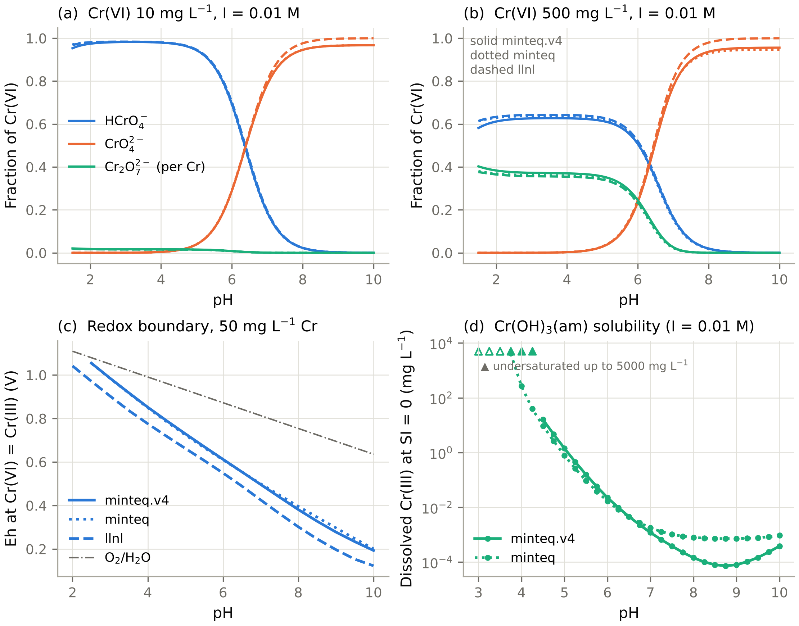
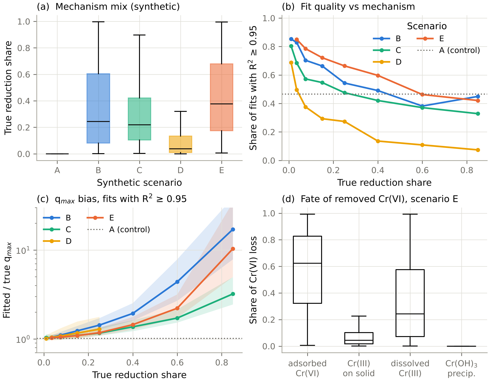

## 3. Results

Sections 3.1 and 3.7 report thermodynamic calculations. Sections 3.2–3.6 report **synthetic, known-truth benchmarks**. They are statements about what the methods can and cannot recover under the simulated mechanisms, not empirical findings about real carbons. Section 3.8 reports the status of the empirical application.

### 3.1 Chromium chemistry across three databases

**Cr(VI) speciation is robust to the database choice (Table 3, Fig. 1a,b).**
- The log K values for HCrO₄⁻ and Cr₂O₇²⁻ agree to within 0.016 and 0.041 log units across the three databases.
- Over pH 1.5–10 and 10–500 mg L⁻¹, species fractions differ from minteq.v4 by at most 0.031 (minteq; HCrO₄⁻ at pH 1.5, 500 mg L⁻¹) and 0.044 (llnl; CrO₄²⁻ at pH 10, 500 mg L⁻¹). The llnl difference reflects the alkali–chromate ion pairs (NaCrO₄⁻, KCrO₄⁻) that only the MINTEQ databases contain.
- The HCrO₄⁻/CrO₄²⁻ crossover lies at pH 6.37–6.38 in all three databases (10 mg L⁻¹, I = 0.01 M).
- The crossover shifts with ionic strength, from pH 6.46 (I = 0.001 M) to 6.24 (I = 0.1 M). The temperature effect is small: pH 6.37 at 288 K, 6.40 at 318 K.
- H₂CrO₄ is the only species with a large log K disagreement (6.42, 5.65 and 5.18). It never exceeds about 2% of Cr(VI) above pH 1.5.

**Concentration matters more than the database.**
- At pH 3 the dichromate share of Cr rises from 0.17% at 1 mg L⁻¹ to 1.7% (10), 7.4% (50), 13.1% (100), 28.2% (300) and 43.7% (700 mg L⁻¹) in minteq.v4.
- The three databases agree to within 0.02 at every concentration.
- A single isotherm spanning 5–300 mg L⁻¹ therefore samples materially different sorbate mixtures. This is why the revised simulator evaluates speciation at the current dissolved Cr(VI).
- The four-dimensional speciation grid reproduced 300 direct PHREEQC solutions with a maximum absolute error of 0.011 and a mean error of 0.0011 in species fraction.

**Table 3.** Equilibrium constants (25 °C) for CrO₄²⁻ + n H⁺ ⇌ product.

| Product | minteq.v4 | minteq | llnl |
|---|---|---|---|
| HCrO₄⁻ | 6.510 | 6.509 | 6.494 |
| Cr₂O₇²⁻ (2 CrO₄²⁻ + 2 H⁺) | 14.560 | 14.557 | 14.519 |
| H₂CrO₄ | 6.419 | 5.651 | 5.175 |

**The redox boundary is database dependent (Fig. 1c).**
- The Eh at which Cr(VI) and Cr(III) are equally abundant (50 mg L⁻¹ total Cr) is 63–83 mV higher in minteq.v4 than in llnl over pH 2.5–10. The two MINTEQ versions agree to within −19 to +5 mV.
- At pH 2, neither MINTEQ database reaches 50% Cr(VI) anywhere inside the water-stability field. At the O₂/H₂O limit, only 12% Cr(VI) remains in minteq.v4.
- Under the conditions where Cr(VI) removal by carbons is usually optimal, Cr(VI) is thermodynamically unstable with respect to reduction at almost any attainable Eh. Its persistence is kinetic.
- The 63–83 mV spread is a *between-database* difference, not an independently validated uncertainty interval for real systems.

**Direct saturation indices replace phase-boundary convergence (Fig. 1d, Table S4).**
- Of 174 bisection evaluations (two databases × three ionic strengths × 29 pH values), 146 were bracketed and 28 returned 'undersaturated up to 5,000 mg L⁻¹'. None failed.
- A 625-point SI map over pH 3–9 and 10⁻³–10³ mg L⁻¹ Cr(III) converged everywhere.
- On the 0.25-pH evaluation grid, undersaturation up to 5,000 mg L⁻¹ extends to pH 4.25 in minteq.v4 at I = 0.001–0.01 M and to pH 4.5 at I = 0.1 M, and to pH 3.5 in minteq at all three ionic strengths (Table S4). This is a direct thermodynamic result, not an inference from non-convergence. The constants themselves have not been validated independently against critically evaluated data (§4.7).
- At I = 0.01 M, the dissolved Cr(III) at saturation with Cr(OH)₃(am) is:

| pH | minteq.v4 (mg L⁻¹) | minteq (mg L⁻¹) |
|---|---|---|
| 4.0 | undersaturated up to 5,000 | 266 |
| 4.5 | 16 | 9.5 |
| 5.0 | 1.42 | 0.79 |
| 6.0 | 0.023 | 0.017 |
| 7.0 | 1.2 × 10⁻³ | 1.8 × 10⁻³ |
| 8.0 | 1.4 × 10⁻⁴ | 7.8 × 10⁻⁴ |

- The two MINTEQ versions therefore differ by more than an order of magnitude at pH 4, and by a factor of 5.5 at pH 8.
- llnl.dat cannot provide this quantity (Section 2.3).

**The background electrolyte matters little for Cr(VI) speciation.** Replacing NaCl by NaNO₃ or Na₂SO₄ changed the Cr(VI) species fractions by at most 0.024 (CrO₄²⁻ at pH 6.5, I = 0.1 M, where Na₂SO₄ forms fewer alkali–chromate ion pairs) at pH 3, 5 and 6.5 (I = 0.01 and 0.1 M), and moved the HCrO₄⁻/CrO₄²⁻ crossover by at most 0.004 pH units. Sulfate formed CrO₃SO₄²⁻, up to 1.0% of Cr(VI) at pH 3 and I = 0.1 M. Competition of these anions for surface sites on the carbon is not represented, so the result concerns solution chemistry only.

**Fig. 1.** PHREEQC chromium chemistry with three databases (thermodynamic calculations; no experimental data). (a, b) Cr(VI) species fractions per Cr atom at 10 and 500 mg L⁻¹, I = 0.01 M NaCl. (c) Eh at which Cr(VI) and Cr(III) are equally abundant (50 mg L⁻¹ total Cr), with the O₂/H₂O boundary. (d) Dissolved Cr(III) at saturation with Cr(OH)₃(am) by direct saturation-index bisection. Triangles mark pH values at which solutions remain undersaturated up to 5,000 mg L⁻¹ (filled: minteq.v4; open: minteq).

### 3.2 Mechanism benchmark: what conventional isotherm analysis recovers (synthetic)

**Scale and mechanism mix.** Across 15,000 virtual studies (5 scenarios × 100 corpora × 30 studies), the true share of Cr(VI) disappearance due to reduction (isotherm series, mass-weighted) had these medians:
- scenario B: 0.24 (5–95%: 0.02–0.92);
- scenario C: 0.22 (0.03–0.75);
- scenario D: 0.04 (0.002–0.54);
- scenario E: 0.38 (0.05–0.93).

In scenario E the removed chromium was distributed as follows (medians): 0.62 adsorbed Cr(VI), 0.24 dissolved Cr(III), 0.045 Cr(III) on the solid and essentially no precipitate (95th percentile 0.065), consistent with the Cr(OH)₃ undersaturation at the isotherm pH of 1.8–3.5 (Section 3.1). The distributions are shown in Fig. 2a,d, and the full partition (adsorbed Cr(VI), dissolved Cr(III), Cr(III) on the solid, precipitate) for every scenario is given in Table S11. Precipitation was absent in scenarios A–D by construction and small in E (mean 0.017). All headline rates have MCSE ≤ 0.02 at 100 replicates (Table S12).

**Goodness of fit does not discriminate mechanisms (Fig. 2b).**
- *Negative control.* In the pure-adsorption control (A), only 46.7% of best-isotherm fits reached R² ≥ 0.95 (MCSE 0.8%). For low-capacity families (manure biochar, hydrochar; median true q_max 1–4 mg g⁻¹), only 16% did, because their adsorption signal is close to analytical noise.
- *Reduction can improve fit quality.* The share of R² ≥ 0.95 fits rose to 58.8% (B) and 59.3% (E). For the low-capacity families it roughly doubled, to 31–34%, because reduction adds a smooth, saturating removal signal.
- *High-reduction studies still fit well.* Among studies whose reduction share exceeded 0.2, R² ≥ 0.95 was reached in 46% (B), 41% (C), 17% (D) and 52% (E).
- *Residual diagnostics did not help.* The runs test flagged 4.9–7.9% of Langmuir fits in every scenario, including the control.
- *Kinetic model choice did not help.* PSO was preferred over PFO in 25% of control series and 27–34% of reduction scenarios, so it carries no mechanistic information.

**Publishable fits overstate capacity in proportion to reduction, and the size depends on the mechanism (Fig. 2c, Table 4).** Fits whose q_max reached the fitting bound because the isotherm never saturated (0.6–3.1%) were excluded.

**Table 4.** Fitted/true Langmuir q_max for publishable fits (R² ≥ 0.95), by scenario (synthetic; 3,000 studies per scenario).

| Scenario | Median ratio (IQR) | Median ratio, reduction share > 0.3 (n) | Spearman ρ, reduction share vs ratio (mean ± SD over replicates) |
|---|---|---|---|
| A (control) | 1.02 (0.97–1.18) | – | – |
| B | 1.32 (1.07–2.60) | 4.88 (604) | 0.60 ± 0.19 |
| C | 1.15 (1.04–1.50) | 1.60 (446) | 0.32 ± 0.19 |
| D | 1.04 (0.98–1.21) | 13.7 (43; mostly very-low-capacity materials) | 0.13 ± 0.20 |
| E | 1.31 (1.08–2.29) | 2.25 (857) | 0.63 ± 0.17 |

- With reduction shares below 0.05, the median ratio was 1.02–1.03 in every scenario.
- The qualitative conclusion is that a saturating fit to apparent removal absorbs the reduction sink into q_max. It holds for direct surface reduction (B), adsorption-coupled reduction (C) and the combined mechanism (E).
- It is weak for dissolved-phase reduction (D), which rarely dominates removal at the simulated leachable-reductant levels.

**Bootstrap intervals are miscalibrated for reasons beyond mechanism.**
- The 95% residual-bootstrap interval of Langmuir q_max covered the true q_max in only 22% of publishable control fits (n = 289).
- Coverage fell further to 8.8–17.4% in the reduction scenarios.
- Eight-point isotherms that do not fully reach equilibrium produce intervals that are both precise and biased, even without reduction. Reduction makes this worse.

**A total-Cr mass balance tracks reduction where Cr(III) stays dissolved.** For Class A/B studies, the aqueous Cr(III) index ranked studies by reduction share with Spearman ρ = 0.73 (B), 0.52 (C), 0.33 (D) and 0.71 (E). It underestimated the share by a median of 23% in C and E, where Cr(III) is partly retained on the solid. It is therefore a lower bound, as intended.

**Family patterns follow from assumed capacity, not from assumed reductance.**
- Even with family-level reductant priors redrawn in every replicate, hydrochar had the highest mean reduction share in 83 of 100 scenario-E replicates.
- With hydrochar excluded, the most reductive family varied (manure biochar 56, wood biochar 39, physically activated carbon 5).
- Within scenario E the drawn family reductant prior correlated with the reduction share (ρ = 0.40), as intended. The dominance of low-surface-area chars, however, comes from the assumed proportionality between S_BET and adsorption capacity: a small adsorption sink inflates the reduction *share*.
- This is a property of the simulator and must not be read as an empirical statement about hydrochars.

**Fig. 2.** Mechanism benchmark (synthetic; 15,000 virtual studies). (a) True reduction share of Cr(VI) disappearance by scenario (box: IQR; whiskers: 5–95%). (b) Share of studies whose best isotherm fit reaches R² ≥ 0.95, against the true reduction share (bins with ≥ 20 studies); dotted line, pure-adsorption control. (c) Fitted/true Langmuir q_max for fits with R² ≥ 0.95 (median and IQR; log scale). (d) Fate of the removed Cr(VI) in scenario E. Scenario definitions are in Section 2.4 and all parameter distributions in Table S1.

### 3.3 Identifiability: which measurements establish the mechanism (synthetic)

**If the model were known (Fig. 3a).** With the mechanistic model structure assumed known, the median Laplace posterior SD of the reduction share fell with each added measurement (high-reduction studies, share > 0.4):

| Design | D1 | D2 | D3 | D4x | D4n | D5 |
|---|---|---|---|---|---|---|
| Posterior SD of reduction share | 0.061 | 0.053 | 0.033 | 0.026 | 0.020 | 0.011 |

The prior SD was 0.04–0.28.
- *Precipitation share.* Only the A2 design constrained it well: posterior SD 0.026 under D5, against 0.037 (D4n), 0.077 (D3) and 0.14 (D1). This rests on only 11 studies with a precipitated share above 0.02, because Cr(OH)₃ is undersaturated at the isotherm pH.
- *Caveat.* The Fisher analysis assumes the exact rate laws are known, so it is an optimistic bound.

**Model-free diagnostics carry technique-specific false alarms (Fig. 3b).** All three diagnostics gained detection with the reduction share (shares < 0.05, 0.05–0.2, 0.2–0.4 and > 0.4), but their false-alarm rates in pure-adsorption controls differed:

| Diagnostic | Detection rate by reduction share | False-alarm rate in controls |
|---|---|---|
| Dissolved-Cr(III) z-test (B) | 10%, 36%, 72%, 71% | 0.9% |
| XPS Cr(III) > 0.20 (A1) | 17%, 57%, 78%, 80% | 7.1% |
| XANES Cr(III) > 0.10 (A1) | 11%, 65%, 85%, 85% | 1.0% |

- XPS false-alarms seven times as often as XANES because of the assumed beam/vacuum reduction and surface enrichment.
- An XPS Cr(III) signal on its own is therefore weaker evidence of reduction than the same signal from XANES.

**Adsorption-only fits: rejection, equivalence or neither (Table 5, Fig. 3c,d; Appendix B).** For 120 studies, each paired with a pure-adsorption control:
- *The nominal χ² test over-rejects.* Its type-I error was 6.7–15%, because the empirical model only approximates the generating adsorption model.
- *Calibration fixes this.* With thresholds calibrated on the controls, the cross-validated type-I error was 3.3–12.5%, mostly 3–7%. With 120 controls the Monte Carlo SE of these estimates is about 2 percentage points.
- *Power with Class C data is low.* For high-reduction studies (share > 0.3), the calibrated test rejected adsorption-only in only 37% (D1) and 35% (D2) at 3% analytical noise, and 26% and 24% at 10% noise.
- *Cr(III) measurements raise power.* Adding total Cr (D3) raised power to 80–88%. Adding solid-phase evidence (D4x, D4n, D5) raised it to 90–96%.

**Non-rejection under Class C reflects genuine structural equivalence.** Because the simulator gives noise-free data, the true misfit of the best adsorption-only approximation is known for every study.
- *Ground truth.* For 77% of high-reduction studies, adsorption only reproduced the noise-free Class C observations (D1) within a 5% systematic discrepancy, and for 90% within 10%. With total Cr (D3), only 22% and 39% did; with solid-phase evidence (D4x–D5), only 12–16% and 24–29%.
- *The test recovers this truth.* At 3% noise, the equivalence test declared 'equivalent within 5%' for 59% (D1) and 65% (D2) of high-reduction studies, but only 4–12% under D3–D5.
- *Its false-equivalence rate stayed within α.* It was 0–4.3% across all designs, noise levels and margins, i.e. at most α = 0.05. Its power to declare equivalence when the true misfit was within the margin was 96–99% at 3% noise for all designs.
- *More noise means more inconclusive outcomes.* At 10% analytical noise, equivalence could be demonstrated less often: under D1, 4% of high-reduction studies at ε = 5% and 43% at ε = 10%. The share of inconclusive outcomes rose to 31–71%.
- *Conclusion.* In this benchmark, residual-Cr(VI) data from strongly reducing systems are typically *demonstrably* compatible with adsorption only within 5–10%, not merely 'not rejected'. Total-Cr and solid-phase data usually break that equivalence.

**Table 5.** Adsorption-only model, high-reduction studies (true share > 0.3; n = 51): calibrated rejection, equivalence within ε = 10% and true within-margin status (synthetic).

| Design | Rejected, 3% noise | Rejected, 10% | Equivalent (ε = 10%), 3% | Equivalent, 10% | Truly within ε = 10% (noise-free) | Calibrated type-I, 3% / 10% |
|---|---|---|---|---|---|---|
| D1 (C) | 0.37 | 0.26 | 0.63 | 0.43 | 0.90 / 0.84 | 0.067 / 0.058 |
| D2 (C) | 0.35 | 0.24 | 0.65 | 0.63 | 0.92 / 0.86 | 0.100 / 0.083 |
| D3 (B) | 0.88 | 0.80 | 0.12 | 0.20 | 0.39 / 0.39 | 0.050 / 0.033 |
| D4x (A1, XPS) | 0.96 | 0.90 | 0.04 | 0.10 | 0.29 / 0.20 | 0.058 / 0.067 |
| D4n (A1, XANES) | 0.94 | 0.92 | 0.06 | 0.08 | 0.28 / 0.16 | 0.125 / 0.033 |
| D5 (A2) | 0.96 | 0.92 | 0.04 | 0.08 | 0.24 / 0.18 | 0.067 / 0.067 |

'Truly within' depends on the noise level because the margin is expressed in units of the analytical SD. For D5, the test uses D4n + solid Cr inventory; phase evidence is excluded from the test and contributes only to the precipitation-share estimate (§2.6).

**These statements are conditional on the benchmark.** They hold under the assumed measurement models (§2.4), in particular the XPS and XANES bias distributions. They do not establish that total-Cr or solid-phase data make mechanisms distinguishable in every real carbonaceous system.

**Profile likelihood (Supplementary Fig. S1; designs D1, D3, D4u).** All profile points met the optimiser convergence criterion, but some profiles are not smooth (e.g. a peak at +0.6 log units for study VS002), indicating local optima at those points; the true profile lies at or below the plotted curve, so these profiles are indicative only; the minimum −2 log L was consistent with the number of observations (3.4 for n = 14 under D1; 21–79 for n = 44–61 under D3/D4).

- *Low-reduction study (true share 0.15).* The reductant capacity R₀ was practically non-identifiable. The 95% profile region extended from at least 16-fold below to 1.6-fold above the true value under every design. The implied reduction share nevertheless stayed within 0.13–0.14 (D1) and 0.17–0.18 (D3, D4). A share can be well determined while the parameter that generates it is not, *provided the model structure is correct*.
- *High-reduction study (true share 0.60).* R₀ was sharply identified, within one grid step of 0.2 log units, under all designs. The share at the minimum was 0.601 in each case.
- *Caveat.* The profiles use the known model structure and include the true parameters among the optimiser starts. They therefore show identifiability under the correct model, not the ease of estimation. The equivalence test removes that assumption, and under it Class C data lose most of their discriminating power.

**Misreported metadata (designs D1, D3).**
- Analysing the data at a pH 0.5 units above the true value biased the inferred reduction share by a median of 0.032 (90th percentile 0.157) under D1, and by 0.024 (0.092) under D3.
- A ten-fold error in ionic strength caused much smaller biases: medians of 0.003 and 0.001, 90th percentiles of 0.025 and 0.015.
- The pH basis (initial vs final) is therefore the reporting omission that matters most for mechanism inference.

**Fig. 3.** Mechanism identifiability by measurement design (synthetic). (a) Laplace-posterior SD of the reduction share assuming the true model structure (median per bin; dotted: prior). (b) Detection rates of three model-free diagnostics; false-alarm rates in pure-adsorption controls are given in the legend. (c) Outcome of the adsorption-only test at 10% analytical noise and ε = 10% (rejected by the calibrated χ² test; equivalent within ε by the noncentral-χ² equivalence test; inconclusive), for studies with reduction share > 0.3 (solid) and 5–30% (hatched). (d) Power of the calibrated rejection test against the true reduction share, by design.
