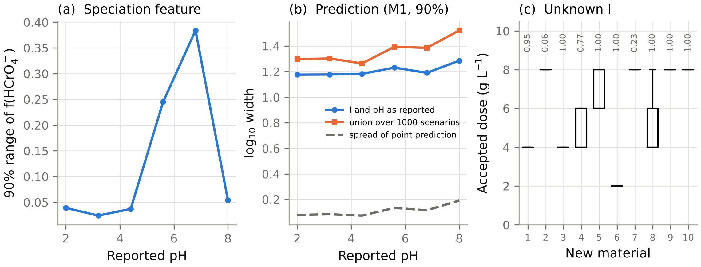

## Supplementary Note S1. Goodness-of-fit and equivalence tests of the adsorption-only model

Section, table and figure numbers without the prefix S refer to the manuscript.

**Observations and weights.**
- *Vector.* The observation vector of a design (§2.6) contains residual Cr(VI) and, as the design requires, total aqueous Cr, the solid oxidation-state fraction, final pH and solid Cr inventory. Phase evidence is excluded, because the precipitated share of solid Cr(III) is undefined under adsorption only (there is no Cr(III)). For D5 the test therefore uses D4n + solid Cr inventory; phase evidence enters only the Fisher analysis of the precipitation share (§2.6, §3.3). No observation model for phase evidence under the null is assumed.
- *Error model.* Each observation $y_i$ carries an independent error with SD $\sigma_i$:
  - $\sigma_{rel}y_i+0.01$ mg L⁻¹ for Cr(VI), with $\sigma_{rel}$ = 0.03 or 0.10;
  - $\sigma_{rel}y_i+0.02$ mg L⁻¹ for total Cr;
  - the technique noise (0.05 XPS, 0.03 XANES) for oxidation state;
  - 0.05 for pH;
  - 5% + 0.01 mg g⁻¹ for inventory.
- *Shared calibration error.* A calibration bias shared by all concentrations of a study is a free parameter, so residual correlation from calibration is absorbed rather than ignored.
- *Below the detection limit.* Observations below the limit of detection are set to LOD/2 with $\sigma_i$ = LOD.

**The adsorption-only model and its fit.**
- *Model.* The empirical adsorption-only model (§2.6) has:
  - a pH-dependent Sips equilibrium (5 parameters plus $q_{\max}$);
  - a free kinetic curve (3 parameters; D2 and later);
  - the study bias;
  - a free pH-relaxation fraction (A1/A2 designs);
  - a free apparent solid Cr(III) fraction produced by the measurement itself, bounded by the technique's assumed maximum beam reduction (A1/A2).
- *Fit.* The model is fitted by bounded weighted least squares with two to three random starts.
- *Statistic.* The misfit statistic is $\chi^2=\sum_i r_i^2/\sigma_i^2$ at the optimum, with $\nu=n_{obs}-n_{free}$ degrees of freedom.

**Rejection threshold: study-pooled empirical calibration and corpus-level conformal calibration.**
- *Why the nominal test fails.* The empirical model is not exactly the data-generating adsorption model, so $\chi^2$ under the null is inflated relative to $\chi^2_\nu$. The nominal test therefore over-rejects (6.7–15% at nominal 5%; §3.3).
- *Study-pooled threshold (primary analysis).* For each design and noise level the threshold is $t=\chi^2_{(k)}$, the $k$-th smallest of the $n=360$ negative-control statistics pooled over studies, with $k=\lceil 0.95(n+1)\rceil$. The split-conformal rank argument (Vovk et al., 2005) gives $P(\chi^2_{new}>t)\le 0.05$ only if the new null statistic is exchangeable with the $n$ calibration statistics. That premise is not assumed here. The negative controls of one corpus share its redrawn family hyper-priors, so a study from a new corpus is exchangeable with the pooled calibration studies only if those corpus-level random effects do not affect the null $\chi^2$. No finite-sample guarantee is therefore claimed for the study-pooled threshold. Its type-I error is an empirical property of the simulator.
- *Evaluation of the study-pooled threshold.* Type-I error is estimated leave-one-corpus-out over all 18 corpora (360 controls): the threshold is computed from the other 17 corpora and applied to the held-out corpus. The 95% interval comes from resampling corpora (4,000 bootstrap replicates). The largest per-corpus rate is reported with it, together with a binomial reference for 20 controls per corpus, a test of extra-binomial variation of the per-corpus counts and the intraclass correlation of log $\chi^2$ (Table S14b). The threshold used for power and equivalence is the one from all 360 controls.
- *Corpus-level split conformal.* This is the single-subsample construction of Dunn et al. (2023) with the corpus as the group. Let the corpora $C_1,\dots,C_{K+1}$ be i.i.d. draws from the simulator, with $C_{K+1}$ a new corpus. From each corpus draw one study uniformly at random, independently of everything else, and let $S_j$ be its null statistic. The $S_j$ are then i.i.d., hence exchangeable. Let $t_K=S_{(k)}$, the $k$-th smallest of $S_1,\dots,S_K$, with $k=\lceil(1-\alpha)(K+1)\rceil$, and $t_K=+\infty$ if $k>K$.
- *Proposition.* $P(S_{K+1}>t_K)\le\alpha$.
- *Proof.* By exchangeability, the rank of $S_{K+1}$ among $S_1,\dots,S_{K+1}$ (ties broken at random) is uniform on $\{1,\dots,K+1\}$. $S_{K+1}>S_{(k)}$ requires that rank to exceed $k$, which has probability $(K+1-k)/(K+1)\le\alpha$.
- *Consequences.* (i) The threshold is finite only if $K\ge(1-\alpha)/\alpha$, i.e. $K\ge 19$ corpora for $\alpha=0.05$. With the $K=18$ corpora available it is unbounded at 5% for every design, and the smallest attainable level is $1/(K+1)=1/19$ (about 0.053), at which $t_K$ is the largest of the 18 draws. (ii) The probability is marginal over corpora, over the study drawn within the new corpus and over the random selection; it does not bound the false-rejection rate within any one corpus. (iii) $t_K$ depends on which control is drawn from each corpus; Table S14b gives its distribution over 2,000 draws, its leave-one-corpus-out type-I error ($K=17$, level $1/18$) and its power.
- *Calibration on 6 corpora.* With the 120 controls of 6 corpora, the empirical 95th percentile gave a type-I error of 15.4% and 13.8% for D1 on 240 controls from 12 new corpora, and the conformal order statistic of the same 120 controls gave 14.2% and 10.8% (Table S14). This is the failure mode the study-pooled rank argument does not exclude when the calibration set comes from few corpora; for D1 the observed calibration set was an unfavourable draw (probability of a type-I error this large about 0.1–0.7% over random choices of 6 corpora; §3.3, Table S14b).
- *Two error rates.* The type-I error refers to rejecting a true adsorption-only model. The false-equivalence probability refers to declaring equivalence when the true misfit exceeds the margin. They are controlled by different procedures and reported separately.

**Equivalence within a margin.**
- *Hypotheses.* Non-rejection is not evidence of equivalence. We therefore test $H_0{:}\ \lambda\ge\lambda_0$ against $H_1{:}\ \lambda<\lambda_0$, where $\lambda$ is the non-centrality of the misfit, i.e. the $\chi^2$ of the best adsorption-only approximation to the noise-free data.
- *Margin.* The margin is $\lambda_0(\varepsilon)=\sum_i(m_i/\sigma_i)^2$, with $m_i=\varepsilon y_i$ for concentrations and inventory and $m_i$ = 0.05 for oxidation-state fractions. In words, the margin is a systematic discrepancy of relative size $\varepsilon$ in every concentration, with $\varepsilon\in\{0.05,0.10,0.20\}$.
- *Decision.* 'Equivalent within $\varepsilon$' is declared when $\chi^2\le F^{-1}_{\nu,\lambda_0}(\alpha)$, the $\alpha$-quantile of the noncentral $\chi^2$ with $\nu$ degrees of freedom and non-centrality $\lambda_0$, at $\alpha$ = 0.05. This is the goodness-of-fit form of an equivalence test (Wellek, 2010). As in two one-sided tests (Schuirmann, 1987), equivalence must be demonstrated rather than presumed.

**Operating characteristics.**
- *Truth.* Because the simulator gives the noise-free observations, the true non-centrality $\lambda_{true}$ of each study is known.
- *Reported.* We report the false-equivalence rate, $P(\text{declared equivalent}\mid\lambda_{true}\ge\lambda_0)$, and the equivalence power, $P(\text{declared equivalent}\mid\lambda_{true}<\lambda_0)$.
- *Three outcomes per study.* Each study is reported as one of: rejected by the test with the study-pooled, empirically calibrated threshold; equivalent within $\varepsilon$; or inconclusive, i.e. neither. Only 'rejected' and 'equivalent' are conclusions. "Not rejected" is never interpreted as "structurally equivalent".

## Supplementary Note S2. Propagation of unreported chemistry

Full methods and results; summary in manuscript §2.10 and §3.7.

### Methods (manuscript §2.10)

**Prediction level.** For studies that did not report ionic strength or final pH, 1,000 scenarios were drawn: I log-uniform on 10⁻³–10⁻¹ M and a pH-basis ambiguity uniform on ±0.5. They were propagated through the speciation features, the q_app,VI predictions and the M1 intervals. For each observation the following were recorded: the 90% range of f(HCrO₄⁻), the spread of the point prediction, and the union interval width against the nominal width. Grouped 5-fold models were used on four corpora.

**Design level.** For six new materials per corpus, the designer's assumed I was drawn 300 times from the same range, while the true I was 0.01 M. The point + verify design was re-run for each draw (confirmatory batches at the true conditions), and the true outcome of each accepted design was simulated. This gives distributions of recommended dose, residual total Cr and compliance probability.

**Mechanistic level.** The first-order bias in the inferred reduction share is given by the identifiability engine (Section 2.6).

### Results (manuscript §3.7)

**Prediction level.** Unknown ionic strength (10⁻³–10⁻¹ M) and an unknown pH basis (±0.5) were propagated with 1,000 draws per observation for 462 pH-edge observations from studies that did not report them.
- The 90% range of f(HCrO₄⁻) was 0.035 at pH ≤ 3.5, 0.045 at pH 3.5–5, 0.24 at pH 5–6.5 and 0.08 at pH 6.5–8.5.
- The resulting spread of the point prediction was 0.08–0.14 log₁₀ units, small compared with the study-level interval width (1.18–1.28 log₁₀ units).
- The union of the M1 intervals over all scenarios was 6–14% wider than the nominal interval.

**Design level.** Twenty-four new materials were each re-designed 300 times with the test-confirmed protocol, under different assumed ionic strengths.
- An unknown ionic strength changed the accepted dose for 3 of the 10 materials with accepted designs (e.g. 4–8 g L⁻¹).
- It never produced a non-compliant accepted design, because the confirmatory batches are run at the true conditions.
- The 95th percentile of true residual total Cr at the accepted designs was 0.08–1.38 mg L⁻¹ across materials, below the 2 mg L⁻¹ limit.

**Capacity level.** A conventional isotherm fit uses neither ionic strength nor the pH basis, so unreported solution chemistry does not change the fitted q_max itself. It changes what q_max means: the inferred reduction share and the speciation-based affinity (mechanistic level below).

**Mechanistic level.** Unreported pH matters more than unreported ionic strength (§3.3): a 0.5-unit pH error biased the inferred reduction share by up to 0.16 (90th percentile).

**Conclusion.** For prediction and design, missing solution chemistry is a second-order uncertainty compared with between-study heterogeneity. For mechanistic interpretation, a missing pH basis is first-order.

**Fig. S2.** Propagation of unreported ionic strength and pH basis (1,000 draws per observation; synthetic studies). (a) 90% range of f(HCrO₄⁻). (b) Width of the nominal M1 interval, of its union over scenarios, and spread of the point prediction (log₁₀). (c) Accepted dose under unknown ionic strength for each new material (box over 300 draws; numbers: compliance probability).

## Supplementary Note S3. Sequential verification of accepted designs

Full results; summary in manuscript §3.6.

**Verification is a sequential decision, so its false-acceptance risk was evaluated explicitly (manuscript Fig. 7b,c).**
- *Simulation.* An independent cohort of 300 new materials per target was drawn from the same hyper-priors as the design cohort (20 training corpora × 15 materials; the material draws differ from those of the design stage). For every material, target and rule, 1,000 verification sequences were simulated, with up to four dose rounds and both endpoints measured each round. Each sequence drew a calibration bias and correlated replicate errors.
- *Per material.* The probability of accepting a non-compliant design was:
  - simple rule (duplicates, mean ≤ 90% of each limit): mean 0.01% across materials, worst material 1.4–1.7%;
  - error-controlled rule (triplicates, one-sided upper confidence bound ≤ limit, Bonferroni over two endpoints and four rounds): worst material 0.1–0.7%.
- *Overall.* No material exceeded 5% under either rule, with shared or independent calibration bias. The controlled rule needed about 50% more batches per material (4.7 against 3.1 for S1; 4.0 against 2.6 for S2).
- *Operating characteristic.* Because these averages depend on how close true concentrations sit to the limits, the following table gives the acceptance probability over four rounds for a design whose true concentrations stay at a fixed ratio to both limits:

| True concentration / limit | Simple rule | Error-controlled rule |
|---|---|---|
| 1.00 (at the limit) | 3.7% | 0.8% |
| 1.05 | 0.2% | 0.04% |
| 0.90 (truly compliant) | 59% | 37% |

  Both figures assume shared calibration bias. The controlled rule is about five times safer at the limit and less likely to accept compliant designs close to the limit.
- *Scope.* These are properties under the assumed analytical-error model (3% random, 5% calibration uncertainty), not guarantees for real laboratories.

**Table S15.** Sequential verification: probability of accepting a non-compliant design (1,000 simulated sequences per material; 300 materials per target).

| Target | Rule | Bias model | Mean P(false acceptance) | Worst material | Materials > 5% | Mean batches |
|---|---|---|---|---|---|---|
| S1 | simple (n = 2, mean ≤ 0.9·limit) | shared | 0.0001 | 0.014 | 0 | 3.1 |
| S1 | controlled (n = 3, UCB ≤ limit) | shared | 0.0000 | 0.001 | 0 | 4.7 |
| S2 | simple | shared | 0.0001 | 0.015 | 0 | 2.6 |
| S2 | controlled | shared | 0.0000 | 0.007 | 0 | 4.0 |
| S1 | simple | independent | 0.0001 | 0.015 | 0 | 3.1 |
| S1 | controlled | independent | 0.0000 | 0.002 | 0 | 4.7 |
